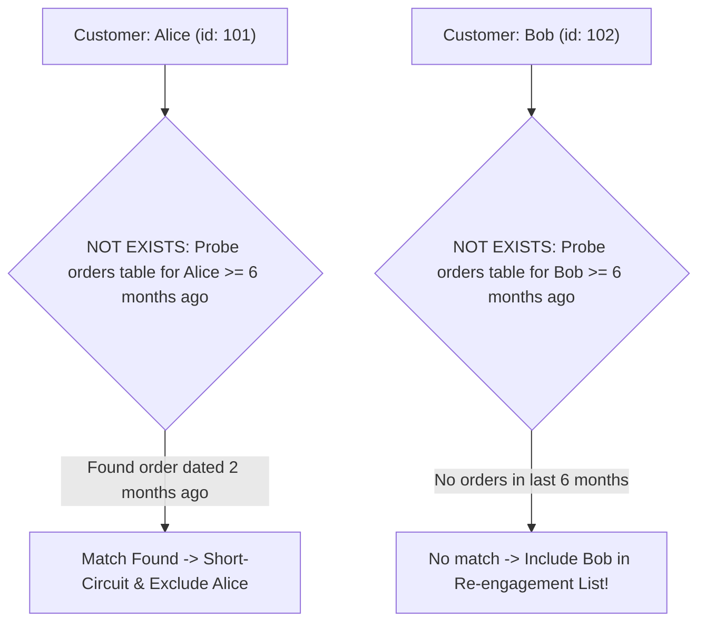

## Fast Revision (10-Second Recall)
- **The Three SQL Patterns for Anti-Joins:**
- 1. **`NOT EXISTS` (Recommended / Fastest):** Scans customers and performs an index probe into orders. Halts on first match (`Semi-Join / Anti-Join`).
- 2. **`LEFT JOIN ... WHERE right.id IS NULL`:** Joins all records and filters in memory. Works well, but builds full hash table in memory.
- 3. **`NOT IN` (Dangerous! Avoid!):** If ANY value returned by the subquery is `NULL`, the entire `NOT IN` expression evaluates to `UNKNOWN` and returns ZERO rows! (Three-valued logic trap).
- **Date Arithmetic:** `order_date >= NOW() - INTERVAL '6 months'`.
- **Performance Optimization:** Composite index on `orders(customer_id, order_date)`. Enables an ultra-fast Index Anti-Join.

## The 30-Second Spoken Script
"To find customers who haven't placed an order in the last 6 months, the best and safest approach in SQL is using a NOT EXISTS clause:

SELECT c.id, c.name, c.email
FROM customers c
WHERE NOT EXISTS (
  SELECT 1
  FROM orders o
  WHERE o.customer_id = c.id
    AND o.order_date >= NOW() - INTERVAL '6 months'
);

Why NOT EXISTS over other methods?
First, compared to NOT IN, NOT EXISTS is completely immune to the notorious SQL three-valued logic NULL trap. If the subquery in a NOT IN expression contains even a single NULL value, the entire query evaluates to UNKNOWN and returns zero results, causing silent data corruption in production.
Second, modern query planners—such as PostgreSQL and MySQL—optimize NOT EXISTS into a Hash Anti-Join or Merge Anti-Join. The engine inspects the orders table and halts as soon as it finds a single matching order within the last 6 months for that customer, skipping the rest of the customer's order history.

Alternatively, a LEFT JOIN filtering where the right-side ID is NULL is functionally equivalent:
SELECT c.id, c.name
FROM customers c
LEFT JOIN orders o ON c.id = o.customer_id AND o.order_date >= NOW() - INTERVAL '6 months'
WHERE o.id IS NULL;

With an index on orders(customer_id, order_date), the NOT EXISTS query executes in milliseconds even across tens of millions of rows."

## Scenario / Problem Context
Marketing teams regularly run re-engagement campaigns targeting churned customers. The interviewer tests your knowledge of SQL anti-joins, understanding why `NOT IN` is dangerous with NULLs, and which query construct produces the fastest execution plan.

## Architectural Workflow / Sequence


## Deep-Dive Analysis & Root Causes

| Construct | NullSafe | OptimizerPlan | Recommendation |
| --- | --- | --- | --- |
| `NOT EXISTS (subquery)` | Yes (100% immune to NULL values in target table) | Hash Anti-Join / Sub-plan short circuiting | Top choice: safest, readable, and fastest
`LEFT JOIN ... WHERE right.id IS NULL` | Yes | Right-outer hash join + filter | Good alternative; slightly more verbose
`NOT IN (SELECT customer_id FROM orders)` | NO! (Fails if any `customer_id` is NULL) | Materialized subquery scan | Never use in production without explicit `WHERE id IS NOT NULL` |


## Practical Debugging Commands & Code
```sql
-- 1. Optimal Production Query using NOT EXISTS:
SELECT c.id, c.name, c.email
FROM customers c
WHERE NOT EXISTS (
    SELECT 1 
    FROM orders o
    WHERE o.customer_id = c.id
      AND o.order_date >= (CURRENT_DATE - INTERVAL '6 months')
);

-- 2. Alternative using LEFT JOIN:
SELECT c.id, c.name, c.email
FROM customers c
LEFT JOIN orders o 
    ON c.id = o.customer_id 
   AND o.order_date >= (CURRENT_DATE - INTERVAL '6 months')
WHERE o.id IS NULL;

-- 3. Composite index to make both queries run at lightning speed:
CREATE INDEX idx_orders_customer_date 
ON orders (customer_id, order_date);
```

## Prevention & Senior Best Practices
- **Avoid `NOT IN` with Subqueries:** Ban `NOT IN (SELECT ...)` in code reviews unless accompanied by `WHERE col IS NOT NULL`.
- **Use Database-Specific Interval Functions:** Use `CURRENT_DATE - INTERVAL '6 months'` in PostgreSQL or `NOW() - INTERVAL 6 MONTH` in MySQL.
- **Composite Indexing is Essential:** Without an index on `(customer_id, order_date)`, this query degrades into an expensive full table scan.
