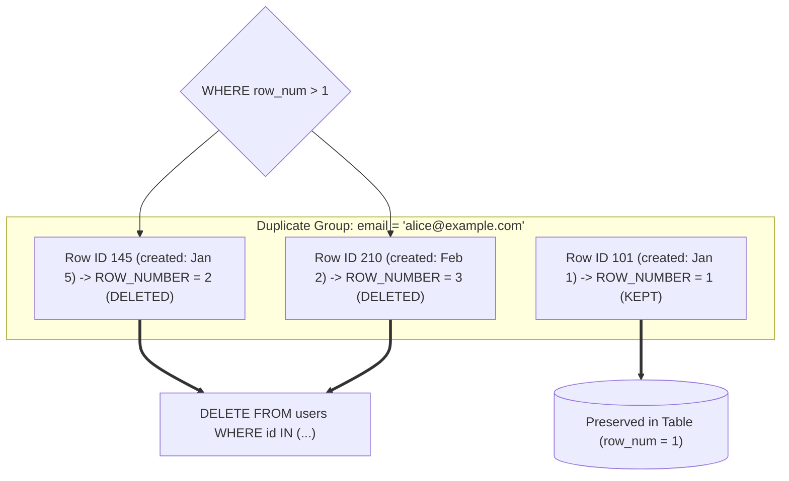

## Fast Revision (10-Second Recall)
- **The Critical Goal:** If a record appears 5 times, delete 4 duplicates and keep exactly 1.
- **Keep Oldest vs Keep Newest:** Controlled by `ORDER BY id ASC` (keeps oldest) vs `ORDER BY id DESC` (keeps newest).
- **Method 1 (Standard ANSI SQL / CTE with `ROW_NUMBER()`):**
- Partition by duplicate columns, order by primary key, assign `ROW_NUMBER()`, and delete where `row_num > 1`. (PostgreSQL, SQL Server, modern MySQL 8+).
- **Method 2 (PostgreSQL Physical Tuple ID `ctid`):**
- `DELETE FROM tbl WHERE ctid NOT IN (SELECT min(ctid) FROM tbl GROUP BY col);` (Ultra-fast when no primary key exists!).
- **Method 3 (MySQL Self-Join DELETE):**
- `DELETE t1 FROM users t1 INNER JOIN users t2 ON t1.email = t2.email AND t1.id > t2.id;` (Deletes higher IDs, keeps lowest).
- **Safety Protocol:** Always test the inner query with `SELECT` before running `DELETE`, and wrap in an explicit transaction.

## The 30-Second Spoken Script
"To delete duplicate records while keeping exactly one, I use a Common Table Expression with the ROW_NUMBER() window function. This is standard ANSI SQL and works reliably across PostgreSQL, modern MySQL, and SQL Server.

First, we partition the data by the duplicated columns—such as email—and order by the primary key or created_at timestamp. If we want to retain the oldest record, we order by id ASC; if we want the newest, we order by id DESC:

WITH RankedDuplicates AS (
  SELECT id,
         ROW_NUMBER() OVER (
           PARTITION BY email 
           ORDER BY id ASC
         ) AS row_num
  FROM users
)
DELETE FROM users
WHERE id IN (
  SELECT id FROM RankedDuplicates WHERE row_num > 1
);

The first occurrence in each email group receives row_num = 1 and is preserved, while all subsequent duplicate rows receive row_num greater than 1 and are safely deleted.

In PostgreSQL, if a table has no primary key column at all, we can leverage the internal physical tuple identifier, ctid, by running:
DELETE FROM users WHERE ctid NOT IN (SELECT min(ctid) FROM users GROUP BY email);

For multi-million row tables, deleting millions of rows in one query generates excessive locks and WAL bloat, so I execute this CTE in chunked transactions."

## Scenario / Problem Context
A production table contains duplicate records due to a missing unique constraint. You are tasked with cleaning up duplicates while preserving exactly one record (either the oldest or the newest). The interviewer evaluates your ability to safely delete without dropping all records or locking the table for hours.

## Architectural Workflow / Sequence


## Deep-Dive Analysis & Root Causes

| Method | Keeps | DatabaseEngine | Pros | Cons |
| --- | --- | --- | --- | --- |
| CTE + `ROW_NUMBER()` (ANSI SQL) | Lowest or highest `id` based on `ORDER BY` | PostgreSQL, MySQL 8+, Oracle, SQL Server | Readable, deterministic, works with composite keys | Requires primary key `id` to reference in outer DELETE
PostgreSQL `ctid` Deduplication | First physical disk tuple (`min(ctid)`) | PostgreSQL exclusive | Works even on completely unkeyed tables with identical rows | Physical disk order is not strictly chronological
MySQL Self-Join DELETE | Lowest `id` (`t1.id > t2.id`) | MySQL 5.7+ / MariaDB | Executes natively without CTE subqueries | Self-join can be slow on tables exceeding 10M rows |


## Practical Debugging Commands & Code
```sql
-- 1. Modern ANSI SQL (PostgreSQL / MySQL 8+) using CTE:
WITH duplicates_to_remove AS (
    SELECT id,
           row_number() OVER (
               PARTITION BY email 
               ORDER BY id ASC -- Keeps the lowest ID (oldest)
           ) AS rn
    FROM users
)
DELETE FROM users
WHERE id IN (
    SELECT id FROM duplicates_to_remove WHERE rn > 1
);

-- 2. PostgreSQL Tuple Identifier (ctid) method (No Primary Key required):
DELETE FROM users
WHERE ctid NOT IN (
    SELECT min(ctid)
    FROM users
    GROUP BY email
);

-- 3. MySQL Self-Join method:
DELETE t1 
FROM users t1
INNER JOIN users t2 
    ON t1.email = t2.email 
   AND t1.id > t2.id; -- Keep the smaller ID, delete the larger ID
```

## Prevention & Senior Best Practices
- **Add Unique Constraint Immediately After Deletion:** Run `ALTER TABLE users ADD CONSTRAINT uq_users_email UNIQUE (email);` so duplicates never re-enter.
- **Run Deletion in Batches on Large Tables:** If there are 5 million duplicates, delete in batches of 10,000 using `LIMIT 10000` to avoid locking the entire table.
- **Always Wrap in a Transaction and Test with SELECT First:** Run `SELECT count(*)` on the CTE before changing the keyword to `DELETE`.
