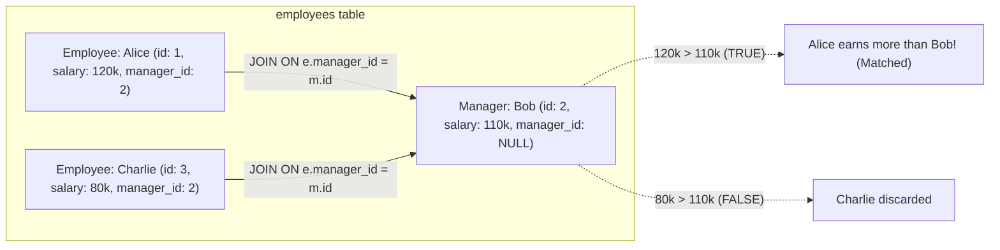

## Fast Revision (10-Second Recall)
- **Schema Structure:** Table `employees` has columns: `id`, `name`, `salary`, `manager_id`.
- **The Self-Join:** Join the table to itself using two distinct aliases:
- 1. Alias `e`: represents the Employee.
- 2. Alias `m`: represents the Manager.
- **The Join Condition:** `e.manager_id = m.id`.
- **The Filter:** `WHERE e.salary > m.salary`.
- **Edge Cases:** Employees with `manager_id IS NULL` (e.g., the CEO) are automatically excluded by the INNER JOIN, which is correct because they have no manager to compare against.
- **Performance Optimization:** An index on `manager_id` prevents nested loop full table scans.

## The 30-Second Spoken Script
"To find employees whose salary exceeds their manager's salary, we perform a Self-Join on the employees table, treating it as two distinct logical tables: one for employees and one for their managers.

Here is the production SQL:
SELECT e.id AS employee_id,
       e.name AS employee_name,
       e.salary AS employee_salary,
       m.name AS manager_name,
       m.salary AS manager_salary
FROM employees e
INNER JOIN employees m ON e.manager_id = m.id
WHERE e.salary > m.salary;

How it works:
We alias the first instance as 'e' representing the employee, and the second instance as 'm' representing their manager. We link them using the condition e.manager_id equals m.id.
The INNER JOIN automatically and safely excludes employees without managers—such as the CEO whose manager_id is NULL.
Then, the WHERE clause filters the joined rows to only those where e.salary is strictly greater than m.salary.

For performance on large organizations with hundreds of thousands of staff, we must have an index on manager_id. Because id is the primary key and already indexed, this index allows the database optimizer to execute an efficient Hash Join or Index Nested Loop Join."

## Scenario / Problem Context
A company table has employees and managers stored in the same table, linked by `manager_id -> id`. The interviewer evaluates your ability to execute self-joins, handle root nodes (CEOs with NULL manager_id), and optimize hierarchical queries.

## Architectural Workflow / Sequence


## Deep-Dive Analysis & Root Causes

| Feature | Syntax | Behavior |
| --- | --- | --- |
| Self INNER JOIN | `employees e JOIN employees m ON e.manager_id = m.id` | Matches each employee to their specific manager row; drops rows where `manager_id IS NULL`
Filter Condition | `WHERE e.salary > m.salary` | Strict inequality comparison between employee and manager salary columns
Indexing Strategy | `CREATE INDEX idx_emp_manager_id ON employees(manager_id);` | Accelerates join lookup from $O(N^2)$ table scan to $O(N)$ index lookup |


## Practical Debugging Commands & Code
```sql
-- 1. Schema setup:
-- CREATE TABLE employees (
--     id INT PRIMARY KEY,
--     name VARCHAR(50),
--     salary NUMERIC(10, 2),
--     manager_id INT REFERENCES employees(id)
-- );

-- 2. Optimal Self-Join Query:
SELECT e.id,
       e.name AS employee_name,
       e.salary AS employee_salary,
       m.name AS manager_name,
       m.salary AS manager_salary
FROM employees e
INNER JOIN employees m ON e.manager_id = m.id
WHERE e.salary > m.salary;

-- 3. Alternative Correlated Subquery (Identical plan in modern optimizers):
SELECT e.name AS employee_name
FROM employees e
WHERE e.salary > (
    SELECT m.salary 
    FROM employees m 
    WHERE m.id = e.manager_id
);
```

## Prevention & Senior Best Practices
- **Always Add a Foreign Key Index:** Relational databases automatically index primary keys (`id`), but do NOT automatically index foreign keys (`manager_id`). Always add an explicit index.
- **Validate Foreign Key Constraints:** Ensure `REFERENCES employees(id) ON DELETE SET NULL` is enforced so orphaned `manager_id` values cannot exist.
- **Watch Out for Circular Hierarchies:** Ensure business logic prevents cyclical management relationships (A manages B, and B manages A).
