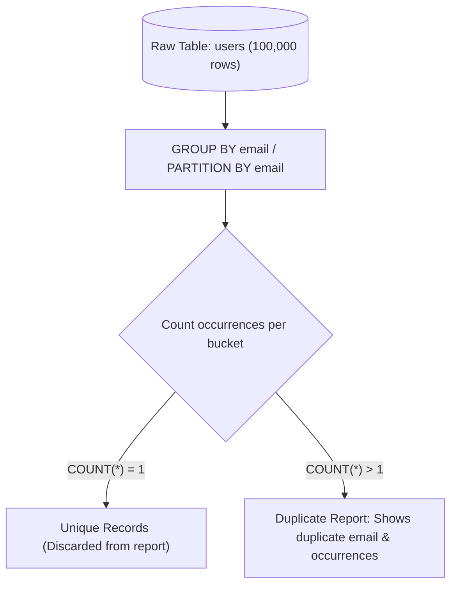

## Fast Revision (10-Second Recall)
- **Single-Column Duplicate Definition:** Rows with the same `email` occurring more than once.
- **Multi-Column (Composite) Duplicate Definition:** Rows with identical `first_name, last_name, date_of_birth`.
- **Method 1 (Standard Aggregation):** `GROUP BY col HAVING COUNT(*) > 1` (Fast, standard, group-level view).
- **Method 2 (Window Function):** `COUNT(*) OVER (PARTITION BY col) AS cnt` inside a CTE (Returns all individual row columns alongside the duplicate count).
- **Method 3 (Self-Join):** `SELECT DISTINCT a.* FROM users a JOIN users b ON a.email = b.email AND a.id <> b.id` (Less efficient, scans table twice).
- **Performance Tip:** Ensure an index exists on the duplicate key columns before running duplicate discovery on multi-million row tables.

## The 30-Second Spoken Script
"To find duplicate records in a table, the approach depends on whether the interviewer wants a summary of duplicated values or all individual row details.

If we only need to identify which values are duplicated and how many times they appear, the cleanest and most efficient approach is GROUP BY with a HAVING clause:
SELECT email, COUNT(*) AS occurrences
FROM users
GROUP BY email
HAVING COUNT(*) > 1
ORDER BY occurrences DESC;

If we need to retrieve the full original records—including primary keys, timestamps, and other columns—for every duplicate instance, I use a Window Function within a Common Table Expression (CTE):
WITH RankedRows AS (
  SELECT id, first_name, last_name, email, created_at,
         COUNT(*) OVER (PARTITION BY email) AS duplicate_count
  FROM users
)
SELECT * FROM RankedRows
WHERE duplicate_count > 1
ORDER BY email, created_at;

The window function performs a single partition scan and preserves all row-level metadata, making it immediately actionable for review or cleanup scripts. For multi-million row tables, having an index on the partitioned columns ensures the database executes a fast HashAggregate or Index Scan rather than an expensive disk sort."

## Scenario / Problem Context
Data duplication caused by unconstrained bulk imports or race conditions pollutes reporting and breaks unique constraints. The interviewer tests your SQL fluency, understanding of aggregate filtering, and ability to handle composite duplicate definitions efficiently on large tables.

## Architectural Workflow / Sequence


## Deep-Dive Analysis & Root Causes

| Approach | ReturnedData | Performance | UseCase |
| --- | --- | --- | --- |
| `GROUP BY ... HAVING COUNT(*) > 1` | Only the grouped key(s) and aggregate count | Very High (Hash Aggregate or Index Skip Scan) | Audit reports and executive summaries
CTE with `COUNT(*) OVER (PARTITION BY ...)` | All original table columns and primary keys | High (WindowAgg node with single table pass) | Reviewing actual duplicate rows before deciding which to delete
Self-Join (`a.col = b.col AND a.id != b.id`) | All original table columns | Poor ($O(N^2)$ worst case without indexes) | Legacy SQL compatibility where window functions are unavailable |


## Practical Debugging Commands & Code
```sql
-- 1. Identify duplicated emails and count:
SELECT email, count(*) AS duplicate_count
FROM users
GROUP BY email
HAVING count(*) > 1
ORDER BY duplicate_count DESC;

-- 2. Identify composite duplicates (first_name, last_name, phone):
SELECT first_name, last_name, phone, count(*) AS occurrences
FROM customers
GROUP BY first_name, last_name, phone
HAVING count(*) > 1;

-- 3. Return full row details for every duplicate using a Window Function:
WITH duplicate_cte AS (
    SELECT id, email, first_name, created_at,
           count(*) OVER (PARTITION BY email) AS total_matches
    FROM users
)
SELECT id, email, first_name, created_at
FROM duplicate_cte
WHERE total_matches > 1
ORDER BY email, created_at ASC;
```

## Prevention & Senior Best Practices
- **Enforce Unique Database Constraints:** Prevent duplicates at the root by declaring `UNIQUE (email)` or composite `UNIQUE (tenant_id, slug)`.
- **Use Upserts (`INSERT ON CONFLICT`):** In batch ingestion pipelines, use `ON CONFLICT (email) DO UPDATE` or `DO NOTHING` to eliminate duplicate insertion race conditions.
- **Standardize Input Case & Whitespace:** Apply `LOWER(TRIM(email))` before hashing or storing to prevent semantic duplicates.
