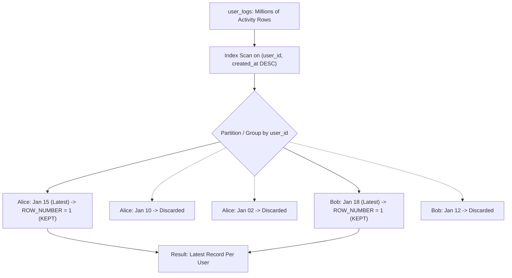

## Fast Revision (10-Second Recall)
- **The Problem:** Given millions of log records `(id, user_id, action, created_at)`, fetch the single row with the maximum `created_at` for each distinct `user_id`.
- **Method 1 (PostgreSQL Exclusive Superpower): `DISTINCT ON`**
- `SELECT DISTINCT ON (user_id) * FROM user_activity ORDER BY user_id, created_at DESC;` (Incredible performance, ultra-concise, single-pass index scan).
- **Method 2 (Standard ANSI SQL): CTE with `ROW_NUMBER()`**
- Assign `ROW_NUMBER() OVER (PARTITION BY user_id ORDER BY created_at DESC) AS rn`, then filter `WHERE rn = 1`. (Universal across PostgreSQL, MySQL 8+, Oracle, SQL Server).
- **Method 3 (Naive / Slow): Correlated Subquery or Self-Join**
- Joining on `MAX(created_at)` requires two passes over the table and handles duplicate timestamps poorly.
- **Critical Index:** `CREATE INDEX idx_user_created ON user_activity(user_id, created_at DESC);`

## The 30-Second Spoken Script
"To find the latest record for each user, there are two premier SQL techniques depending on whether you are using PostgreSQL or an ANSI-compliant cross-database stack.

In PostgreSQL, the most performant and elegant technique is DISTINCT ON:

SELECT DISTINCT ON (user_id) 
       id, user_id, status, payload, created_at
FROM user_logs
ORDER BY user_id, created_at DESC;

How it works: DISTINCT ON evaluates rows grouped by user_id. Because the ORDER BY sorts by created_at DESC, PostgreSQL evaluates only the very first row for each user and discards the rest. Backed by a composite index on (user_id, created_at DESC), this executes as an extremely fast Index Scan without sorting in memory.

For cross-database compatibility across MySQL 8+, SQL Server, and Oracle, the standard pattern is a Common Table Expression with ROW_NUMBER():

WITH RankedLogs AS (
  SELECT id, user_id, status, payload, created_at,
         ROW_NUMBER() OVER (
           PARTITION BY user_id 
           ORDER BY created_at DESC
         ) AS row_num
  FROM user_logs
)
SELECT id, user_id, status, payload, created_at
FROM RankedLogs
WHERE row_num = 1;

Both approaches avoid the severe performance penalty of legacy correlated subqueries with MAX(), which force the engine to scan the table twice."

## Scenario / Problem Context
In activity feeds, audit logs, and message threads, developers frequently need to retrieve the single most recent record per user or device. The interviewer evaluates whether you know modern SQL techniques beyond slow correlated subqueries.

## Architectural Workflow / Sequence


## Deep-Dive Analysis & Root Causes

| Technique | EngineSupport | Performance | SyntaxVerbosity |
| --- | --- | --- | --- |
| PostgreSQL `DISTINCT ON (user_id)` | PostgreSQL only | Fastest possible (stops scanning as soon as first row per user is read) | Extremely concise (single SELECT query)
CTE with `ROW_NUMBER() = 1` | PostgreSQL, MySQL 8+, Oracle, SQL Server, Snowflake | Near-identical to DISTINCT ON with proper composite index | Requires CTE or subquery wrapper
`INNER JOIN (SELECT user_id, MAX(created_at))` | All legacy SQL databases (MySQL 5.6) | Slow ($2\times$ table scan + temporary table join) | Verbose; duplicate timestamps create duplicate rows! |


## Practical Debugging Commands & Code
```sql
-- 1. PostgreSQL DISTINCT ON (Fastest & Most Elegant):
SELECT DISTINCT ON (user_id) 
       id, user_id, action, created_at
FROM user_logs
ORDER BY user_id, created_at DESC;

-- 2. Standard ANSI SQL (MySQL 8+, SQL Server, Postgres):
WITH ranked_activity AS (
    SELECT id, user_id, action, created_at,
           row_number() OVER (
               PARTITION BY user_id 
               ORDER BY created_at DESC
           ) as rn
    FROM user_logs
)
SELECT id, user_id, action, created_at
FROM ranked_activity
WHERE rn = 1;

-- 3. Composite index that powers both queries:
CREATE INDEX idx_user_logs_user_created 
ON user_logs (user_id, created_at DESC);
```

## Prevention & Senior Best Practices
- **Always Use a Composite Index with DESC Order:** `CREATE INDEX idx_user_activity ON user_logs(user_id, created_at DESC);`. This enables backward/forward index-only scans without sorting.
- **Avoid `MAX(created_at)` Self-Joins:** If two actions share the exact same timestamp, `MAX(created_at)` joins will return multiple rows for a single user.
- **Consider Pre-Aggregating in User Entity:** If read latency must be sub-millisecond, store `last_active_at` directly on the `users` table via a trigger or application update.
