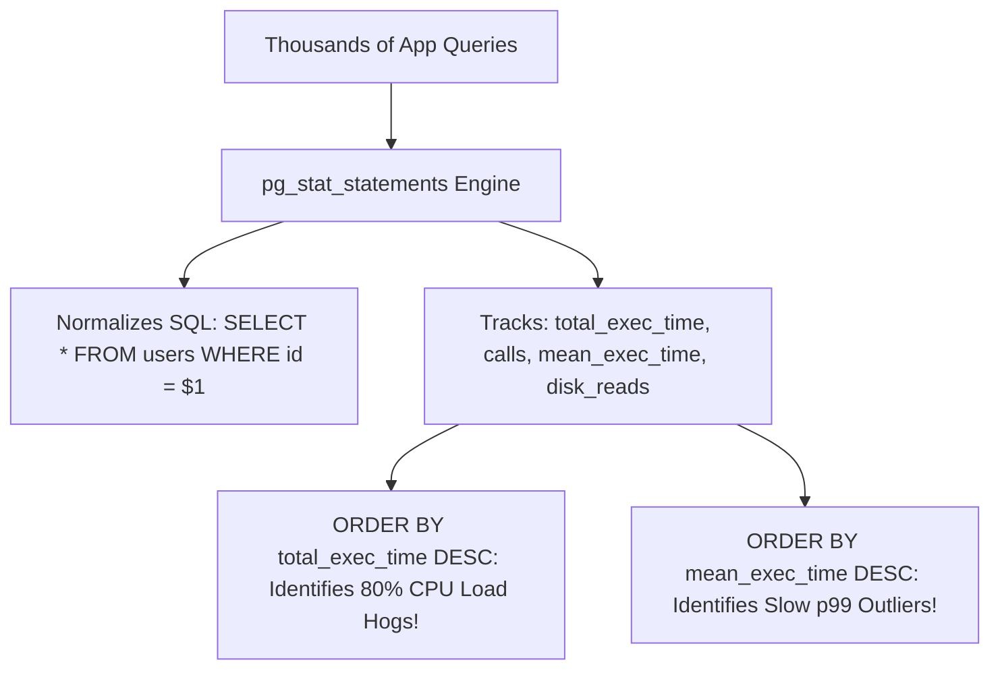

## Fast Revision (10-Second Recall)
- **The Top Tool in PostgreSQL: `pg_stat_statements`**
- Normalizes parameterized SQL queries (replaces constants with `$1, $2`) and tracks cumulative statistics: `total_exec_time`, `calls`, `mean_exec_time`, `rows`, and buffer cache hit ratio.
- **Top Metric to Order By:**
- 1. **`total_exec_time DESC`:** Identifies queries responsible for the **aggregate database load** (e.g., a fast 2ms query called 50 million times burns more CPU than a 10s query called once!).
- 2. **`mean_exec_time DESC`:** Identifies the slowest individual queries that harm p99 user latency.
- **MySQL Equivalent:** `performance_schema.events_statements_summary_by_digest`.
- **Resetting Stats:** `SELECT pg_stat_statements_reset();` is useful when testing optimizations or after a release.

## The 30-Second Spoken Script
"To identify which query consumes the most execution time in PostgreSQL, the industry standard tool is the pg_stat_statements extension. In MySQL, the equivalent is performance_schema.

Here is the exact diagnostic query:

SELECT query,
       calls,
       round(total_exec_time::numeric, 2) AS total_time_ms,
       round(mean_exec_time::numeric, 2) AS mean_time_ms,
       round((100.0 * total_exec_time / sum(total_exec_time) OVER ())::numeric, 2) AS pct_total_load
FROM pg_stat_statements
ORDER BY total_exec_time DESC
LIMIT 10;

This reveals the queries driving the vast majority of CPU and I/O consumption across the entire database.

When analyzing the output, I look at two distinct profiles:
First, queries with high total_exec_time and high call counts. These are lightweight queries—running in perhaps 2 to 5 milliseconds—that are called millions of times due to application N+1 query bugs. Optimizing or caching these delivers the biggest immediate reduction in overall database CPU load.
Second, queries with high mean_exec_time and low call counts. These are heavy analytical queries or unindexed full table scans that directly hurt p99 latency for individual users.

In PostgreSQL, we also inspect shared_blks_read versus shared_blks_hit in pg_stat_statements. Queries with high physical disk reads (shared_blks_read) pinpoint missing indexes where queries are reading millions of disk pages into memory."

## Scenario / Problem Context
Database CPU is running at 90%, and overall application response times are slowing down. The engineering lead asks: "Which SQL query is responsible for the majority of our database workload?" The interviewer tests your production diagnostic toolset.

## Architectural Workflow / Sequence


## Deep-Dive Analysis & Root Causes

| Metric | Formula | Significance |
| --- | --- | --- |
| `total_exec_time` | `calls * mean_exec_time` | Measures aggregate workload on database hardware. Best target for lowering CPU from 95% to 30%
`mean_exec_time` | `total_exec_time / calls` | Measures individual query latency. Best target for fixing slow user-facing API endpoints
`shared_blks_read` | Disk blocks read from OS disk / NVMe | Indicates cache misses and heavy I/O consumption; points directly to missing indexes
`shared_blks_hit` | Blocks read from RAM buffer cache | Measures in-memory cache efficiency |


## Practical Debugging Commands & Code
```sql
-- 1. Enable pg_stat_statements in postgresql.conf:
-- shared_preload_libraries = 'pg_stat_statements'
-- pg_stat_statements.track = top

-- 2. Query top 5 CPU consumers by total cumulative time:
SELECT round(total_exec_time::numeric, 1) AS total_ms,
       calls,
       round(mean_exec_time::numeric, 1) AS mean_ms,
       round((100 * total_exec_time / sum(total_exec_time) OVER ())::numeric, 1) AS pct_load,
       substr(query, 1, 80) AS short_query
FROM pg_stat_statements
ORDER BY total_exec_time DESC
LIMIT 5;

-- 3. Query top queries driving physical disk I/O reads (Missing Index Candidates):
SELECT round(mean_exec_time::numeric, 1) AS avg_ms,
       calls,
       shared_blks_read AS disk_reads,
       shared_blks_hit AS cache_hits,
       substr(query, 1, 80) AS query
FROM pg_stat_statements
ORDER BY shared_blks_read DESC
LIMIT 5;

-- 4. Reset stats after deploying query optimizations:
SELECT pg_stat_statements_reset();
```

## Prevention & Senior Best Practices
- **Enable `pg_stat_statements` on All Environments:** The overhead is less than 1% to 2% CPU, making it standard for every production PostgreSQL cluster.
- **Reset Statistics Periodically or Post-Release:** Old query stats obscure newly introduced regressions. Reset statistics after major schema migrations.
- **Alert on `mean_exec_time` Spikes:** Integrate pg_stat_statements metrics into Datadog, Prometheus, or AWS Performance Insights to alert when p95 query latency degrades.
