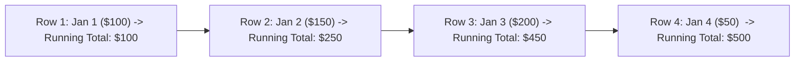

## Fast Revision (10-Second Recall)
- **The Standard Window Function:** `SUM(amount) OVER (ORDER BY order_date)` computes the running total.
- **The Trap: ROWS vs RANGE (The Duplicate Date Bug!):**
- 1. Default frame: `RANGE BETWEEN UNBOUNDED PRECEDING AND CURRENT ROW`.
- If two orders occur on the exact same date, `RANGE` sums BOTH orders and displays the same combined total on both rows!
- 2. The Fix: Always specify `ROWS BETWEEN UNBOUNDED PRECEDING AND CURRENT ROW` to calculate a true row-by-row running tally.
- **Partitioning:** To compute running totals per category or per customer, add `PARTITION BY customer_id`.
- **Performance:** Backed by an index on `(order_date, amount)`, the database computes running totals in a single sequential $O(N)$ pass.

## The 30-Second Spoken Script
"To calculate a running total of sales in SQL, we use the SUM() window function with an ORDER BY clause.

Here is the production SQL:
SELECT order_id,
       order_date,
       amount,
       SUM(amount) OVER (
         ORDER BY order_date, order_id
         ROWS BETWEEN UNBOUNDED PRECEDING AND CURRENT ROW
       ) AS running_total
FROM sales
ORDER BY order_date, order_id;

A critical detail that distinguishes senior engineers in interviews is the difference between ROWS and RANGE frame specifications:
By default, if you omit the frame clause, SQL defaults to RANGE BETWEEN UNBOUNDED PRECEDING AND CURRENT ROW. If two sales occur on the exact same day, RANGE treats them as peer rows and calculates the sum of all matching rows together, causing the running total to jump prematurely.
By explicitly specifying ROWS BETWEEN UNBOUNDED PRECEDING AND CURRENT ROW, the database evaluates the cumulative sum strictly row by row, guaranteeing a true chronological accumulation.

If we need running totals calculated independently per customer or department, we add a PARTITION BY clause:
SUM(amount) OVER (
  PARTITION BY customer_id
  ORDER BY order_date
  ROWS BETWEEN UNBOUNDED PRECEDING AND CURRENT ROW
) AS customer_running_total;

This completes in a single sequential pass over the data with zero subqueries or joins."

## Scenario / Problem Context
Financial ledgers, account balances, and sales progress charts require computing a cumulative running total across time. The interviewer tests your mastery of SQL window frames and your awareness of the dangerous default behavior of `RANGE BETWEEN`.

## Architectural Workflow / Sequence


## Deep-Dive Analysis & Root Causes

| FrameSpec | Behavior | DuplicateValues | Recommendation |
| --- | --- | --- | --- |
| `ROWS BETWEEN UNBOUNDED PRECEDING AND CURRENT ROW` | Accumulates strictly physical row by row | Smooth incremental running tally | Always use for financial transactions and audit ledgers
`RANGE BETWEEN UNBOUNDED PRECEDING AND CURRENT ROW` (Default) | Accumulates by value peers | Ties receive the identical lumped sum on all duplicate rows | Avoid unless peer aggregation is explicitly desired
`ROWS BETWEEN 6 PRECEDING AND CURRENT ROW` | Moving 7-day rolling window sum | Smooth sliding window calculation | Use for rolling moving averages or weekly totals |


## Practical Debugging Commands & Code
```sql
-- 1. Global chronological running total:
SELECT id,
       order_date,
       amount,
       sum(amount) OVER (
           ORDER BY order_date, id
           ROWS BETWEEN UNBOUNDED PRECEDING AND CURRENT ROW
       ) AS running_total
FROM orders;

-- 2. Running total partitioned by customer:
SELECT customer_id,
       order_date,
       amount,
       sum(amount) OVER (
           PARTITION BY customer_id 
           ORDER BY order_date, id
           ROWS BETWEEN UNBOUNDED PRECEDING AND CURRENT ROW
       ) AS customer_cumulative_spend
FROM orders;

-- 3. 7-Day Rolling Window Sum:
SELECT order_date,
       amount,
       sum(amount) OVER (
           ORDER BY order_date
           ROWS BETWEEN 6 PRECEDING AND CURRENT ROW
       ) AS rolling_7day_sales
FROM daily_sales_summary;
```

## Prevention & Senior Best Practices
- **Always Add Primary Key to Tie-Breaker:** In `ORDER BY order_date, id`, adding `id` guarantees a strictly deterministic ordering.
- **Explicitly Declare `ROWS` Frame:** Prevent subtle financial bugs caused by SQL's default `RANGE` behavior when dates collide.
- **Do Not Use Correlated Self-Joins:** Legacy queries like `SELECT SUM(b.amount) FROM sales b WHERE b.date <= a.date` run in $O(N^2)$ quadratic time. Window functions run in $O(N)$.
