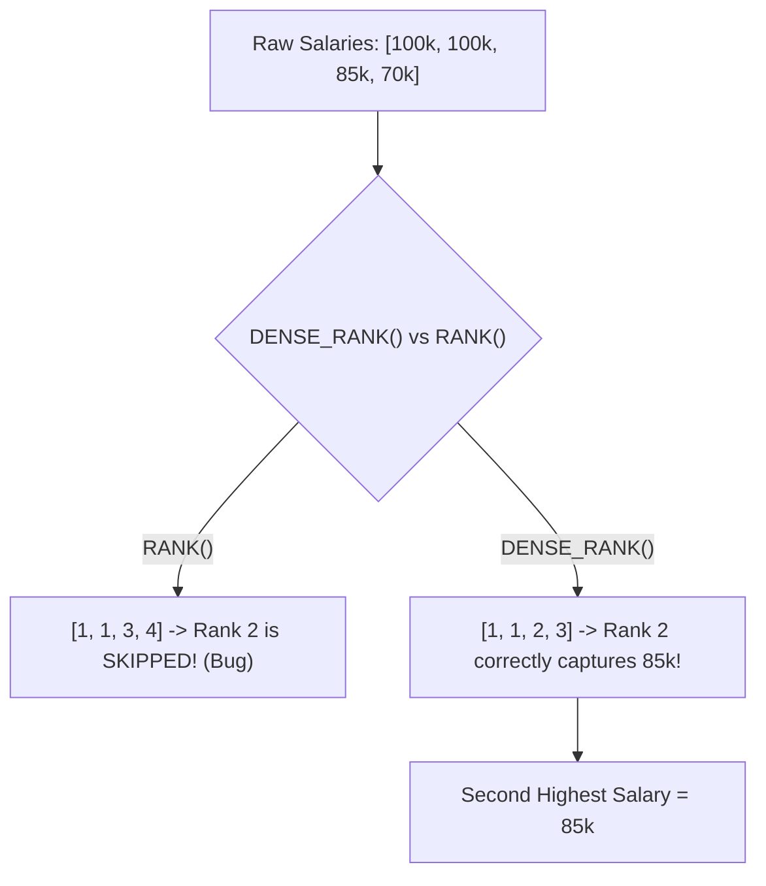

## Fast Revision (10-Second Recall)
- **The Trap (Ties in Salary):** If employees have salaries [100, 100, 90], the second-highest salary is **90**, NOT 100!
- **The Edge Case:** If table only has 1 employee (or empty), the query MUST return `NULL`, not an empty set.
- **Method 1 (Best Practice - Window Function `DENSE_RANK()`):**
- `DENSE_RANK() OVER (ORDER BY salary DESC)` ranks [100, 100, 90] as [1, 1, 2]. Second highest is `WHERE rank = 2`.
- *(Note: `RANK()` assigns [1, 1, 3], completely skipping rank 2! Always use `DENSE_RANK()`!)*
- **Method 2 (`DISTINCT` with `LIMIT 1 OFFSET 1`):**
- `SELECT DISTINCT salary FROM employees ORDER BY salary DESC LIMIT 1 OFFSET 1;` (Fast in MySQL/PostgreSQL, but returns empty set instead of NULL if only 1 salary exists).
- **Method 3 (Correlated Subquery - Standard ANSI):**
- `SELECT MAX(salary) FROM employees WHERE salary < (SELECT MAX(salary) FROM employees);` (Guaranteed to return NULL if no second salary exists).

## The 30-Second Spoken Script
"To find the second-highest salary, you must account for two critical real-world edge cases: duplicate salaries among top earners, and tables with fewer than two distinct salaries.

The most robust and extensible approach uses the DENSE_RANK() window function:

WITH SalaryRanks AS (
  SELECT salary,
         DENSE_RANK() OVER (ORDER BY salary DESC) AS rank_pos
  FROM employees
)
SELECT MAX(salary) AS SecondHighestSalary
FROM SalaryRanks
WHERE rank_pos = 2;

Why DENSE_RANK() instead of RANK()? If two executives both earn 200,000, DENSE_RANK() assigns rank 1 to both, and rank 2 to the next highest salary of 150,000. Standard RANK() would assign rank 1 to both and skip directly to rank 3, missing the second-highest salary entirely! Wrapping the result in MAX() guarantees that if there are fewer than two distinct salaries, the query cleanly returns NULL instead of an empty result set.

Alternatively, in standard SQL, the correlated subquery method is simple and portable:
`SELECT MAX(salary) AS SecondHighestSalary FROM employees WHERE salary < (SELECT MAX(salary) FROM employees);`

This finds the maximum salary strictly smaller than the global maximum, naturally returning NULL if only one unique salary exists."

## Scenario / Problem Context
Finding the Nth highest value (second-highest salary, second-highest sale) is one of the most classic SQL interview questions. The interviewer evaluates whether your query handles salary ties (e.g., three people sharing the top salary) and edge cases where fewer than 2 distinct salaries exist.

## Architectural Workflow / Sequence


## Deep-Dive Analysis & Root Causes

| Approach | HandlesTies | ReturnsNullOnEdgeCase | GeneralizesToNth |
| --- | --- | --- | --- |
| `DENSE_RANK() OVER (ORDER BY salary DESC)` | Yes (consecutive ranking without gaps: 1, 1, 2, 3) | Yes (when wrapped in `MAX(salary)`) | Yes (simply change `rank_pos = N`)
Correlated Subquery (`MAX WHERE salary < MAX`) | Yes (strictly filters out all top salaries) | Yes (`MAX()` of empty set is `NULL`) | No (awkward and slow for 5th or 10th salary)
`DISTINCT` + `LIMIT 1 OFFSET 1` | Yes (`DISTINCT` deduplicates values) | No (returns empty set; requires outer wrapper query for NULL) | Yes (`LIMIT 1 OFFSET N-1`) |


## Practical Debugging Commands & Code
```sql
-- 1. Best Practice: Window Function with NULL safety (Generalizes to Nth salary):
WITH RankedSalaries AS (
    SELECT salary,
           dense_rank() OVER (ORDER BY salary DESC) as rk
    FROM employees
)
SELECT max(salary) AS SecondHighestSalary
FROM RankedSalaries
WHERE rk = 2;

-- 2. Classical Subquery (Guaranteed NULL if only 1 distinct salary exists):
SELECT max(salary) AS SecondHighestSalary
FROM employees
WHERE salary < (SELECT max(salary) FROM employees);

-- 3. LIMIT / OFFSET approach with NULL protection wrapper:
SELECT (
    SELECT DISTINCT salary 
    FROM employees 
    ORDER BY salary DESC 
    LIMIT 1 OFFSET 1
) AS SecondHighestSalary;
```

## Prevention & Senior Best Practices
- **Never Use `RANK()` for Nth Values:** `RANK()` produces gaps on ties. Always use `DENSE_RANK()`.
- **Index the Search Column:** Create an index on `(salary DESC)` so the database can fetch top salaries in O(log N) time without scanning the whole table.
- **Always Verify NULL Requirements:** In LeetCode and senior interviews, returning an empty set instead of a single-row `NULL` is marked incorrect.
