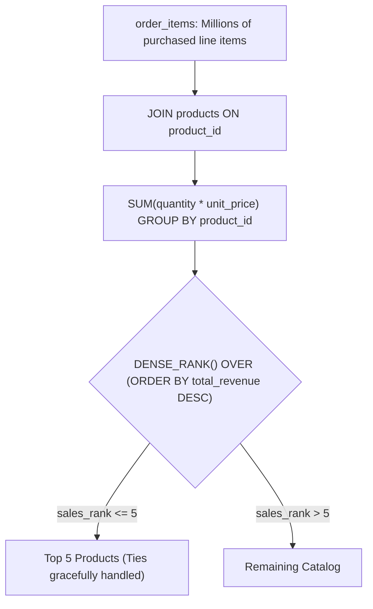

## Fast Revision (10-Second Recall)
- **Revenue vs Quantity:** Clarify whether "highest-selling" means **total revenue** (`SUM(quantity * unit_price)`) or **units sold** (`SUM(quantity)`).
- **Basic Query:** `GROUP BY p.id, p.name ORDER BY total_sales DESC LIMIT 5`.
- **The Ranking Tie Problem:** What if product #5 and product #6 both generated exactly $50,000 in sales? A naive `LIMIT 5` will arbitrarily discard one!
- **The Senior Solution (Tie Handling):** Use `DENSE_RANK() OVER (ORDER BY total_sales DESC)` inside a CTE to return all products sharing top 5 ranks.
- **Performance Indexing:** Index `order_items(product_id) INCLUDE (quantity, unit_price)` to enable Index-Only scans without reading heap tables.

## The 30-Second Spoken Script
"To find the top 5 highest-selling products, the first clarification is whether 'highest-selling' refers to total revenue generated or total units sold. In e-commerce, it usually means total revenue: the sum of quantity multiplied by unit price.

For standard reporting where exactly 5 rows are expected, a GROUP BY query with LIMIT 5 is standard:

SELECT p.id,
       p.name AS product_name,
       SUM(oi.quantity * oi.unit_price) AS total_revenue
FROM products p
INNER JOIN order_items oi ON p.id = oi.product_id
GROUP BY p.id, p.name
ORDER BY total_revenue DESC
LIMIT 5;

However, in production analytics and senior technical interviews, you must address ranking ties. If the 5th and 6th products have identical sales, LIMIT 5 arbitrarily drops one based on physical disk order.

To handle ties equitably, I use a Common Table Expression with DENSE_RANK(), ranking products by total revenue, and then filtering `WHERE sales_rank <= 5`. This guarantees all products tied for the top 5 positions are included. For performance on millions of order items, we maintain a composite index on order_items(product_id, quantity, unit_price)."

## Scenario / Problem Context
E-commerce dashboards need to compute top products by total revenue or quantity sold. The interviewer tests your aggregation skills, ability to join order headers and order items, and how you resolve ranking ties for 5th place.

## Architectural Workflow / Sequence


## Deep-Dive Analysis & Root Causes

| Approach | ReturnedRows | TieHandling | BestFor |
| --- | --- | --- | --- |
| `ORDER BY ... DESC LIMIT 5` | Strictly 5 rows | Arbitrary (non-deterministic if ties exist at boundary) | Simple UI cards and widgets
CTE with `DENSE_RANK() <= 5` | 5 or more rows if ties exist | Fair and mathematically complete | Financial reports, leaderboards, and executive analytics
Summary Materialized View | Instant results | Pre-computed via scheduled cron or trigger | High-traffic homepages receiving 10,000 requests/sec |


## Practical Debugging Commands & Code
```sql
-- 1. Revenue-based Top 5 with LIMIT:
SELECT p.id,
       p.name,
       sum(oi.quantity * oi.unit_price) AS total_revenue
FROM products p
INNER JOIN order_items oi ON p.id = oi.product_id
GROUP BY p.id, p.name
ORDER BY total_revenue DESC
LIMIT 5;

-- 2. Quantity-based Top 5 with DENSE_RANK tie-handling:
WITH product_sales AS (
    SELECT p.id,
           p.name,
           sum(oi.quantity) AS total_units_sold,
           dense_rank() OVER (ORDER BY sum(oi.quantity) DESC) AS rank
    FROM products p
    JOIN order_items oi ON p.id = oi.product_id
    GROUP BY p.id, p.name
)
SELECT id, name, total_units_sold, rank
FROM product_sales
WHERE rank <= 5
ORDER BY rank ASC;

-- 3. Optimal Covering Index for order_items:
CREATE INDEX idx_order_items_product_sales 
ON order_items (product_id) 
INCLUDE (quantity, unit_price);
```

## Prevention & Senior Best Practices
- **Use Materialized Views for Real-Time Dashboards:** Do not aggregate 100 million order items on every homepage view. Refresh a materialized view hourly.
- **Include Cancelled/Returned Filters:** Remember to filter out cancelled orders (`WHERE o.status != 'cancelled'`) to avoid inflating sales metrics.
- **Index Foreign Keys with Covering Attributes:** Use PostgreSQL `INCLUDE` clause so aggregation runs via Index-Only scans.
