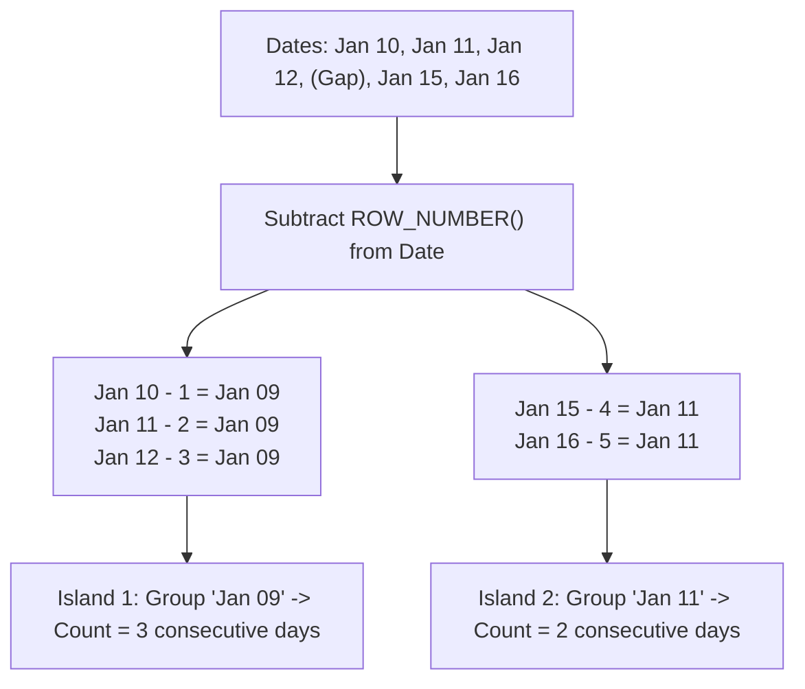

## Fast Revision (10-Second Recall)
- **The Problem:** Given `(user_id, login_date)`, find all users who logged in for N or more consecutive days.
- **The Mathematical Insight (The "Island" Trick):**
- If you take a sequence of consecutive dates and subtract a monotonically increasing integer (`ROW_NUMBER()`), the resulting date difference is a **CONSTANT** for all consecutive rows in that island!
- Example: Dates `[Jan 10, Jan 11, Jan 12]` with row numbers `[1, 2, 3]`:
- `Jan 10 - 1 = Jan 09`
- `Jan 11 - 2 = Jan 09`
- `Jan 12 - 3 = Jan 09` $\rightarrow$ Constant grouping date `Jan 09`!
- When a gap occurs (`Jan 15 - 4 = Jan 11`), a NEW group anchor is created!
- **The Final Step:** `GROUP BY user_id, island_group HAVING COUNT(*) >= 5`.

## The 30-Second Spoken Script
"Finding consecutive dates with activity is the classic 'Gaps and Islands' problem in SQL. The challenge is grouping contiguous daily dates together so we can measure streak lengths.

The mathematical key to solving this is date arithmetic combined with the ROW_NUMBER() window function.

Here is the 3-step solution:

First, we deduplicate multiple logins on the same day using DISTINCT so each user has at most one record per calendar date.

Second, we calculate an 'Island Group' identifier:
In an active streak, each consecutive calendar day advances by exactly 1 day. Similarly, the window function ROW_NUMBER() advances by exactly 1 for each row.
Therefore, if we subtract ROW_NUMBER() days from the activity_date:
activity_date minus (ROW_NUMBER() * interval '1 day')
The resulting date remains identical for all consecutive days in that streak! When a gap of one or more days occurs, the resulting date anchor jumps, creating a new island.

Third, we group by user_id and this calculated island group anchor:
SELECT user_id,
       MIN(activity_date) AS streak_start,
       MAX(activity_date) AS streak_end,
       COUNT(*) AS consecutive_days
FROM Islands
GROUP BY user_id, island_group
HAVING COUNT(*) >= 5;

This cleanly identifies every user who achieved a streak of 5 or more consecutive days, along with the start and end dates of each streak."

## Scenario / Problem Context
Gaming apps, fitness trackers, and learning platforms need to calculate user activity streaks (e.g., users who logged in 5 days in a row). This is the classic "Gaps and Islands" problem in SQL. The interviewer tests whether you can model grouped consecutive sequences using window functions.

## Architectural Workflow / Sequence


## Deep-Dive Analysis & Root Causes

| Step | Action | Purpose |
| --- | --- | --- |
| 1. Deduplication | `SELECT DISTINCT user_id, login_date::date FROM logins` | Eliminates multiple logins in a single day which would distort ROW_NUMBER()
2. Island Calculation | `login_date - (ROW_NUMBER() OVER (...) * INTERVAL '1 day') AS grp` | Generates an identical synthetic anchor date for every row in a contiguous run
3. Streak Aggregation | `GROUP BY user_id, grp HAVING COUNT(*) >= N` | Filters for streaks meeting the target consecutive day threshold |


## Practical Debugging Commands & Code
```sql
-- 1. Complete Gaps and Islands Streak Query (PostgreSQL):
WITH distinct_logins AS (
    -- Step 1: Deduplicate multiple logins on the same day
    SELECT DISTINCT user_id, login_date::date AS login_day
    FROM user_activity
),
ranked_logins AS (
    -- Step 2: Assign row numbers ordered by login day
    SELECT user_id, login_day,
           row_number() OVER (
               PARTITION BY user_id 
               ORDER BY login_day ASC
           ) AS rn
    FROM distinct_logins
),
islands AS (
    -- Step 3: Compute constant group anchor (Date - Row Number)
    SELECT user_id, login_day,
           login_day - (rn * INTERVAL '1 day') AS grp
    FROM ranked_logins
)
-- Step 4: Group by island to find streaks >= 5 days
SELECT user_id,
       min(login_day) AS streak_start,
       max(login_day) AS streak_end,
       count(*) AS consecutive_days
FROM islands
GROUP BY user_id, grp
HAVING count(*) >= 5
ORDER BY consecutive_days DESC;
```

## Prevention & Senior Best Practices
- **Always Cast to `DATE`:** Timestamp fields include hours and minutes, which will prevent exact 1-day step arithmetic. Always cast to `::date`.
- **Deduplicate First:** If a user logs in 4 times on Monday, naive row numbering increments 4 times on the same date, breaking the math.
- **Index on `(user_id, login_date)`:** A composite B-tree index allows the database to read logins in pre-sorted order, avoiding expensive memory sort spills.
