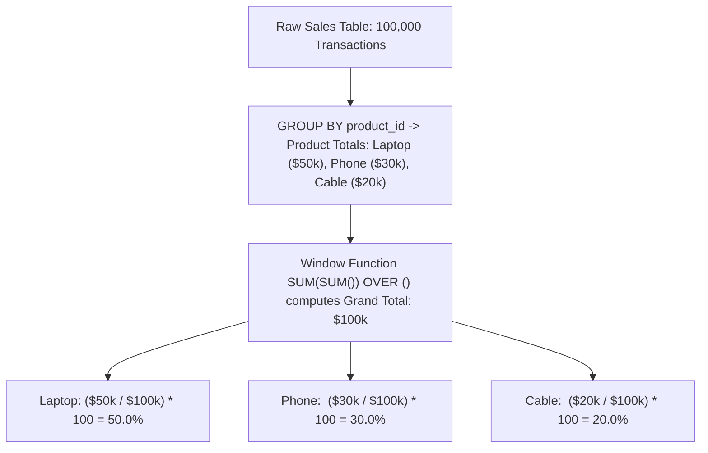

## Fast Revision (10-Second Recall)
- **The Mathematical Formula:** `(Product Total Sales / Grand Total Sales) * 100`.
- **The SQL Superpower:** Combining a standard `SUM()` with a Window `SUM() OVER ()` in the same expression!
- `ROUND(100.0 * SUM(sales) / SUM(SUM(sales)) OVER (), 2) AS pct_share`.
- How it works: The inner `SUM(sales)` computes the product total via `GROUP BY product_id`. The outer `SUM(...) OVER ()` computes the grand total across all product groups.
- **Zero-Division Safety:** Wrap denominator in `NULLIF(..., 0)` to prevent runtime division-by-zero crashes.
- **Category Proportions:** Use `OVER (PARTITION BY category_id)` to calculate contribution within each department.

## The 30-Second Spoken Script
"To calculate the percentage contribution of each product to total sales, the most performant and elegant technique combines a standard aggregate SUM with a window SUM() OVER () in a single query.

Here is the SQL:
SELECT product_id,
       product_name,
       SUM(sales_amount) AS product_revenue,
       ROUND(
         100.0 * SUM(sales_amount) / NULLIF(SUM(SUM(sales_amount)) OVER (), 0), 
         2
       ) AS percentage_of_total
FROM sales
GROUP BY product_id, product_name
ORDER BY product_revenue DESC;

Notice the nested expression:
The inner SUM(sales_amount) calculates the total revenue for that specific product group defined by GROUP BY.
The outer SUM(...) OVER () calculates the grand total across all product groups without collapsing the individual rows.
Multiplying by 100.0 forces decimal division instead of integer truncation.
Wrapping the denominator in NULLIF(..., 0) provides production safety by preventing division-by-zero exceptions if the sales table is empty.

If we want the percentage contribution within each specific product category, we simply add PARTITION BY category:
ROUND(100.0 * SUM(sales_amount) / SUM(SUM(sales_amount)) OVER (PARTITION BY category_id), 2) AS pct_within_category;

This executes in a single pass over the aggregated data with zero self-joins."

## Scenario / Problem Context
Product analytics, revenue attribution, and portfolio analysis require calculating each item's percentage share of the whole. The interviewer tests whether you can compute proportions cleanly in a single SQL query without unnecessary self-joins or secondary subqueries.

## Architectural Workflow / Sequence


## Deep-Dive Analysis & Root Causes

| Scope | Syntax | Result |
| --- | --- | --- |
| Grand Total Contribution | `SUM(sales) / SUM(SUM(sales)) OVER ()` | Product share relative to the entire business (sums to 100%)
Category-Level Contribution | `SUM(sales) / SUM(SUM(sales)) OVER (PARTITION BY category_id)` | Product share within its specific category (sums to 100% per category)
Division Safety | `NULLIF(denominator, 0)` | Returns `NULL` instead of throwing `division by zero` error on empty datasets |


## Practical Debugging Commands & Code
```sql
-- 1. Overall Percentage Contribution to Total Company Sales:
SELECT p.id,
       p.name,
       sum(s.amount) AS total_sales,
       round(
           100.0 * sum(s.amount) / nullif(sum(sum(s.amount)) OVER (), 0), 
           2
       ) AS pct_contribution
FROM products p
JOIN sales s ON p.id = s.product_id
GROUP BY p.id, p.name
ORDER BY total_sales DESC;

-- 2. Category-Level Percentage Contribution:
SELECT p.category,
       p.name,
       sum(s.amount) AS product_sales,
       round(
           100.0 * sum(s.amount) / sum(sum(s.amount)) OVER (PARTITION BY p.category), 
           2
       ) AS pct_within_category
FROM products p
JOIN sales s ON p.id = s.product_id
GROUP BY p.category, p.name
ORDER BY p.category, product_sales DESC;
```

## Prevention & Senior Best Practices
- **Always Multiply by `100.0` Float Literal:** In databases like PostgreSQL and SQL Server, dividing integers (`50 / 100`) performs integer truncation and yields `0`! Using `100.0` ensures floating-point precision.
- **Always Wrap Denominator with `NULLIF`:** Protects automated analytics pipelines from crashing on division by zero when testing against empty staging tables.
- **Format Output with `ROUND(..., 2)`:** Presenting 6 decimal places (`33.333333%`) clutters dashboards; always round to 2 decimal places for user interfaces.
