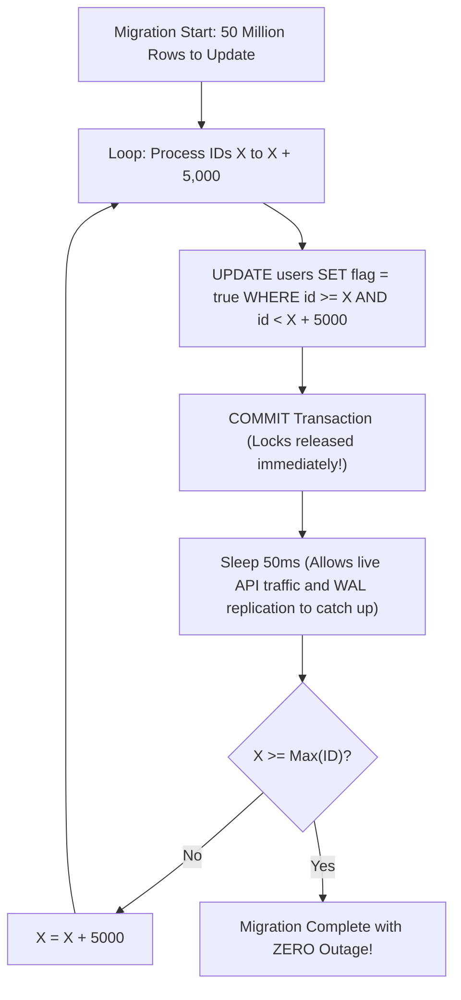

## Fast Revision (10-Second Recall)
- **The Catastrophic Failure of Unbounded `UPDATE`:**
- 1. **Row Lock Escalation:** Millions of exclusive row locks block all incoming concurrent writes.
- 2. **Replication Lag:** Standby replicas choke on a multi-gigabyte monolithic WAL transaction.
- 3. **Rollback Catastrophe:** If the query crashes at minute 40, rolling back takes another 40 minutes of full downtime!
- **The Production Playbook (Keyset Range Batching):**
- 1. Iterate in indexed ID chunks (e.g., `WHERE id >= batch_start AND id < batch_end`).
- 2. Chunk size: 2,000 to 10,000 rows per transaction.
- 3. Commit each batch independently.
- 4. Inject a throttle sleep (`pg_sleep(0.05)`) between batches to let autovacuum, WAL flushes, and user traffic breathe.

## The 30-Second Spoken Script
"Updating millions of records in production must never be executed as a single massive UPDATE statement. An unbatched UPDATE on 50 million rows creates millions of exclusive locks, generates hundreds of gigabytes of Write-Ahead Log bloat, causes severe replication lag on read replicas, and risks a catastrophic 45-minute rollback if interrupted.

The production-grade approach is Keyset Range Batching executed in small, throttled transactions.

Here is the protocol:
First, we update records in chunks of 5,000 rows based on the primary key, committing each batch independently.
Second, we use keyset boundaries—`WHERE id >= current_id AND id < current_id + 5000`—rather than OFFSET pagination, ensuring every batch executes via an instant primary key Index Range Scan.
Third, we inject a short sleep—such as 50 milliseconds—between successive batches. This throttling allows the CPU to cool down, gives replication workers time to stream WAL records, and prevents lock queues from starving live API requests.

In a script or stored procedure:
We record the maximum primary key ID in the table. In a WHILE loop, we issue an UPDATE on the next 5,000 ID window, commit the transaction, sleep briefly, and advance the pointer until reaching the maximum ID.

If the migration is interrupted halfway, it is completely resumable with zero wasted work because all previously committed batches remain intact."

## Scenario / Problem Context
A data migration or business logic update requires setting a new column or status across 50 million records. Running `UPDATE users SET status = 'verified';` locks the table for 45 minutes, exhausts the transaction log / WAL, and takes down production. The interviewer tests your knowledge of safe operational batching.

## Architectural Workflow / Sequence


## Deep-Dive Analysis & Root Causes

| Dimension | LockDuration | WalImpact | CrashRecovery |
| --- | --- | --- | --- |
| Single Monolithic UPDATE | Entire duration of migration (Hours) | Explodes WAL / undo logs; replicas lag by hours | Catastrophic rollback takes hours; all work lost
Chunked Keyset Batching (Recommended) | Milliseconds per batch (5,000 rows) | Steady, manageable WAL stream; replicas keep up seamlessly | Instant; restart from last committed ID without losing progress
Batch Size Selection | 2,000 to 10,000 rows | Optimal sweet spot between transaction overhead and lock time | Negligible rollback overhead if single batch fails |


## Practical Debugging Commands & Code
```sql
-- 1. PostgreSQL Safe Chunked Batch Script (PL/pgSQL Block):
DO $$
DECLARE
    batch_size INT := 5000;
    max_id BIGINT;
    cur_id BIGINT := 0;
    rows_updated BIGINT := 0;
BEGIN
    SELECT max(id) INTO max_id FROM orders;

    WHILE cur_id < max_id LOOP
        UPDATE orders
        SET status = 'archived'
        WHERE id >= cur_id 
          AND id < cur_id + batch_size
          AND status != 'archived';

        cur_id := cur_id + batch_size;
        
        -- Commit batch and throttle to protect live user traffic
        COMMIT;
        PERFORM pg_sleep(0.05); -- 50ms sleep
    END LOOP;
    
    RAISE NOTICE 'Batch update completed successfully!';
END $$;

-- 2. MySQL / Node.js Loop pattern:
-- while (true) {
--   const result = await db.query(
--     'UPDATE orders SET status = "archived" WHERE status != "archived" LIMIT 5000'
--   );
--   if (result.affectedRows === 0) break;
--   await sleep(50);
-- }
```

## Prevention & Senior Best Practices
- **Never Use `LIMIT / OFFSET` for Batching:** `LIMIT 5000 OFFSET 10000000` forces the database to scan 10 million rows just to throw them away. Always use Keyset primary key batching.
- **Monitor Replication Lag During Batch Jobs:** If `replay_lag` exceeds 5 seconds, increase sleep intervals to throttle the batch worker.
- **Run Table VACUUM / OPTIMIZE Post-Migration:** Updating 50 million rows creates 50 million dead tuple versions in PostgreSQL. Schedule a `VACUUM ANALYZE` after migration completes.
