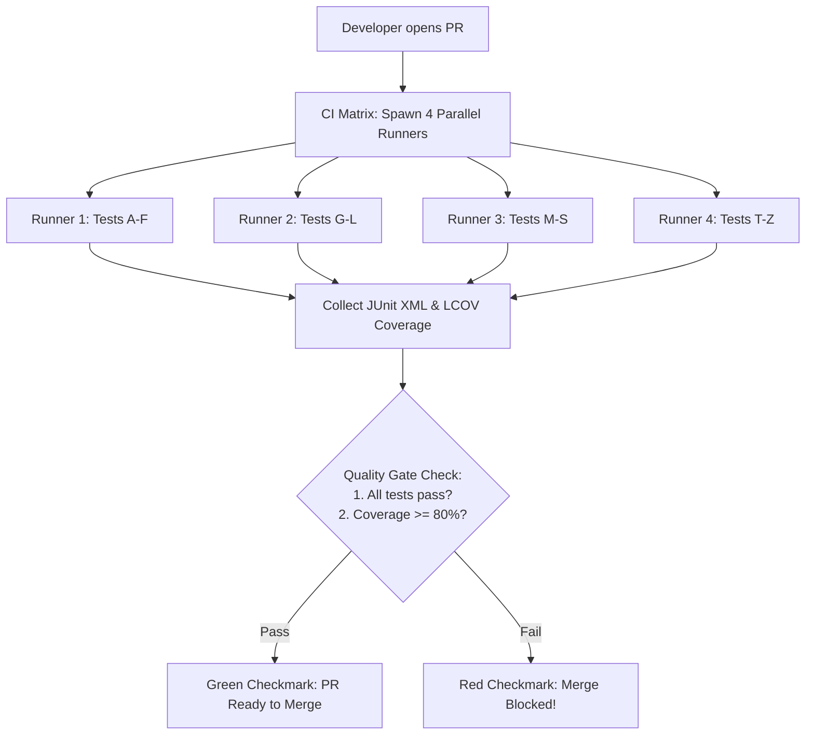

## Fast Revision (10-Second Recall)
- **Core Principles of CI Unit Testing:**
- 1. **Fast Execution:** Unit test suite must finish in &lt; 3 minutes (mock external databases, I/O, and HTTP).
- 2. **Deterministic & Isolated:** Tests must never depend on execution order or shared state.
- 3. **Parallel Execution:** Shard test suites across multiple CI runners (e.g. 4 runners split test files).
- 4. **Flaky Test Management:** Quarantine flaky tests automatically; never allow flaky tests to normalize "re-run until green".
- 5. **Quality Gates:** Assert code coverage thresholds (e.g. 80% branch coverage) using Codecov or SonarQube in PR checks.

## The 30-Second Spoken Script
"Automating unit testing in a CI/CD pipeline requires balancing thoroughness with speed, ensuring developers receive fast, deterministic feedback on every commit.

My implementation strategy:

First, isolate unit tests from external I/O. Unit tests must test pure business logic in memory using mocks or stubs for external HTTP calls, databases, and filesystem access. This guarantees each test runs in single-digit milliseconds and cannot fail due to network blips.

Second, parallelize test execution. As test suites grow into thousands of tests, running them sequentially takes 20 minutes. In GitHub Actions, we shard the test suite across multiple parallel runner containers using test runner matrix configurations—such as Jest's shard flag or pytest-xdist. A 15-minute test suite runs in under 3 minutes across 5 parallel nodes.

Third, enforce automated coverage gates. In our pull request pipeline, we integrate tools like Codecov or SonarQube. We configure an automated pull request status check that fails if total branch coverage falls below 80% or if new code introduced in the PR has uncovered lines.

Fourth, eliminate flaky tests with quarantine policies. Flaky tests destroy developer trust in CI. We track test flakiness; if a test fails intermittently without code changes, our pipeline automatically quarantines it to a non-blocking test suite and files a high-priority bug ticket for the owning team to fix."

## Scenario / Problem Context
Manual QA is a bottleneck, and buggy regressions keep reaching staging. You need to automate unit testing in CI, enforce coverage thresholds, keep test runs fast, and eliminate flaky test noise. The interviewer tests your testing architecture and CI optimization skills.

## Architectural Workflow / Sequence


## Deep-Dive Analysis & Root Causes

| Aspect | Technique | Impact |
| --- | --- | --- |
| Speed Optimization | Dependency caching (`actions/cache`) + Sharded test matrix | Reduces test execution time from 20 minutes to under 3 minutes
Coverage Enforcement | Codecov / SonarQube PR status checks | Prevents code untested by developers from entering the main codebase
Flaky Test Remediation | Automated test quarantine and flakiness tracking | Protects CI reliability and developer velocity |


## Practical Debugging Commands & Code
```bash
# 1. Parallel test execution with Jest sharding:
npx jest --shard=1/4 --coverage --coverageReporters="lcov"
npx jest --shard=2/4 --coverage --coverageReporters="lcov"

# 2. PyTest parallel execution with xdist:
pytest -n auto --cov=src --cov-report=xml

# 3. GitHub Actions matrix configuration snippet:
# strategy:
#   matrix:
#     shard: [1, 2, 3, 4]
# steps:
#   - run: npm test -- --shard=${{ matrix.shard }}/4
```

## Prevention & Senior Best Practices
- **Ban Real Network Calls in Unit Tests:** Use mocking libraries (Nock, MSW, Mockito) to strictly intercept network requests at the transport layer.
- **Never Allow "Re-run until it passes":** Re-running failed CI jobs masks flaky tests and eventually leads to broken code in production.
- **Cache Dependency Directories:** Cache `node_modules` or `~/.m2` using hash-keys of lockfiles to shave 2 minutes off every CI job.
