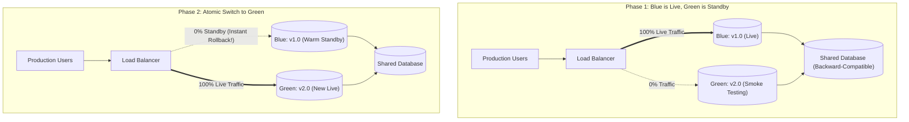

## Fast Revision (10-Second Recall)
- **Core Concept:** Maintain two identical production environments: **Blue** (currently running live production) and **Green** (idle standby / staging).
- **How It Works:**
- 1. Deploy new version to **Green** environment.
- 2. Run automated smoke tests and QA verification against Green in isolation.
- 3. Flip router / Load Balancer to point 100% of live user traffic to Green.
- 4. Green becomes the new live environment; Blue becomes the idle standby.
- 5. If a critical bug is detected, flip router back to Blue in &lt; 30 seconds!
- **The Critical Challenge:** The Database! Both Blue and Green must share the same database; schema changes must be 100% backward-compatible (Expand/Contract pattern).

## The 30-Second Spoken Script
"Blue-Green deployment is a release management strategy that achieves zero downtime and near-instantaneous rollback by running two identical physical or logical production environments, labeled Blue and Green.

At any given time, one environment—say Blue—is live, receiving 100% of production user traffic through the load balancer. The other environment, Green, is completely idle.

Here is the operational lifecycle:

Step 1: Deploy to Green. We deploy the new release version exclusively to the idle Green environment. Because Green receives zero production traffic, this deployment causes zero user impact.

Step 2: Comprehensive Smoke Testing. We execute automated end-to-end integration tests and internal QA verification directly against Green using private test domains or custom HTTP headers.

Step 3: Atomic Traffic Switch. Once Green is certified healthy, we execute an atomic router switch at the load balancer or ingress layer—such as updating AWS ALB target group rules or Nginx upstream blocks. Within seconds, 100% of incoming production requests are routed to Green.

Step 4: Standby and Instant Rollback Safety. We keep the older Blue environment running warm for a configurable bake period—typically 1 to 2 hours. If unexpected errors emerge, we simply flip the load balancer rule back to Blue, restoring service in under 30 seconds.

The primary architectural requirement is database backward compatibility: both Blue and Green must connect to the same underlying database cluster, meaning all schema changes must follow the Expand/Contract pattern."

## Scenario / Problem Context
The company wants zero downtime during major releases and the ability to instantly roll back in seconds without rebuilding containers. The interviewer evaluates your architectural mastery of Blue-Green deployments, traffic routing mechanisms, and how to handle shared state.

## Architectural Workflow / Sequence


## Deep-Dive Analysis & Root Causes

| Attribute | Detail | Comparison |
| --- | --- | --- |
| Rollback Speed | Under 30 seconds (single router rule change) | Much faster than rolling update undo (which takes minutes)
Infrastructure Cost | Requires ~2x compute capacity during deployment | Higher cost than rolling updates
Version Concurrency | Zero version mixing; users see either v1 or v2 | Eliminates mixed-version API bugs common in rolling updates
Database Constraint | Shared database requires Expand/Contract migrations | Cannot rollback schema destructively if Green wrote new data |


## Practical Debugging Commands & Code
```bash
# 1. Nginx upstream atomic Blue-Green switch:
# upstream app_backend {
#     # server blue.internal:8080;  # Commented out
#     server green.internal:8080;   # Active
# }
sudo nginx -s reload  # Zero-downtime configuration reload (< 10ms)

# 2. AWS ALB Target Group weighted shift via AWS CLI:
aws elbv2 modify-listener   --listener-arn <LISTENER_ARN>   --default-actions Type=forward,ForwardConfig='{TargetGroups:[{TargetGroupArn="'$GREEN_TG'",Weight=100},{TargetGroupArn="'$BLUE_TG'",Weight=0}]}'
```

## Prevention & Senior Best Practices
- **Never Terminate Blue Immediately:** Retain the Blue environment running warm for at least 60 minutes after switching to Green to guarantee fast rollback.
- **Use Load Balancer Switching Over DNS:** DNS caching (TTL) delays client updates for hours. Always perform Blue-Green switching at the load balancer or proxy layer, never via DNS records.
- **Enforce Strict Database Backward Compatibility:** Both Blue and Green must operate concurrently against the database without errors.
