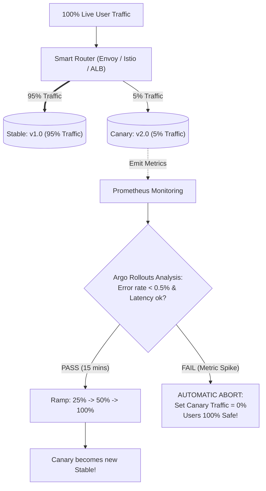

## Fast Revision (10-Second Recall)
- **Origin:** "Canary in a coal mine"—miners carried canaries to detect toxic gas before it killed the miners.
- **Core Concept:** Deploy the new version alongside the current stable version, but route only a tiny percentage of real traffic (e.g. 2%, 5%, 10%) to it.
- **How It Works:**
- 1. **Step 1:** Route 5% traffic to Canary; 95% remains on Stable.
- 2. **Step 2 (Bake Period):** Automated Canary Analysis (ACA) monitors error rate, latency, and business KPIs for 15 minutes.
- 3. **Step 3 (Progressive Promotion):** If metrics remain healthy, ramp traffic to 25% $\rightarrow$ 50% $\rightarrow$ 100%.
- 4. **Step 4 (Automated Abort):** If canary metrics breach thresholds, immediately reset traffic to 0% canary and 100% stable.
- **Traffic Routing Mechanisms:** Weighted DNS / ALB rules, Service Mesh (Istio / Linkerd), or Envoy proxy header routing.

## The 30-Second Spoken Script
"Canary deployment is a progressive delivery strategy that minimizes the blast radius of potential defects by routing a tiny fraction of real production traffic to a new version, monitoring its health metrics, and incrementally ramping up traffic only if the canary performs well.

The operational workflow follows four stages:

Stage 1: Initial Canary Injection.
We deploy the new container version alongside our existing stable pods. Using an intelligent routing layer—such as Istio, Envoy, or AWS ALB weighted target groups—we direct 5% of production user requests to the canary pods, while 95% continues to the stable baseline.

Stage 2: Automated Canary Analysis (ACA).
During a 15-minute bake window, our metrics engine (like Prometheus or Datadog) evaluates the canary against our Service Level Indicators (SLIs): HTTP 5xx error rate, p99 latency, and crash counts. Crucially, the canary's metrics are compared directly against the concurrent stable pods, accounting for overall site traffic fluctuations.

Stage 3: Progressive Ramping.
If the canary analysis passes, the controller automatically steps up the traffic weight: from 5% to 25%, then to 50%, and finally to 100%.

Stage 4: Automated Circuit Breaker Rollback.
If at any point the canary error rate spikes beyond our threshold (such as exceeding 0.5%), the controller immediately aborts the rollout, resets the traffic weight to 0% canary, and purges the canary pods.

The fundamental advantage of Canary deployment is that even if a catastrophic bug slips past CI and staging, at most 5% of users experience an error for a brief window before the system automatically self-heals."

## Scenario / Problem Context
A bug affecting 100% of users during a release can cause millions of dollars in damages. The engineering organization requires a progressive delivery system that exposes new versions to a tiny fraction of users first and aborts automatically on failure. The interviewer evaluates your knowledge of Canary architecture.

## Architectural Workflow / Sequence


## Deep-Dive Analysis & Root Causes

| Dimension | Canary | BlueGreen |
| --- | --- | --- |
| Canary vs Blue-Green | Progressive traffic shift (5% $\rightarrow$ 100%); limits blast radius | Atomic all-or-nothing shift (0% $\rightarrow$ 100%); 2x infrastructure cost
Routing Technology | Service mesh (Istio/Envoy) or ALB weighted target groups | Simple load balancer listener switch or DNS flip
Automated Scoring | Statistical metric evaluation (Mann-Whitney U test, threshold queries) | Smoke tests run before flipping |


## Practical Debugging Commands & Code
```bash
# 1. Istio VirtualService configuration for 90/10 traffic split:
# apiVersion: networking.istio.io/v1alpha3
# kind: VirtualService
# metadata:
#   name: api-routing
# spec:
#   hosts:
#   - api.example.com
#   http:
#   - route:
#     - destination:
#         host: api-service
#         subset: stable
#       weight: 90
#     - destination:
#         host: api-service
#         subset: canary
#       weight: 10

# 2. Argo Rollouts canary promotion CLI command:
kubectl argo rollouts promote web-app -n production

# 3. Argo Rollouts emergency abort command:
kubectl argo rollouts abort web-app -n production
```

## Prevention & Senior Best Practices
- **Automate Canary Scoring with AnalysisTemplates:** Never rely on manual dashboard observation; let Argo Rollouts or Flagger query Prometheus and decide automatically.
- **Use Session Affinity or User Segmentation for State:** If users have long interactive sessions, route specific internal employee accounts or beta cohorts to the canary first using HTTP request headers (`X-Canary: true`).
- **Ensure Database Changes Support Both Versions:** Just as in Blue-Green, Canary deployments run $V1$ and $V2$ concurrently against the same database, requiring strict Expand/Contract schema design.
