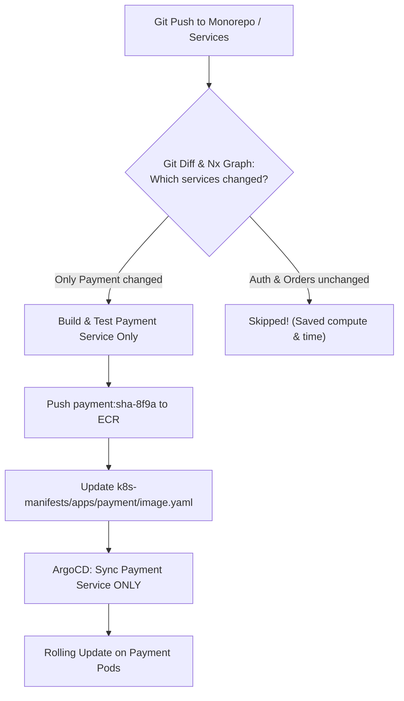

## Fast Revision (10-Second Recall)
- **The Fundamental Principle:** Independent Deployability. Each microservice must be built, tested, and released independently without forcing other services to redeploy.
- **Monorepo vs Polyrepo Deployments:**
- - **Monorepo (Nx / Turborepo):** Change detection (`git diff`) builds and tests ONLY services whose files or internal dependencies changed.
- - **Polyrepo:** Each service has its own repository and isolated CI pipeline; dependencies managed via versioned packages.
- **The GitOps Architecture for Multiple Services:**
- Central `k8s-infra` repository organized by environment (`staging/`, `production/`) and service (`auth/`, `payments/`, `orders/`). ArgoCD syncs each service independently.
- **Consumer-Driven Contract Testing:** Use Pact to guarantee API compatibility across independently deploying services.

## The 30-Second Spoken Script
"Deploying multiple microservices successfully requires maintaining independent deployability: every microservice must have its own isolated release lifecycle so that a defect in one service does not halt deployments for the other twenty-four.

Here is how I structure the deployment architecture:

First, Change Detection and Selective Builds.
Whether using a Monorepo with Turborepo/Nx or a Polyrepo structure, our CI pipeline uses Git diff change detection. When a developer merges code, the pipeline calculates the dependency graph and only builds, tests, and packages the specific microservices that were actually modified. Unchanged services are skipped entirely, keeping CI runtimes fast.

Second, GitOps-Driven Release Management.
We maintain a centralized infrastructure repository containing declarative Kubernetes manifests structured by service and environment. When the Payment service CI pipeline builds a new image, it updates only the image tag inside /apps/payment/production/deployment.yaml.

Third, Independent Cluster Synchronization with ArgoCD.
Inside Kubernetes, ArgoCD manages each microservice as an independent Application resource. When the manifest for the Payment service changes, ArgoCD initiates a rolling update exclusively for the Payment service, leaving Auth, Catalog, and Inventory untouched.

Fourth, Consumer-Driven Contract Verification.
To prevent breaking downstream dependencies when services deploy independently, we use Pact for contract testing in CI. Before a service deploys, it queries our Pact Broker to verify that its new API changes satisfy all registered consumer contracts."

## Scenario / Problem Context
The platform has grown to 25 microservices. Deploying services manually or rebuilding all 25 services on every commit is causing CI bottlenecks and dependency conflicts. The interviewer tests your microservice release engineering, GitOps architecture, and monorepo vs polyrepo workflows.

## Architectural Workflow / Sequence


## Deep-Dive Analysis & Root Causes

| Strategy | Pros | Cons |
| --- | --- | --- |
| Monorepo (Nx / Turborepo) | Atomic cross-service refactoring; single PR for frontend and backend changes | Requires sophisticated change-detection tooling; large repo clone times
Polyrepo | Clear boundary ownership; isolated repository permissions and CI pipelines | Dependency hell; updating shared libraries requires cascading PRs across 25 repos
GitOps App-of-Apps (ArgoCD) | Declarative view of all microservices in a single dashboard; selective sync | Requires strict manifest directory discipline |


## Practical Debugging Commands & Code
```bash
# 1. Turborepo: Run build only for changed packages against main:
npx turbo run build --filter=...[origin/main]

# 2. Nx: Test only affected microservices:
npx nx affected --target=test --base=origin/main

# 3. ArgoCD App-of-Apps pattern (deploy all microservices):
kubectl apply -f https://raw.githubusercontent.com/argoproj/argo-cd/stable/manifests/install.yaml
kubectl apply -f ./manifests/root-application.yaml
```

## Prevention & Senior Best Practices
- **Strictly Avoid Lock-Step Release Trains:** Never require all 20 microservices to deploy together on Thursday night. Services must deploy on demand.
- **Use Asynchronous Event Schemas (Protobuf / Avro):** Buffer inter-service communication through message brokers to eliminate tight synchronous runtime coupling.
- **Implement Pact Contract Testing:** Catch breaking API changes in CI before deployment reaches any cluster.
