## Fast Revision (10-Second Recall)
- **CI vs CD:**
- - **CI (Continuous Integration):** Build, lint, test, security scan on every Git push/PR to validate code integration.
- - **CD (Continuous Delivery):** Automatically package and deploy artifacts to staging, with an automated or manual approval gate for production.
- - **CD (Continuous Deployment):** Every change passing all automated gates deploys straight to production with zero human intervention.
- **The 5 Pipeline Stages:**
- 1. **Lint & Static Analysis:** ESLint, SonarQube, Prettier, TypeScript compile check.
- 2. **Test:** Unit tests, integration tests, code coverage assertions (>80%).
- 3. **Security (DevSecOps):** SAST (SonarQube), SCA (Snyk/Trivy), Secret scanning (TruffleHog), Container scanning.
- 4. **Build & Package:** Multi-stage Docker build, immutable tag (Git SHA), push to ECR/GHCR.
- 5. **Deploy & Verify:** GitOps (ArgoCD/Flux), progressive rollout (Canary/Blue-Green), automated smoke tests.

## The 30-Second Spoken Script
"Designing a production CI/CD pipeline requires separating the build and verification stages—Continuous Integration—from the deployment and release stages—Continuous Delivery—using an immutable artifact promotion model.

Here is the 5-stage architecture I implement:

Stage 1: Commit and Fast Validation.
On every pull request, the CI runner triggers fast feedback checks: code linting, static type checking with TypeScript or Go compiler, and secret scanning using tools like TruffleHog to ensure no API keys are committed.

Stage 2: Automated Testing and Quality Gates.
We run parallelized unit tests and integration tests with mocked external services. We enforce code coverage thresholds using SonarQube. If test coverage drops or any test fails, the pull request is blocked from merging.

Stage 3: Build and Security Scanning.
Once merged into the main branch, a multi-stage Docker build creates an immutable container image tagged with the Git commit SHA, never using 'latest'. We scan the image using Trivy or Snyk for Common Vulnerabilities and Exposures (CVEs) before pushing it to our container registry.

Stage 4: Automated Staging Deployment.
Using a GitOps controller like ArgoCD, the new image tag is committed to an environment manifest repository. ArgoCD detects the change and synchronizes the staging Kubernetes cluster. Automated end-to-end synthetic tests run against staging.

Stage 5: Progressive Production Rollout.
For production, we trigger an Argo Rollouts canary deployment. 5% of production traffic routes to the new version. Prometheus monitors error rates and p99 latency for 10 minutes. If the canary scores 100%, it automatically ramps to 100%; if error rates exceed 0.5%, it triggers an automated rollback."

## Scenario / Problem Context
The engineering organization is scaling from 5 to 50 engineers. Deployments are currently manual and error-prone. The interviewer asks you to architect an enterprise-grade CI/CD pipeline from scratch, covering source control to production rollout.

## Architectural Workflow / Sequence

```mermaid
flowchart LR
    Dev["1. Git Push / PR"] --> Lint["2. Lint & Type Check<br/>(ESLint / tsc)"]
    Lint --> Test["3. Unit & Integration Tests<br/>(Jest / PyTest)"]
    Test --> Security["4. Security Scan<br/>(Trivy / Snyk / Sonar)"]
    Security --> Build["5. Docker Build & Push<br/>(Tag: Git Commit SHA)"]
    Build --> GitOps["6. ArgoCD GitOps Sync<br/>(Deploy to Staging)"]
    GitOps --> E2E["7. Automated Smoke Tests"]
    E2E --> Canary["8. Canary Prod Rollout<br/>(5% -> 25% -> 100%)"]
```


## Deep-Dive Analysis & Root Causes

| Stage | Tools | Purpose | Duration |
| --- | --- | --- | --- |
| Continuous Integration (CI) | GitHub Actions, GitLab CI, CircleCI | Validates code correctness, security, and builds immutable image | Target &lt; 5-8 minutes
Artifact Storage | AWS ECR, Google Artifact Registry, Harbor | Stores immutable, cryptographically signed Docker images | N/A
Continuous Delivery (CD / GitOps) | ArgoCD, Flux, Spinnaker | Pulls declarative manifests from Git and reconciles cluster state | Continuous synchronization
Progressive Delivery | Argo Rollouts, Flagger, Istio | Automated Canary analysis with automated metric-based rollback | 10 to 30 minutes |


## Practical Debugging Commands & Code
```bash
# 1. GitHub Actions workflow snippet (.github/workflows/ci.yml):
# name: Production CI
# on: [push, pull_request]
# jobs:
#   test:
#     runs-on: ubuntu-latest
#     steps:
#       - uses: actions/checkout@v4
#       - run: npm ci && npm run test:coverage
#       - name: Vulnerability Scan
#         uses: aquasecurity/trivy-action@master
#         with:
#           scan-type: 'fs'
#           severity: 'CRITICAL,HIGH'

# 2. Build Docker image tagged with Git SHA:
export GIT_SHA=$(git rev-parse --short HEAD)
docker build -t 123456789.dkr.ecr.us-east-1.amazonaws.com/api:${GIT_SHA} .
docker push 123456789.dkr.ecr.us-east-1.amazonaws.com/api:${GIT_SHA}

# 3. Trigger ArgoCD sync via CLI:
argocd app sync api-production --prune
```

## Prevention & Senior Best Practices
- **Build Once, Deploy Everywhere:** Never rebuild the container image for each environment. Build the image ONCE in CI, and promote the exact same binary hash from Dev $\rightarrow$ Staging $\rightarrow$ Production.
- **Never Use the `latest` Docker Tag:** Always tag images with immutable identifiers (e.g. `v1.2.3` or `git-sha-7a8b9c`). The `latest` tag creates non-deterministic deployments.
- **Keep Pipeline Runs Under 10 Minutes:** Slow pipelines lead to developer context-switching and bypassed testing gates. Use layer caching and parallelization.
