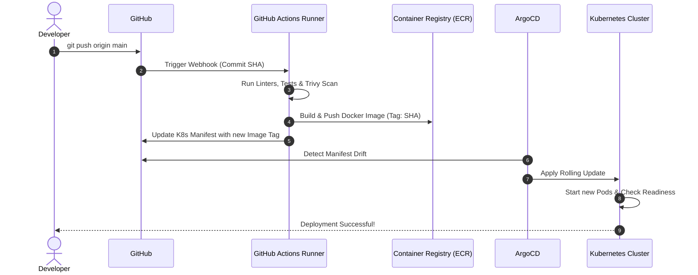

## Fast Revision (10-Second Recall)
- **Step-by-Step Lifecycle:**
- 1. **Client & Server Webhook:** Git client pushes over SSH/HTTPS $\rightarrow$ Git server (GitHub) verifies branch protection $\rightarrow$ triggers webhook payload.
- 2. **CI Orchestrator Receives Webhook:** GitHub Actions / GitLab assigns an ephemeral runner VM.
- 3. **Lint, Security & Compile:** Runner clones repository, installs dependencies from cache, runs linters, unit tests, and SAST scans.
- 4. **Container Image Build & Push:** Builds container using multi-stage Dockerfile, tags with Git SHA, pushes to container registry (ECR).
- 5. **GitOps Manifest Update:** CI bot commits new image tag to `k8s-manifests` Git repository.
- 6. **CD Reconciliation:** ArgoCD controller notices manifest diff $\rightarrow$ triggers Kubernetes Rolling/Canary deployment.
- 7. **Traffic Switch & Live Verification:** Readiness probes pass $\rightarrow$ ingress routes live traffic.

## The 30-Second Spoken Script
"The journey from a developer running 'git push' to live production traffic consists of six automated phases:

Phase 1: Webhook Ingestion.
When git push executes, the Git host (such as GitHub) validates permissions and branch protection rules. Once accepted, GitHub fires an HTTPS webhook containing the commit SHA, branch name, and author to our CI orchestrator.

Phase 2: Ephemeral Runner Provisioning and CI Validation.
The CI orchestrator spins up an isolated runner. It checks out the code, restores cached package dependencies, and executes three parallel verification jobs: static code analysis, security vulnerability scanning with Trivy, and unit/integration test suites. If any job exits with a non-zero status, the build aborts and alerts the developer.

Phase 3: Immutable Artifact Creation.
Once tests pass, the runner executes a Docker build. It builds a production image using multi-stage builds, labels it with the Git commit hash, and pushes the image to our private container registry.

Phase 4: GitOps Configuration Update.
Rather than giving CI direct SSH access to the production cluster, we follow GitOps. The pipeline issues a pull request or commit to our deployment repository, updating the target container image tag to the newly built commit SHA.

Phase 5: Orchestrator Reconciliation.
The ArgoCD operator running inside Kubernetes polls the deployment repository. It detects the drift between the running cluster state and the desired Git state, and issues a Kubernetes rolling update.

Phase 6: Ingress Routing.
Kubernetes starts new pods. Once their startup and readiness probes return HTTP 200, the Service and Ingress controllers begin routing live customer traffic to them, terminating the old pods gracefully."

## Scenario / Problem Context
A classic systems design and DevOps interview question. The interviewer asks you to walk through the entire operational lifecycle of code from the moment `git push origin main` executes in a terminal to the moment a customer runs the new code in production.

## Architectural Workflow / Sequence


## Deep-Dive Analysis & Root Causes

| Stage | SecurityRequirement | FailureMode |
| --- | --- | --- |
| 1. Git Push Hook to CI | Branch protection + cryptographic commit signature verification | Blocked if branch protection rules are violated
2. CI Build & Containerization | Zero access to production cluster; push image to private ECR | Fails on compilation, tests, or critical security vulnerabilities
3. GitOps Pull Reconciliation | In-cluster ArgoCD pull model (no external write access to K8s API) | Rollout pauses if pods fail liveness/readiness probes |


## Practical Debugging Commands & Code
```bash
# 1. Track Git commit SHA and status in Git:
git log -1 --format="Commit: %h | Author: %an | Date: %ad | Msg: %s"

# 2. Inspect active pods running the specific Git commit image:
kubectl get pods -n production -o custom-columns=NAME:.metadata.name,IMAGE:.spec.containers[*].image

# 3. View deployment status and revision in ArgoCD:
argocd app get api-production
```

## Prevention & Senior Best Practices
- **Use Pull-Based GitOps Over Push-Based CI:** Never give CI runners full administrative `kubectl` credentials to production; use an in-cluster GitOps controller like ArgoCD.
- **Automate Commit Signing:** Require developers to sign Git commits with GPG or SSH keys to prevent identity spoofing.
- **Separate App Code Repositories from Deployment Manifest Repositories:** Decouple application source code from Kubernetes deployment configurations.
