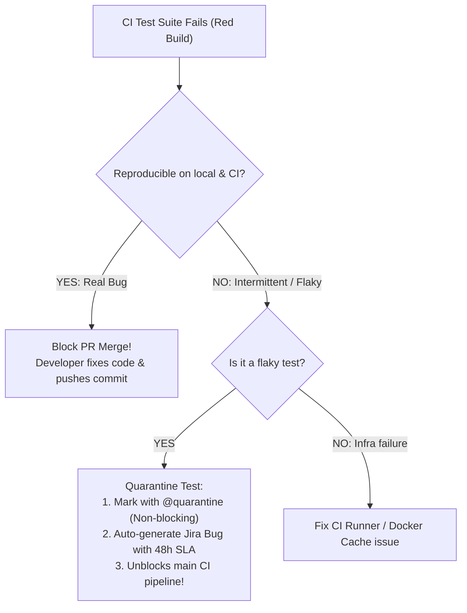

## Fast Revision (10-Second Recall)
- **The Zero-Tolerance Rule:** Never ignore test failures or merge broken builds. Merging over broken tests degrades team trust and invites catastrophic regressions.
- **The 4-Step Failure Resolution Workflow:**
- 1. **Inspect Artifacts & Traces:** Pull failed test logs, screenshots (Playwright), video recordings, and network HAR files from CI artifacts.
- 2. **Determine Flakiness vs Real Regression:** Re-run the failed tests in isolation. Did it fail on an assertion or a network timeout?
- 3. **Quarantine Immediately if Flaky:** Move confirmed flaky tests into a `@quarantine` suite so they do not block other developers.
- 4. **File a High-Priority Technical Debt Ticket:** Assign owning team 48 hours to fix or permanently delete the quarantined test.
- **Root Causes of Flakiness:** Timing issues (hardcoded `sleep`), non-isolated test state (leaked database rows), parallel resource contention.

## The 30-Second Spoken Script
"When automated tests fail in CI/CD, my approach balances strict quality discipline with developer velocity: never allow a broken build to be merged, but ensure fast, actionable diagnostics.

My process:

Step 1: Diagnostic Triaging via CI Artifacts.
I inspect the CI run's JUnit XML report and failure summary. For end-to-end tests, our pipeline captures screenshots, console logs, and trace recordings at the exact moment of failure. Looking at the Playwright trace or API response body usually identifies the issue within 2 minutes—whether it was a real code assertion failure or an unexpected environment timeout.

Step 2: Classify Real Bug vs Flaky Test.
If the test failure is reproducible and represents a legitimate code regression, the developer must fix the code before merging. If the test failed due to an async race condition, timing issue, or third-party network timeout, it is classified as a flaky test.

Step 3: Flaky Test Quarantine.
A critical engineering rule: developers must never re-run CI five times until it randomly passes. That masks bugs and wastes compute. Instead, if a test is proven flaky, we move it to a quarantined test suite using annotations like @quarantine. Quarantined tests run in CI for observability, but their failure does not block PR merges.

Step 4: Automated Accountability and Remediation.
Our CI bot automatically creates a high-priority Jira ticket assigned to the author or owning team with a 48-hour SLA. If the test is not fixed within 48 hours, it is deleted. This keeps the test suite reliable and trustworthy."

## Scenario / Problem Context
A pull request fails in CI with "3 tests failed out of 1,200". The developer claims "those are just flaky tests, let's merge anyway". The interviewer evaluates your engineering discipline, test failure diagnosis, and systematic management of flaky test suites.

## Architectural Workflow / Sequence


## Deep-Dive Analysis & Root Causes

| FailureType | Cause | Action |
| --- | --- | --- |
| Assertion Failure (`expect(val).toBe(true)`) | Real code regression or breaking API contract change | Developer fixes business logic or updates test expectations
Timeout / Async Wait Failure | Flaky test: relying on hardcoded `sleep(2000)` instead of polling `waitForSelector` | Refactor test to use explicit condition-based polling
State Pollution / Database Collision | Test assumes clean DB, but previous test left dirty rows | Wrap tests in database transactions that rollback after each test (`TRUNCATE CASCADE`)
CI Runner OOM / Out of Resources | Too many parallel threads spawned on a 2-vCPU runner VM | Limit parallel workers (`--maxWorkers=2`) or upgrade runner instance |


## Practical Debugging Commands & Code
```bash
# 1. Re-run only the failed tests in Jest:
npx jest --onlyFailures

# 2. Run Playwright trace viewer on CI failure zip:
npx playwright show-trace ./test-results/failed-test-trace.zip

# 3. Flaky test detection: run test 50 times in a loop locally:
# for i in {1..50}; do npx jest path/to/suspect.test.ts || break; done

# 4. GitHub Actions upload test artifacts on failure:
# - name: Upload Artifacts on Failure
#   if: failure()
#   uses: actions/upload-artifact@v4
#   with:
#     name: test-results
#     path: test-results/
```

## Prevention & Senior Best Practices
- **Ban Arbitrary Sleep Statements:** Ban `setTimeout` or `time.sleep()` in test code; mandate explicit wait helpers (`waitForResponse`, `waitForElement`).
- **Enforce Test Isolation:** Ensure every test creates its own unique test data using random UUIDs rather than static hardcoded emails.
- **Track Flakiness Metrics:** Use Datadog CI Visibility or Buildkite Test Engine to automatically identify and alert on top flaky tests.
