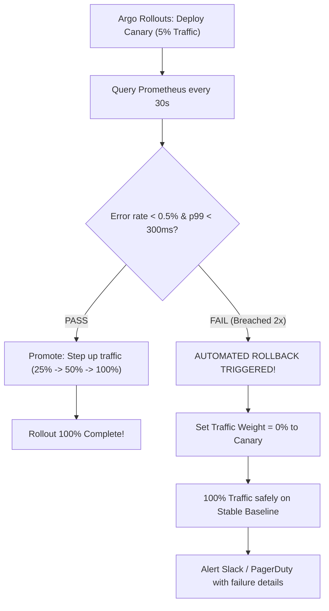

## Fast Revision (10-Second Recall)
- **The Goal:** Detect defects in production and execute rollback within 60 seconds with ZERO human intervention.
- **The 3 Components of Automated Rollback:**
- 1. **Metric Aggregator (Prometheus / Datadog):** Continuously measures error rates, latency, and system health.
- 2. **Canary Controller (Argo Rollouts / Flagger):** Increments traffic in steps (e.g. 5% $\rightarrow$ 25% $\rightarrow$ 100%) and runs metric queries at each step.
- 3. **Automated Rollback Criteria (AnalysisTemplate):**
-    - HTTP 5xx error rate &gt; 0.5% over 2 minutes $\rightarrow$ ABORT & ROLLBACK.
-    - p99 latency &gt; 500ms $\rightarrow$ ABORT & ROLLBACK.
-    - Unhandled crash restarts &gt; 0 $\rightarrow$ ABORT & ROLLBACK.

## The 30-Second Spoken Script
"Implementing automated rollback requires a progressive delivery controller like Argo Rollouts or Flagger combined with automated metric analysis against real-time Prometheus or Datadog telemetry.

Here is how I architect automated rollback:

First, we define our Service Level Indicators (SLIs) and thresholds in an AnalysisTemplate. The primary metric is HTTP 5xx error rate, and the secondary metric is p99 latency. For example: 'HTTP 5xx rate must remain below 0.5% over a 3-minute rolling window'.

Second, during deployment, Argo Rollouts launches the new version as a Canary, routing 5% of production traffic to it using our service mesh or ALB.

Third, the controller executes automated queries against Prometheus every 30 seconds, comparing the canary pods' metrics directly against the stable baseline.

Fourth, if any metric breaches our threshold—for example, if the canary throws a 1.2% error rate—the controller increments the failure count. Once failures reach our limit (such as 2 consecutive checks), Argo Rollouts automatically marks the analysis FAILED.

Fifth, the controller immediately cuts all traffic away from the canary pods and resets the router to 100% stable baseline. The canary pods are terminated, and an alert is dispatched to our #incident-alerts Slack channel with the exact Prometheus graph that triggered the abort.

The entire detection and rollback cycle completes in under 90 seconds without human intervention."

## Scenario / Problem Context
Manual rollbacks are slow—by the time an on-call engineer wakes up, reads logs, and clicks rollback, users have suffered 20 minutes of downtime. You need an automated system that detects deployment regressions and triggers rollbacks autonomously. The interviewer evaluates your SRE automation architecture.

## Architectural Workflow / Sequence


## Deep-Dive Analysis & Root Causes

| Metric | Query | Threshold |
| --- | --- | --- |
| HTTP 5xx Error Rate | `sum(rate(http_requests_total{status=~"5.."}[2m])) / sum(rate(http_requests_total[2m])) * 100` | &gt; 0.5% triggers rollback
p99 Response Latency | `histogram_quantile(0.99, sum(rate(http_request_duration_seconds_bucket[2m])) by (le))` | &gt; 500ms triggers rollback
Container Crash Restarts | `sum(increase(kube_pod_container_status_restarts_total[5m]))` | &gt; 0 restarts triggers rollback |


## Practical Debugging Commands & Code
```bash
# 1. Argo Rollouts AnalysisTemplate definition (Kubernetes YAML snippet):
# apiVersion: argoproj.io/v1alpha1
# kind: AnalysisTemplate
# metadata:
#   name: success-rate
# spec:
#   metrics:
#   - name: success-rate
#     interval: 30s
#     failureLimit: 2
#     provider:
#       prometheus:
#         address: http://prometheus.monitoring:9090
#         query: |
#           sum(rate(http_requests_total{status=~"2.*",app="canary"}[1m])) 
#           / 
#           sum(rate(http_requests_total{app="canary"}[1m])) > 0.995

# 2. Manually abort and rollback an active Argo Rollout:
kubectl argo rollouts abort web-app -n production
kubectl argo rollouts undo web-app -n production
```

## Prevention & Senior Best Practices
- **Use Consecutive Failure Thresholds:** Require 2 or 3 consecutive failed checks before aborting to prevent false-positive rollbacks from momentary network blips.
- **Compare Canary Directly Against Baseline:** Measure the canary relative to the current stable version to account for overall site traffic spikes.
- **Test Rollbacks in Staging Drills:** Regularly run Chaos engineering drills in staging, deliberately injecting 500 errors to verify that the automated rollback controller reacts correctly.
