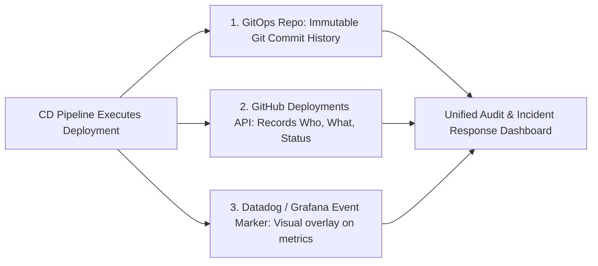

## Fast Revision (10-Second Recall)
- **The Gold Standard for Deployment History: GitOps as the Single Source of Truth.**
- Every production deployment is represented as a **Git commit** in an infrastructure/manifest repository.
- **The 4 Critical Metadata Points Every Deployment Must Record:**
- 1. **What:** Exact Git commit SHA, Docker image digest (`sha256:...`), and Helm chart version.
- 2. **Who:** Developer who created PR and manager/lead who authorized production rollout.
- 3. **When:** Precise start timestamp, completion timestamp, and duration.
- 4. **Verification Status:** Automated smoke test results and post-deployment metrics.
- **Tooling:** GitOps (ArgoCD history), GitHub Deployments API, Datadog Deployment Tracking markers.

## The 30-Second Spoken Script
"Maintaining an immutable, auditable deployment history is essential for compliance frameworks like SOC 2 and ISO 27001, as well as for rapid root cause analysis during incident response.

I implement a three-tiered deployment history architecture:

Tier 1: GitOps Manifest History (The Single Source of Truth).
We manage all environment state in a dedicated GitOps repository. Every single deployment—whether automated or manual—is executed via a Git commit that updates the target image digest or Helm values. Because Git provides an immutable, cryptographically signed log (git log), we can reconstruct the exact state of any environment at any historical timestamp with 100% precision.

Tier 2: The GitHub / GitLab Deployments API.
Our CI/CD pipeline registers each deployment with the GitHub Deployments API. When a rollout begins, CI posts a 'PENDING' deployment record referencing the environment, commit SHA, and author. When canary analysis succeeds, CI updates the record to 'SUCCESS'. This provides an instant visual history of every release in GitHub.

Tier 3: Observability Overlay Markers in Datadog and Grafana.
Whenever a deployment completes, our pipeline sends an event marker to Datadog and Grafana via their API. This draws a vertical deployment line directly across our CPU, latency, and error rate dashboards. If an error spike occurs 10 minutes later, on-call engineers instantly correlate the regression with the exact release event."

## Scenario / Problem Context
During an outage or security audit, the compliance officer asks: "What exact version was running on October 14th at 3:15 PM, who approved it, which pull requests were included, and what database migrations ran?" The interviewer tests your release audit logging and GitOps provenance.

## Architectural Workflow / Sequence


## Deep-Dive Analysis & Root Causes

| RecordType | StoredData | Retention | UseCase |
| --- | --- | --- | --- |
| GitOps Commit Log | Target YAML manifests, Docker image digest, Helm values | Permanent (Git history) | Reconstructing historical cluster configurations
GitHub Deployments API | Environment name, author, commit SHA, release status | Permanent | Fast visual audit of recent releases and active versions
APM Event Markers | Timestamp, version string, release notes summary | 15 to 18 months | Instant correlation between releases and latency/error spikes |


## Practical Debugging Commands & Code
```bash
# 1. Query Kubernetes deployment rollout history:
kubectl rollout history deployment/api-gateway -n production

# 2. View exact pod revision template and image for a past revision:
kubectl rollout history deployment/api-gateway --revision=4 -n production

# 3. Send deployment marker event to Datadog via cURL:
curl -X POST "https://api.datadoghq.com/api/v1/events"   -H "DD-API-KEY: $DD_API_KEY"   -H "Content-Type: application/json"   -d '{
    "title": "Deployed api-gateway v2.4.1",
    "text": "Deployed commit sha-7f8a9b to production by Alice",
    "priority": "normal",
    "tags": ["env:production", "service:api-gateway", "version:v2.4.1"]
  }'
```

## Prevention & Senior Best Practices
- **Disallow Manual `kubectl edit` / `apply` in Production:** Enforce strict RBAC so all cluster modifications must originate from Git commits via ArgoCD.
- **Sign All Production Commits with GPG:** Ensure all release commits are cryptographically verified to guarantee provenance.
- **Track DORA Metrics:** Automate tracking of Deployment Frequency and Lead Time for Changes to measure DevOps velocity and reliability.
