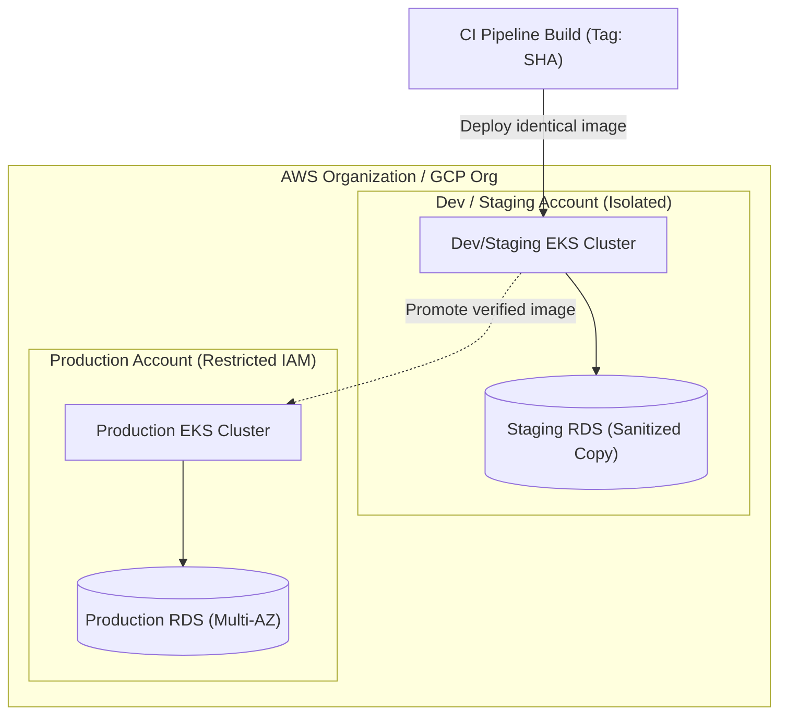

## Fast Revision (10-Second Recall)
- **Core Principles:**
- 1. **Parity (12-Factor App):** Dev, Staging, and Production must have identical architecture, operating systems, and runtime versions.
- 2. **Strict Account / VPC Isolation:** Production runs in an entirely separate AWS account / GCP project from Dev/Staging (prevents accidental production data deletion or security spillover).
- 3. **Infrastructure as Code (IaC):** All environments are defined in Terraform or Pulumi using reusable modules; environments differ only by sizing parameters (e.g. 2 nodes vs 20 nodes).
- 4. **Configuration Decoupled from Code:** Environment-specific configs injected via Kubernetes ConfigMaps, Secrets, or Vault—never hardcoded.
- 5. **Sanitized Staging Data:** Staging uses anonymized production schemas and realistic data volume to catch performance regressions.

## The 30-Second Spoken Script
"Managing development, staging, and production environments effectively requires strict environment isolation combined with structural parity driven by Infrastructure as Code.

My architectural framework:

First, Cloud Account Separation. We isolate environments into distinct AWS accounts or GCP projects managed under an organization root. Production lives in its own dedicated account with strict IAM controls and zero developer SSH access. Development and staging live in separate accounts. This guarantees that an accidental script or resource deletion in staging cannot impact production.

Second, Infrastructure as Code with Environment Parity. All infrastructure—VPCs, Kubernetes clusters, databases, and caches—is defined in Terraform using standardized modules. The staging and production environments use the exact same Terraform module; they differ only by sizing inputs (for example, staging runs a single-instance RDS db.t4g, while production runs a multi-AZ cluster with read replicas on db.r6g).

Third, Configuration and Secrets Management. Following 12-Factor App principles, code artifacts are identical across all environments. The application container image built from commit SHA 7a8b9c is promoted through Dev, Staging, and Production without rebuilding. Environment-specific settings (database URLs, feature toggles) are injected externally via Kubernetes ConfigMaps and HashiCorp Vault.

Fourth, Realistic Staging Data. Staging environments that contain 10 fake seed rows fail to uncover query performance bugs. We maintain an automated weekly pipeline that takes a production database snapshot, anonymizes PII (emails, names, tokens), and restores it to staging so staging tests reflect real production scale."

## Scenario / Problem Context
Developers complain that features tested in staging break in production due to different database sizes, missing environment variables, or different cloud permissions. The interviewer tests your environment management strategy, infrastructure as code, and data sanitization.

## Architectural Workflow / Sequence


## Deep-Dive Analysis & Root Causes

| Dimension | Strategy | Benefit |
| --- | --- | --- |
| Account Isolation | Multi-account AWS Organizations / GCP Folders | Complete blast radius containment; production credentials cannot be leaked by staging code
Infrastructure Definition | Terraform Modules with environment `.tfvars` | Guarantees infrastructure parity; staging mirrors production architecture
Artifact Immutability | Promote identical Docker Image SHA | Guarantees that what was tested in staging is 100% byte-for-byte what runs in production
Data Strategy | Anonymized production data sync | Detects index and query performance bottlenecks before release |


## Practical Debugging Commands & Code
```bash
# 1. Terraform environment deployment using workspaces or tfvars:
terraform workspace select production
terraform plan -var-file="production.tfvars"

# 2. Check current active Kubernetes context (prevent deploying to wrong cluster!):
kubectl config current-context

# 3. Safe environment switching with kubectx / kubens:
kubectx prod-us-east-1
kubens api-production
```

## Prevention & Senior Best Practices
- **Never Use Staging Credentials in Production or Vice-Versa:** Strictly enforce separate IAM roles and KMS keys per environment.
- **Use Visual CLI Prompts (kube-ps1):** Ensure all engineers have shell prompts that display the active Kubernetes cluster and namespace in bright red for production to prevent accidental CLI commands.
- **Ephemeral PR Environments:** Use tools like vcluster or Preview Environments to give every pull request an isolated, clean test environment.
