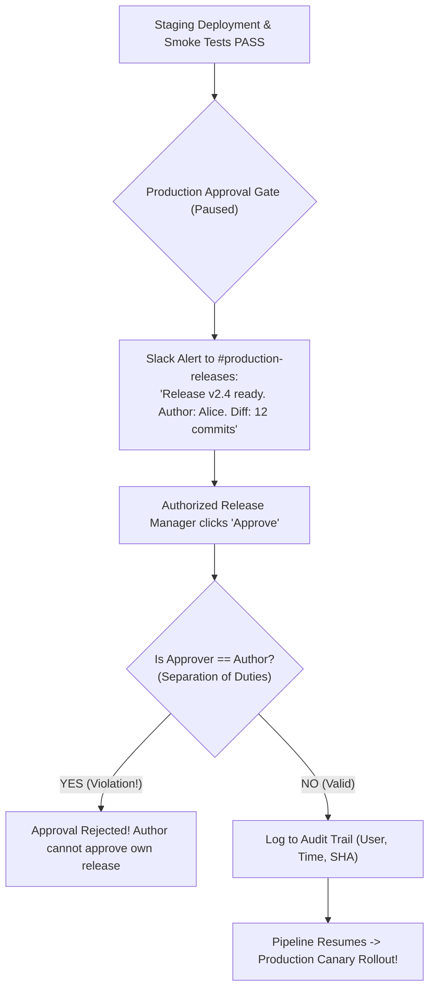

## Fast Revision (10-Second Recall)
- **The Regulatory Requirement (SOC2 / SOX):** Separation of Duties (the author of code cannot be the sole approver of the production release).
- **Implementation Mechanisms:**
- 1. **GitHub / GitLab Protected Environments:** Define a "production" environment with required reviewers (Release Managers, Lead SREs).
- 2. **ChatOps Approval (Slack / Teams):** Bot posts release summary (commit diff, author, Jira tickets) $\rightarrow$ authorized leads click "Approve" $\rightarrow$ triggers webhook to resume CD pipeline.
- 3. **Jira / ServiceNow Change Advisory Board (CAB) Integration:** CD queries change ticket status; deploys only if CAB ticket is in "Approved" state.
- 4. **Full Audit Logging:** Record who requested, who approved, exact timestamp, and Git commit SHA.

## The 30-Second Spoken Script
"Implementing an approval gate before production deployment requires balancing regulatory compliance—such as SOC 2 separation of duties—with developer velocity and clear auditability.

Here is my implementation approach:

First, Environment Protection Rules in the CD System.
In GitHub Actions or GitLab CI, we define an environment named 'production'. We configure required reviewers, designating specific roles—such as the Engineering Lead, Release Manager, or on-call SRE team. When the pipeline finishes deploying to staging and passes all automated smoke tests, it pauses at the production stage, entering a 'Waiting for Approval' state.

Second, ChatOps Notification and Contextual Metadata.
To ensure approvers don't have to manually log into GitHub, an automated notification fires to our #production-releases Slack channel. The message includes full deployment context: the Git commit hash, author, a link to the Jira epic, the list of included pull requests, and the green staging test results.

Third, Enforcing Separation of Duties.
To comply with SOC 2 standards, we enforce the rule that the author of the pull request cannot approve their own production release. A different authorized engineer must review the diff and grant approval.

Fourth, Automated Webhook Resumption.
Once an authorized approver clicks 'Approve' in Slack or GitHub, the cryptographic approval event is recorded in our audit log, and the CD pipeline automatically resumes, initiating the progressive production rollout."

## Scenario / Problem Context
Financial regulations (SOX, SOC2) and enterprise governance mandate that no engineer can push code directly to production without documented managerial approval and separation of duties. The interviewer tests your release gating, compliance mechanisms, and CD automation.

## Architectural Workflow / Sequence


## Deep-Dive Analysis & Root Causes

| Feature | HowItWorks | ComplianceValue |
| --- | --- | --- |
| GitHub Environments | Built-in protection rules; pauses pipeline until designated team member approves | Native audit log stored in GitHub Security logs
ChatOps Bot (Slack/Teams) | Interactive message cards with one-click approval buttons | Eliminates release latency; managers approve from mobile
Change Management (ServiceNow/Jira) | Pipeline calls REST API to verify approved Change Request (CR) number | Mandatory for strict banking and healthcare compliance |


## Practical Debugging Commands & Code
```bash
# 1. GitHub Actions environment configuration in YAML:
# jobs:
#   deploy-production:
#     environment:
#       name: production
#       url: https://api.example.com
#     runs-on: ubuntu-latest
#     steps:
#       - run: ./deploy.sh

# 2. Check pending environment approvals via GitHub CLI:
gh api repos/org/repo/actions/runs/12345/pending_deployments
```

## Prevention & Senior Best Practices
- **Enforce Automated Separation of Duties:** Configure CI platforms to strictly prohibit code authors from self-approving their own production environment deployments.
- **Set Approval Expiration Windows:** Set pending approvals to expire after 2 hours so an old, stale release is not approved days later without re-testing.
- **Maintain Immutable Audit Records:** Store approval logs and Git commit SHAs in append-only storage for compliance audits.
