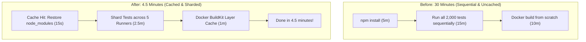

## Fast Revision (10-Second Recall)
- **The Goal:** Slash CI runtime from 30 minutes to &lt; 5 minutes.
- **The Top 5 CI Optimization Levers:**
- 1. **Profile the Pipeline:** Measure time spent per stage (Identify the bottleneck: is it `npm install`, tests, or Docker build?).
- 2. **Aggressive Dependency Caching:** Cache `node_modules`, `~/.m2`, or `~/.cache/pip` keyed on package lockfiles (saves 4-6 minutes).
- 3. **Docker Multi-Stage & BuildKit Caching:** Order Dockerfile instructions from least-frequently changed to most-frequently changed; use `--cache-from` and GitHub Actions cache backend (saves 8-10 minutes).
- 4. **Test Parallelization / Sharding:** Split unit and integration tests across 4 to 8 parallel runner VMs (saves 10-15 minutes).
- 5. **Selective Affected Execution:** Run tests only on files modified in the pull request (Nx, Turborepo).

## The 30-Second Spoken Script
"Reducing a 30-minute CI/CD pipeline down to under 5 minutes requires a data-driven profiling approach followed by aggressive caching, test sharding, and Docker layer optimization.

My optimization strategy:

Step 1: Profile the pipeline stages.
I inspect the step execution breakdown in GitHub Actions. Typically, the 30 minutes breaks down into: 5 minutes downloading dependencies, 15 minutes running tests sequentially, and 10 minutes building un-cached Docker images.

Step 2: Optimize Dependency Installation.
Instead of running a fresh npm install or pip install on every run, we use actions/cache keyed against the lockfile hash. When the lockfile hasn't changed, dependencies restore from cache in 15 seconds instead of 5 minutes.

Step 3: Parallelize the Test Suite.
The 15-minute test suite is the single largest bottleneck. We shard the test execution across 5 parallel runner containers using a matrix strategy. Each runner processes a fraction of the test files concurrently, bringing test execution down to under 3 minutes.

Step 4: Docker BuildKit Layer Caching.
We refactor the Dockerfile to optimize layer caching. We copy package.json and install dependencies in an early layer, copying application source code only in the final layer. We enable BuildKit with GitHub Actions cache backend (cache-from=type=gha). Since dependencies rarely change between commits, the Docker build skips the install layer and completes in 45 seconds.

Step 5: Incremental Affected Execution.
Using tools like Turborepo or Nx, we run tests only on the code packages touched by the Git diff relative to the main branch.

Together, these changes consistently reduce pipeline duration from 30 minutes to under 5 minutes."

## Scenario / Problem Context
Developers are blocked waiting 30 minutes for CI to finish on every pull request. Team velocity has plummeted, and developers merge large, risky batches to avoid waiting. Leadership tasks you with reducing pipeline runtime to under 5 minutes. The interviewer tests your CI profiling and optimization toolkit.

## Architectural Workflow / Sequence


## Deep-Dive Analysis & Root Causes

| Bottleneck | Solution | Result |
| --- | --- | --- |
| Dependency Installation (5 mins) | `actions/cache` using `package-lock.json` hash | Reduced to 15 seconds on cache hit
Sequential Unit Tests (15 mins) | Matrix sharding across 4 to 8 parallel runners (`--shard=1/4`) | Reduced to 2.5 minutes
Full Docker Build (10 mins) | Docker BuildKit + GitHub Actions remote cache (`type=gha`) | Reduced to 45 seconds
Testing Unchanged Modules | Nx / Turborepo affected graph analysis | Completely skips tests for unaffected modules |


## Practical Debugging Commands & Code
```bash
# 1. GitHub Actions BuildKit remote cache snippet:
# - name: Build and push Docker image with GitHub cache
#   uses: docker/build-push-action@v5
#   with:
#     context: .
#     push: true
#     tags: ${{ steps.meta.outputs.tags }}
#     cache-from: type=gha
#     cache-to: type=gha,mode=max

# 2. Optimal Dockerfile ordering for caching:
# FROM node:20-alpine AS builder
# WORKDIR /app
# COPY package*.json ./
# RUN npm ci               <-- CACHED unless package.json changes!
# COPY . .                 <-- Only invalidates when source code changes
# RUN npm run build
```

## Prevention & Senior Best Practices
- **Set Pipeline Run Budget Alerts:** Configure pipeline alerts that notify the platform team whenever average CI runtime exceeds 8 minutes.
- **Use Self-Hosted or Larger Runners:** For heavy workloads, use 8-vCPU or 16-vCPU runners (e.g. AWS c6i instances) rather than default underpowered 2-vCPU VMs.
- **Order Dockerfile Instructions by Change Frequency:** Place heavy, infrequently modified dependencies at the top and fast-changing application code at the bottom.
