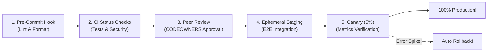

## Fast Revision (10-Second Recall)
- **The Swiss Cheese Model (Defense in Depth):** No single gate catches 100% of bugs; multiple overlapping layers ensure defects are stopped.
- **The 5 Gates from Left to Right (Shift-Left):**
- 1. **Local Developer Machine:** Pre-commit hooks (Husky, lint-staged) catch formatting and lint errors before commit.
- 2. **Pull Request CI Gates:** Protected branches enforce required status checks (tests pass, coverage > 80%, zero critical CVEs, peer approvals).
- 3. **Staging End-to-End Tests:** Automated Playwright/Cypress UI and API integration tests run against ephemeral staging environments.
- 4. **Canary Deployment with Automated Analysis:** Roll out to 5% of users; Prometheus monitors error rates and latency.
- 5. **Automated Circuit Breaker Rollbacks:** Automatic rollback if 5xx errors breach 0.5% in canary.

## The 30-Second Spoken Script
"To prevent broken code from reaching production, I implement a defense-in-depth strategy following the 'Shift-Left' philosophy—catching errors as close to the developer's workstation as possible, where they are cheapest to fix.

I structure quality gates into five sequential layers:

Layer 1: Developer Workstation.
We use pre-commit hooks via Husky and lint-staged to run local linting, formatting, and static typing before a commit is even created, preventing low-level syntax bugs from entering Git.

Layer 2: Git Branch Protection and CI Status Checks.
Direct commits to main are blocked. Merging a pull request requires:
1. All automated unit and integration tests passing with 100% success.
2. Code coverage maintaining our 80% baseline.
3. Zero High or Critical CVEs flagged by Snyk and Trivy.
4. Mandatory approval from at least one code owner (CODEOWNERS).

Layer 3: Ephemeral Staging Environments.
For major features, CI spins up an ephemeral preview environment. Automated Playwright end-to-end tests simulate complete customer workflows (such as login, checkout, and search).

Layer 4: Progressive Canary Rollout.
In production, we never deploy 100% of traffic at once. Using Argo Rollouts, we route 5% of live traffic to canary pods for 15 minutes.

Layer 5: Automated Canary Analysis and Circuit Breakers.
Our monitoring system evaluates error rates, p99 latency, and log exceptions against the stable baseline. If the canary error rate exceeds 0.5%, the deployment automatically aborts and rolls back without human intervention."

## Scenario / Problem Context
Recent releases suffered from syntax regressions, security vulnerabilities, and broken user journeys. Leadership demands a comprehensive defense-in-depth strategy to prevent defective code from reaching production. The interviewer tests your quality gating and Shift-Left architecture.

## Architectural Workflow / Sequence


## Deep-Dive Analysis & Root Causes

| DefenseLayer | Tools | DefectCaught |
| --- | --- | --- |
| 1. Local Pre-commit | Husky, lint-staged, Prettier | Syntax errors, formatting discrepancies, unformatted imports
2. Pull Request CI | GitHub Actions, Jest, Trivy, SonarQube | Broken business logic, regressions, security vulnerabilities, secret leaks
3. Peer Review | GitHub CODEOWNERS, PR Templates | Architectural anti-patterns, missing edge cases, business logic misunderstandings
4. Staging Synthetics | Playwright, Cypress, Newman | Cross-service contract mismatches, broken multi-page browser flows
5. Canary Analysis | Argo Rollouts, Prometheus, Datadog | Scale-dependent bugs, high latency under load, unhandled runtime crashes |


## Practical Debugging Commands & Code
```bash
# 1. GitHub Branch Protection API rule (enforcing required checks):
# curl -X PUT https://api.github.com/repos/org/repo/branches/main/protection/required_status_checks \
#   -H "Authorization: token $GITHUB_TOKEN" \
#   -d '{"strict":true,"contexts":["test","security-scan","coverage"]}'

# 2. Package.json pre-commit hook with Husky:
# "lint-staged": {
#   "*.{js,ts}": ["eslint --fix", "prettier --write"]
# }

# 3. Check Trivy security scanner exit code in CI:
trivy fs --exit-code 1 --severity CRITICAL,HIGH .
```

## Prevention & Senior Best Practices
- **Enforce Strict GitHub Branch Protection:** Make status checks mandatory; ensure PRs cannot be merged if any check fails, even by administrators.
- **Require Approvals via `CODEOWNERS`:** Automatically assign domain experts based on modified file paths (e.g. database schema changes require DBA review).
- **Implement Automated Canary Analysis:** Never rely on manual human observation to verify canary health; automate scoring with Prometheus.
