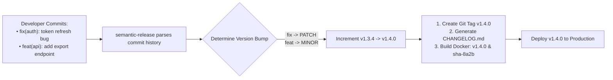

## Fast Revision (10-Second Recall)
- **Semantic Versioning Specification (SemVer - `MAJOR.MINOR.PATCH`):**
- - **MAJOR:** Breaking API changes (e.g. `2.0.0` drops a field).
- - **MINOR:** New backward-compatible features (e.g. `1.1.0` adds optional query param).
- - **PATCH:** Backward-compatible bug fixes (e.g. `1.0.1` fixes null check).
- **The Industry Standard: Conventional Commits + Semantic Release:**
- - `feat: add google login` $\rightarrow$ triggers MINOR bump.
- - `fix: prevent double debit` $\rightarrow$ triggers PATCH bump.
- - `feat!: remove legacy v1 auth` (or `BREAKING CHANGE:`) $\rightarrow$ triggers MAJOR bump.
- **Automated Artifact Tagging:** Docker images tagged with `v1.2.3` and git commit SHA `sha-7a8b9c`.

## The 30-Second Spoken Script
"Handling deployment versioning cleanly requires adopting Semantic Versioning (SemVer) automated through Conventional Commits and automated release tooling.

Here is the system I enforce:

First, Semantic Versioning (MAJOR.MINOR.PATCH).
We adhere strictly to SemVer:
PATCH versions increment for backward-compatible bug fixes.
MINOR versions increment for new, backward-compatible features.
MAJOR versions increment when introducing breaking API changes or contract modifications.

Second, Conventional Commits.
Developers format their commit messages according to the Conventional Commits specification. For example:
'fix: resolve memory leak in stream consumer' automatically signals a patch.
'feat: implement apple pay checkout' signals a minor feature.
'feat!: redesign public user endpoint' signals a breaking major change.

Third, Automated Release Pipeline with semantic-release.
When a pull request merges to main, the CI pipeline runs semantic-release. The tool analyzes all commit messages since the previous Git tag, determines the next version number automatically, creates a signed Git tag, generates a categorized markdown CHANGELOG.md, and publishes a GitHub Release.

Fourth, Docker Image Tagging Strategy.
Every built Docker container receives two immutable tags: the SemVer tag (v2.4.1) and the short Git commit SHA (sha-4f8a2b). We strictly ban the use of the mutable 'latest' tag in production manifests to guarantee absolute reproducibility during rollbacks."

## Scenario / Problem Context
Releases are labeled arbitrarily (e.g. "prod-new", "build-latest", or random timestamps), making it impossible to know which features or bug fixes are live in production. The interviewer assesses your release engineering discipline and automated versioning practices.

## Architectural Workflow / Sequence


## Deep-Dive Analysis & Root Causes

| CommitPrefix | SemVerImpact | Meaning |
| --- | --- | --- |
| `fix:` | PATCH (e.g. `1.0.0` $\rightarrow$ `1.0.1`) | Backward-compatible bug fix
`feat:` | MINOR (e.g. `1.0.1` $\rightarrow$ `1.1.0`) | New backward-compatible feature
`feat!:` or `BREAKING CHANGE:` | MAJOR (e.g. `1.1.0` $\rightarrow$ `2.0.0`) | Breaking API or schema modification
`chore:` / `docs:` / `refactor:` | No release triggered | Internal maintenance without user-facing impact |


## Practical Debugging Commands & Code
```bash
# 1. Run semantic-release in CI:
npx semantic-release

# 2. View latest release tags and commit details in Git:
git tag -l -n9 "v*" --sort=-v:refname | head -n 5

# 3. Commit message linter (commitlint) in pre-commit hook:
# echo "feat(checkout): add paypal support" | npx commitlint
```

## Prevention & Senior Best Practices
- **Automate Versioning Completely:** Never allow engineers to manually edit `package.json` version strings. Let CI determine version bumps from commit messages.
- **Ban the `latest` Docker Tag in Production:** Mandate that Kubernetes deployment manifests only accept explicit SemVer or commit SHA tags.
- **Enforce `commitlint` via Pre-Commit Hooks:** Reject improperly formatted commit messages locally before developers open pull requests.
