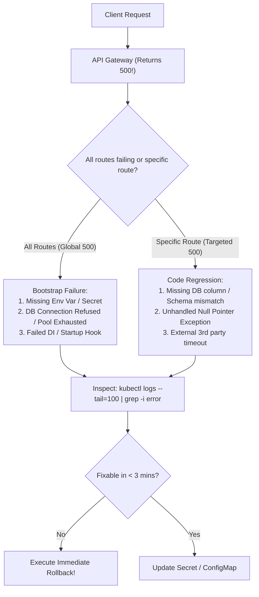

## Fast Revision (10-Second Recall)
- **The Nature of HTTP 500:** 500 Internal Server Error indicates an unhandled server-side exception or crashed upstream dependency—it is never a client mistake.
- **Top 4 Root Causes After Deployment:**
- 1. **Missing or Mismatched Environment Variables / Secrets:** A newly required env var (e.g., `PAYMENT_API_KEY`) was not injected into production ConfigMaps/Vault.
- 2. **Database Migration Desynchronization:** The new code references a column or table that hasn't been migrated or cannot be accessed.
- 3. **Database Connection Pool Starvation:** New pods exhausted connection limits or credentials failed authentication.
- 4. **Runtime Initialization Crash:** Unhandled exception in bootstrap lifecycle (e.g., failed DNS lookup to external microservice during app startup).
- **Immediate Investigation Step:** Tail live container logs filtering for fatal stack traces: `kubectl logs -l app=my-service --tail=50 -f`.

## The 30-Second Spoken Script
"When an API begins throwing HTTP 500 errors immediately post-deployment, I execute a structured 4-step triage from external proxy to internal stack traces:

Step 1: Scope the blast radius. Is HTTP 500 returning for all endpoints, or only specific routes? If all endpoints return 500 including the health check, the application failed during bootstrap or connection initialization. If only specific routes fail, the issue is isolated to a specific controller, database query, or external service call.

Step 2: Inspect application logs directly. I filter our centralized logging—like Datadog, ELK, or CloudWatch—for log level ERROR and FATAL occurring in the last 10 minutes. In Kubernetes, I run kubectl logs -l app=api --tail=100 looking for unhandled runtime exceptions. 90% of post-deployment 500s reveal an exact stack trace—such as a missing environment variable throwing a NullPointerException or a database column not found error.

Step 3: Check configuration and secrets. I inspect the environment variables and secrets injected into the running pod using kubectl describe pod or env commands, comparing them against the release notes to confirm that newly added variables were properly updated in production.

Step 4: Check database and dependency health. I verify whether the new code ran a required schema migration and verify that database credentials and connection pools are healthy.

If the root cause cannot be fixed within 3 minutes via a configuration toggle, I trigger an immediate rollback to restore customer traffic while we fix the bug in staging."

## Scenario / Problem Context
The deployment pipeline finished without compile errors, but the API gateway returns 500 Internal Server Error for every incoming client request. The interviewer evaluates your systematic troubleshooting steps from edge proxy down to application code.

## Architectural Workflow / Sequence


## Deep-Dive Analysis & Root Causes

| Symptom | RootCause | Verification |
| --- | --- | --- |
| Immediate global 500 on all routes | Database connection failed or missing critical environment variable | `kubectl logs` shows `ConnectionRefused` or `KeyError / undefined env`
500 on specific POST / GET routes | Database schema mismatch or unhandled NPE in business logic | Stack trace points to missing SQL column or null pointer dereference
500 accompanied by high response times (> 30s) | Downstream dependency timeout or connection pool deadlock | APM trace shows external HTTP call or DB checkout timing out
Gateway 500 / 502 with no application logs | Container crashed before processing HTTP request (OOMKilled or Segfault) | `kubectl describe pod` shows `OOMKilled` or `CrashLoopBackOff` |


## Practical Debugging Commands & Code
```bash
# 1. Stream real-time errors from all pods in deployment:
kubectl logs -l app=api-service -n production --tail=100 -f | grep -iE "error|exception|fatal"

# 2. Verify environment variables inside the running container:
kubectl exec -it deployment/api-service -n production -- env | grep -E "DATABASE_URL|API_KEY|REDIS"

# 3. Probe the internal health endpoint directly inside cluster:
kubectl exec -it deployment/api-service -n production -- curl -I http://localhost:8080/health

# 4. Check APM trace error rates via Datadog / OpenTelemetry CLI:
curl -s http://localhost:8080/actuator/health
```

## Prevention & Senior Best Practices
- **Validate Environment Variables on Startup:** Use validation libraries like Zod or Joi to enforce schema validation on all required `process.env` keys during application startup; fail fast if missing.
- **Synthetics in CD Pipeline:** Have the deployment pipeline execute automated HTTP integration tests against canary pods before directing production traffic.
- **Global Exception Handlers:** Ensure all microservices implement global exception middleware that logs structured JSON error details with correlation IDs.
