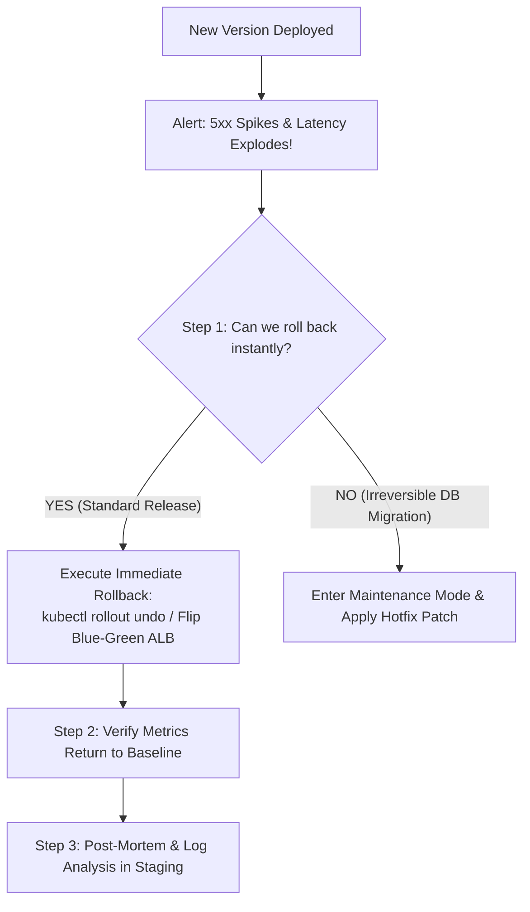

## Fast Revision (10-Second Recall)
- **Golden Rule of Production Outages:** Prioritize restoring customer service immediately (MTTR) over diagnosing the root cause. Roll back first, investigate in staging later!
- **The 5-Step Incident Response Protocol:**
- 1. **Assess Blast Radius & Acknowledge:** Verify error rates on Datadog/Grafana; declare a P1 incident and post in #incident-response.
- 2. **Trigger Instant Rollback:** Execute `kubectl rollout undo` or flip load balancer traffic back to the previous stable release artifact.
- 3. **Verify Restoration:** Confirm p99 latency, error rates, and canary health checks return to baseline.
- 4. **Isolate Artifact & Logs:** Pull failed container logs (`kubectl logs --previous`), thread dumps, and diff commit hashes.
- 5. **Post-Incident Review (Blameless RCA):** Conduct RCA, determine why CI/staging missed the regression, and add automated regression gates.

## The 30-Second Spoken Script
"If an application stops working immediately after deployment, my top priority is minimizing Mean Time to Recovery (MTTR) for our customers. I never attempt to debug live in production while users are suffering an outage.

My immediate response protocol:
First, I verify the blast radius in our APM dashboards—such as Datadog or Grafana—confirming that error rates spiked precisely at the deployment timestamp. I immediately declare a Sev-1 incident, post an incident acknowledgment in Slack, and notify stakeholders.

Second, I initiate an immediate rollback. In Kubernetes, this means running kubectl rollout undo deployment/api-service, or in AWS flipping our Route53 weighted routing or ALB back to the previous Blue environment. Rolling back restores service within 60 to 90 seconds.

Third, once health metrics and error rates return to normal, I verify customer functionality using automated synthetic smoke tests.

Fourth, only after production is stable do I investigate the root cause. I inspect the failed container logs using kubectl logs --previous, review the Git diff between the two deployment tags, and reproduce the failure in an isolated staging environment.

Finally, we conduct a blameless post-mortem to identify why our staging environment and automated CI testing pipeline failed to catch the issue before it reached production."

## Scenario / Problem Context
Immediately after a deployment pipeline triggers a "Deployment Successful" green checkmark, alerts begin firing and customer tickets flood in. The interviewer tests your production incident response playbook, composure under pressure, and decision criteria for rollbacks vs hotfixes.

## Architectural Workflow / Sequence


## Deep-Dive Analysis & Root Causes

| Action | Rationale | AntiPattern |
| --- | --- | --- |
| 1. Roll Back First | Customer availability is the primary metric | Attempting to debug live in production with SSH or ad-hoc patches while users are failing
2. Check Ingress / ALB Routing | Rules or target groups may point to dead pods | Assuming the code crashed when the load balancer configuration was malformed
3. Inspect Container Exit Codes | Exit 137 (OOMKilled) vs Exit 1 (Unhandled Exception) | Re-running the deployment blindly without reading crash logs
4. Blameless Post-Mortem | Convert failure into automated regression tests | Assigning individual blame rather than fixing pipeline verification gaps |


## Practical Debugging Commands & Code
```bash
# 1. Instant rollback in Kubernetes:
kubectl rollout undo deployment/api-gateway -n production

# 2. Check rollout history and revisions:
kubectl rollout history deployment/api-gateway -n production

# 3. Inspect logs of the crashed container:
kubectl logs -l app=api-gateway -n production --previous --tail=100

# 4. Check pod termination reasons and exit codes:
kubectl get pods -l app=api-gateway -n production -o jsonpath='{range .items[*]}{.metadata.name}{"	"}{.status.containerStatuses[*].lastState.terminated.reason}{"	Exit:"}{.status.containerStatuses[*].lastState.terminated.exitCode}{"
"}{end}'
```

## Prevention & Senior Best Practices
- **Implement Automated Canary Analysis (ACA):** Use Argo Rollouts or Flagger to deploy to 5% of traffic, measuring error rates for 5 minutes before progressing.
- **Enforce Automated Rollback Triggers:** If HTTP 5xx errors exceed 1% over 2 consecutive minutes during a deployment, abort and rollback automatically without human intervention.
- **Decouple Code Deployments from Database Migrations:** Ensure all database changes are 100% backward-compatible using the Expand/Contract pattern.
