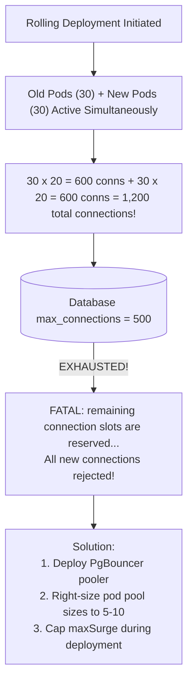

## Fast Revision (10-Second Recall)
- **Top 4 Reasons DB Connections Fail After Deployment:**
- 1. **Connection Pool Multiplier Effect:** Rolling update doubled pod count (e.g. 20 old pods + 20 new pods = 40 pods). Each pod allocated 20 connections = 800 connections, exceeding database `max_connections = 500`!
- 2. **Missing or Expired SSL/TLS Certificates:** New Docker base image lacks updated CA root certificates (`ca-certificates`), causing SSL handshake to reject RDS/PostgreSQL.
- 3. **VPC Subnet & Security Group Drift:** New deployment placed pods in a new private subnet lacking Security Group ingress to the database.
- 4. **Malformed Connection String in Secrets:** Production secret was updated with an unescaped special character in password (e.g. `#` or `@` breaking URI parser).

## The 30-Second Spoken Script
"When database connections fail immediately after a deployment, I investigate across three distinct layers: credentials and URI parsing, network topology, and connection pool scaling.

First, I inspect the application error message.
If the error is 'password authentication failed', it points to a bad secret update or an unescaped special character in the database connection string.
If the error is 'connection timed out', it is a network or firewall issue. In Kubernetes or cloud deployments, new worker nodes or newly provisioned subnets may lack the Security Group rules required to reach the database port 5432.
If the error is 'SSL handshake failed', it means the new container image is missing the ca-certificates package or the database CA certificate has rotated.

Second, I check connection pool exhaustion caused by the deployment itself. During a rolling deployment, Kubernetes runs old pods and new pods simultaneously. If you have 30 existing pods each with a pool size of 20, that is 600 connections. During a rolling update, 30 new pods boot up, requesting another 600 connections. This instantly exhausts the database's max_connections limit, causing incoming connections to be refused.

To resolve this immediately:
If it's pool exhaustion, I scale down old pods or introduce PgBouncer in transaction pooling mode.
If it's a security group issue, I add the new subnet to the database ingress rules.
If it's a credentials error, I correct the secret in Vault or Kubernetes and trigger a rolling restart."

## Scenario / Problem Context
The new version goes live, and immediately logs fill with `ConnectionRefused`, `FATAL: too many connections`, or `SSL connection has been closed unexpectedly`. The database was working fine minutes before the release. The interviewer evaluates your ability to diagnose database network boundaries and connection pooling.

## Architectural Workflow / Sequence


## Deep-Dive Analysis & Root Causes

| ErrorPattern | RootCause | Resolution |
| --- | --- | --- |
| `FATAL: too many connections` | Rolling deployment surge doubled active connection demand | Cap `maxSurge: 25%` in deployment spec; deploy PgBouncer
`Connection timed out` | Security Group or Network ACL blocks pod subnet from DB port 5432 | Verify Security Group ingress rules in AWS/GCP
`self signed certificate in certificate chain` | New container image missing `ca-certificates` or AWS global bundle | Add `RUN apt-get update && apt-get install -y ca-certificates` to Dockerfile
`URI malformed` or `auth failed` | Password contains unencoded special characters like `@`, `:`, or `#` | URL-encode database credentials in connection string (`encodeURIComponent`) |


## Practical Debugging Commands & Code
```bash
# 1. Check current connection counts on PostgreSQL:
SELECT count(*), max_val, count(*) * 100 / max_val AS pct_used
FROM pg_stat_activity, (SELECT setting::int AS max_val FROM pg_settings WHERE name = 'max_connections') s
WHERE state != 'idle'
GROUP BY max_val;

# 2. Test raw TCP connectivity from inside application pod:
kubectl exec -it <pod-name> -n production -- nc -zv <db-hostname> 5432

# 3. Test database login using psql from inside cluster:
kubectl exec -it <pod-name> -n production -- psql "$DATABASE_URL" -c "SELECT 1;"

# 4. Sane rolling update settings in deployment.yaml to avoid pool explosion:
# strategy:
#   rollingUpdate:
#     maxSurge: 20%
#     maxUnavailable: 20%
```

## Prevention & Senior Best Practices
- **Deploy PgBouncer Ahead of Production:** Decouple application pod scaling from physical database connections using transaction pooling.
- **Right-Size Application Pool Sizes:** Set connection pools to 5 to 10 per pod, not 50. Let PgBouncer handle concurrency.
- **Include `ca-certificates` in All Docker Images:** Ensure base minimal images (`alpine`, `distroless`) install and update trusted CA certificates.
