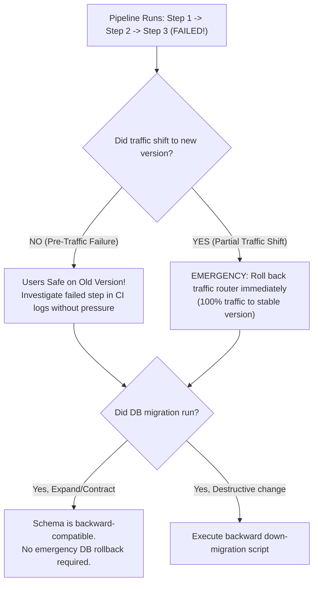

## Fast Revision (10-Second Recall)
- **The Core Danger:** Inconsistent system state (e.g. backend expects new API, frontend runs old code, database migrated halfway).
- **Immediate Actions:**
- 1. **Do NOT blindly click "Retry":** Blind retries without investigating why step 3 failed can double-execute un-idempotent scripts or corrupt state.
- 2. **Determine Failure Point:** Check the pipeline step: Was it Build, Test, DB Migration, Blue-Green switch, or Post-Deploy smoke test?
- 3. **Evaluate Idempotency:** Can the failed step be safely re-run (`terraform apply`, idempotent SQL)?
- 4. **Decide: Rollback or Roll-Forward:** If state is corrupted, roll back to previous known-good deployment artifact. If step failed due to a transient network timeout during cache purge, manually run the remaining steps.
- **Architectural Golden Rule:** Every step in a deployment pipeline MUST be idempotent.

## The 30-Second Spoken Script
"When a deployment pipeline fails halfway through, the primary risk is leaving the production environment in a fractured, inconsistent state where some services run new code and others run old code.

My response protocol:

First, freeze and analyze. I never blindly press the 'Retry' button in GitHub Actions or Jenkins. Doing so on a non-idempotent script—such as a database data backfill—can cause duplicate data or secondary crashes. I inspect the pipeline logs to pinpoint the exact failed step and error code.

Second, assess production stability and current traffic routing. Did the pipeline fail before or after traffic was shifted to the new version? If it failed before traffic shifting—such as during container image pulling or automated canary testing—production users are completely unaffected because traffic remains on the stable previous version. If it failed after a partial traffic shift, I immediately trigger a manual rollback to route 100% of traffic back to the previous stable release.

Third, evaluate database migration impact. If a database migration executed before the pipeline failed, did it introduce breaking changes? Because we enforce the Expand/Contract migration pattern, the database schema remains 100% backward-compatible with both the old and new code, meaning the old version continues running safely.

Fourth, remediate and resume. If the failure was transient—such as a Docker registry rate limit or network glitch during CDN invalidation—we fix the transient blocker and re-run the pipeline cleanly from a verified state."

## Scenario / Problem Context
The CD pipeline was deploying step 3 of 5 (e.g. database migration succeeded, backend deployed, but frontend or cache invalidation failed). The pipeline halted in a red ERROR state. The interviewer tests your ability to recover from interrupted deployments without causing split-brain states.

## Architectural Workflow / Sequence


## Deep-Dive Analysis & Root Causes

| Scenario | UserImpact | CorrectAction |
| --- | --- | --- |
| Failure during Canary / Smoke Testing | Minimal (Canary received 5% traffic) | Abort canary and route 100% back to stable baseline
Failure during Database Migration Step | None (Application not deployed yet) | Inspect migration lock; fix SQL script; ensure transaction rolled back automatically
Failure during Post-Deploy CDN Cache Invalidation | Users see stale UI assets | Manually trigger CDN invalidation via AWS CLI / Cloudflare dashboard
Failure during Multi-Service Deploy (Service A ok, B failed) | API protocol mismatch between services | Roll back Service A unless strict backward API compatibility is preserved |


## Practical Debugging Commands & Code
```bash
# 1. Check status of current Kubernetes deployment rollout:
kubectl rollout status deployment/web-app -n production

# 2. Cancel and undo an in-flight hung rollout:
kubectl rollout undo deployment/web-app -n production

# 3. Check for stuck database migration locks (e.g., Flyway, Prisma, Liquibase):
# SELECT * FROM flyway_schema_history WHERE success = false;
# SELECT pg_cancel_backend(pid) FROM pg_stat_activity WHERE query LIKE '%ALTER TABLE%';

# 4. Manually run remaining cache purge step via AWS CLI:
aws cloudfront create-invalidation --distribution-id EXXXXXX --paths "/*"
```

## Prevention & Senior Best Practices
- **Enforce Pipeline Idempotency:** Every pipeline script must be safe to run multiple times without unintended side effects (`CREATE TABLE IF NOT EXISTS`, `ON CONFLICT DO NOTHING`).
- **Atomic Blue-Green Switching:** Shift traffic in a single atomic load balancer router flip only AFTER all services, migrations, and health checks pass 100%.
- **Automated Pipeline Timeouts:** Set reasonable step timeouts (e.g., 10 minutes) so a stuck process does not lock pipeline runners indefinitely.
