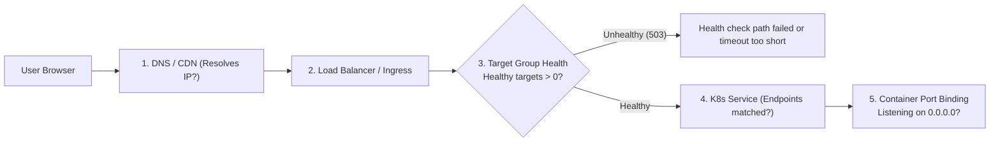

## Fast Revision (10-Second Recall)
- **The Golden Distinction:** The deployment succeeded **internally** (containers are running), but the **traffic routing layer** cannot reach them.
- **Top 4 Networking Chokepoints:**
- 1. **Load Balancer Target Health Check Failure:** ALB/Nginx marks all new pods unhealthy (e.g. health check path is `/healthz` but app expects `/health`) $\rightarrow$ 0 healthy targets $\rightarrow$ HTTP 503 Service Unavailable.
- 2. **Kubernetes Service Selector Mismatch:** Pod labels changed from `app: web` to `app: frontend` $\rightarrow$ Service endpoints list is empty (`Endpoints: <none>`).
- 3. **Security Group / Firewall Ingress Blocks:** Port 80/443 closed or backend container port changed from 3000 to 8080 without updating ALB target group port.
- 4. **DNS / Ingress Controller Routing:** DNS points to wrong CNAME or Ingress TLS certificate failed to renew.

## The 30-Second Spoken Script
"When a deployment completes successfully in CI/CD but users cannot reach the service, the failure is almost always located in the routing, load balancing, or network ingress layer.

I trace the user request journey backwards from edge to container:

Step 1: Check DNS and Edge CDN. I test the public domain using dig and curl. Is the DNS record resolving to the correct CDN or Load Balancer IP? Is the SSL certificate valid? If DNS and TLS resolve, I move to the load balancer.

Step 2: Inspect Load Balancer Target Group Health. In AWS ALB or Nginx, I check target health metrics. In 70% of these incidents, the targets are marked UNHEALTHY. This happens when the application startup takes longer than the health check timeout, or the deployment changed the health check endpoint path (such as from /health to /api/health). If zero targets are healthy, the load balancer returns HTTP 503 or 502 to users.

Step 3: Check Kubernetes Service Endpoints. In Kubernetes, I run kubectl get endpoints to see if the Service is actually pointing to pod IPs. If Endpoints shows 'none', there is a selector mismatch: the deployment template labels do not match the service spec selector.

Step 4: Check Port Bindings and Security Groups. I check whether the container is listening on the correct interface. If a Node.js or Go application binds to 127.0.0.1 (localhost) instead of 0.0.0.0 (all interfaces), external traffic from the load balancer cannot reach it.

By following this outside-in network trace, I isolate whether the barrier is DNS, load balancer health checks, service selectors, or listening interfaces."

## Scenario / Problem Context
The CI/CD pipeline deployed the pods or virtual machines and reported 100% success. However, users attempting to visit the application receive connection timeouts, HTTP 502/503 Bad Gateway, or DNS lookup failures. The interviewer evaluates your end-to-end networking knowledge.

## Architectural Workflow / Sequence


## Deep-Dive Analysis & Root Causes

| Layer | FailureMechanism | Resolution |
| --- | --- | --- |
| Load Balancer Target Groups | Health check fails 3 consecutive times $\rightarrow$ Target marked unhealthy | Fix health check path, port, or response status code in ALB config
Kubernetes Service Selectors | Service selector `app: api` does not match Pod label `app: api-v2` | Align labels in `deployment.yaml` and `service.yaml`; verify `kubectl get endpoints`
Container IP Binding | App binds to `127.0.0.1` (loopback only) inside container | Configure server to bind to `0.0.0.0`
VPC Security Groups | ALB cannot reach EC2/EKS worker nodes on target container port | Allow inbound traffic from ALB Security Group on worker node ports |


## Practical Debugging Commands & Code
```bash
# 1. Check Kubernetes Service endpoints (Look for missing pod IPs):
kubectl get endpoints api-service -n production

# 2. Check AWS ALB Target Health via AWS CLI:
aws elbv2 describe-target-health --target-group-arn <TARGET_GROUP_ARN>

# 3. Test if container binds to 0.0.0.0 or 127.0.0.1:
kubectl exec -it deployment/api-service -n production -- netstat -tuln
# Look for: 0.0.0.0:8080 (CORRECT) vs 127.0.0.1:8080 (BROKEN!)

# 4. Probe the pod directly from inside another cluster pod (bypass ALB):
kubectl run test-curl --rm -it --image=curlimages/curl -- curl -Iv http://api-service.production:8080/health
```

## Prevention & Senior Best Practices
- **Always Bind to 0.0.0.0 in Containers:** Enforce `HOST=0.0.0.0` in base Docker images and environment configuration.
- **Validate Service Endpoints in CI/CD Smoke Tests:** Have the deployment pipeline assert `kubectl get endpoints` returns at least one active IP before closing the deployment step.
- **Graceful Health Check Thresholds:** Configure `initialDelaySeconds: 15` and `failureThreshold: 3` on readiness probes so slow-starting JVM/Node apps are not prematurely marked dead.
