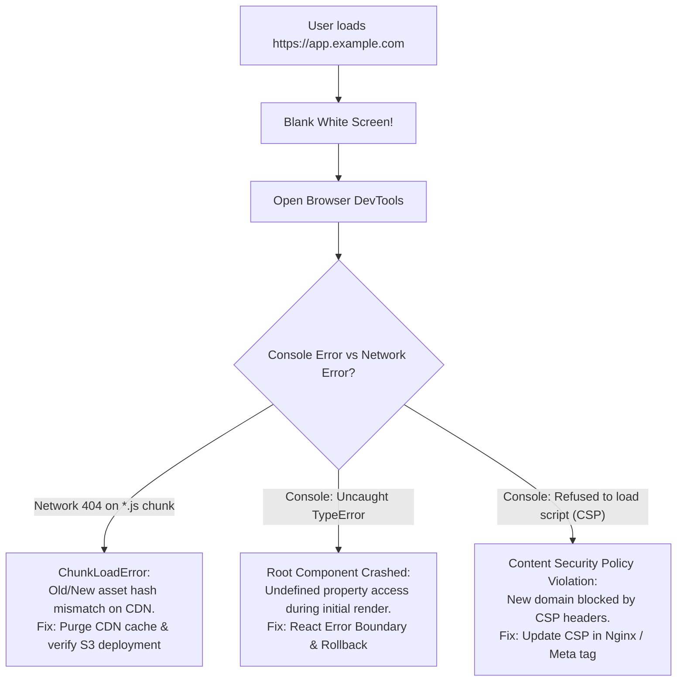

## Fast Revision (10-Second Recall)
- **Top 3 Causes of Post-Deployment Blank Pages:**
- 1. **`ChunkLoadError` (Stale Assets on CDN):** The new `index.html` references `bundle.abc123.js`, but older hashed JS files were deleted from S3/CDN or cached with conflicting headers.
- 2. **Unhandled Runtime Exception in Root Component:** Code tries to read `user.profile.name` where `profile` is undefined before initial state loads, crashing the React/Vue component tree.
- 3. **CORS / Content Security Policy (CSP) Block:** Newly added CDN domain or API endpoint blocked by strict CSP headers in `index.html`.
- **First Move in Browser DevTools:** Open Console $\rightarrow$ check for red unhandled errors; open Network tab $\rightarrow$ check for red 404s on `.js` or `.css` chunks.

## The 30-Second Spoken Script
"A blank white screen after deploying a frontend Single Page Application is almost always caused by either a JavaScript bundle loading failure or an uncaught runtime exception during the initial component render.

My systematic troubleshooting procedure:

First, open the Browser DevTools Console and Network tabs.
In the Console, I look for fatal JavaScript errors. If I see an unhandled error like 'Cannot read properties of undefined' occurring inside the root render tree, it means a breaking change was introduced in frontend code or an API payload changed unexpectedly.
In the Network tab, I check for failed asset requests. If I see 404 Not Found on JavaScript chunks—such as ChunkLoadError for dynamic imports—it indicates a cache invalidation mismatch: the CDN is serving a new index.html referencing new hashed chunks that either haven't been uploaded to S3 yet, or an aggressive CDN cache is serving an old index.html pointing to purged chunks.

Second, verify the root HTML structure and Content Security Policy. I inspect the DOM to verify that the root mounting div—such as id='root'—exists. I also check for CSP console errors blocking script execution or API calls.

Third, verify CDN and caching headers. In modern SPA architectures, index.html must ALWAYS be served with Cache-Control: no-cache, no-store, must-revalidate so browsers always fetch the latest chunk manifest, while hashed JS/CSS assets are cached with max-age=31536000, immutable.

If the issue is caused by a code bug, I roll back the deployment; if caused by missing chunks, I trigger an immediate CDN cache purge and upload the missing build artifacts."

## Scenario / Problem Context
Users report opening the web app and seeing only a blank white screen ("White Screen of Death"). The server returns HTTP 200 for index.html, but nothing renders. The interviewer evaluates your browser debugging skills, understanding of single-page application (SPA) bundling, and CDN caching.

## Architectural Workflow / Sequence


## Deep-Dive Analysis & Root Causes

| RootCause | Symptom | Fix |
| --- | --- | --- |
| `ChunkLoadError` | Console: `Loading chunk 42 failed` / Network: 404 on `app.a8f9.js` | Serve `index.html` with `no-cache`; ensure CI/CD uploads new chunks BEFORE invalidating `index.html`; retain old chunks on S3 for 24 hours
Uncaught Exception in Root Component | Console: `Uncaught TypeError: Cannot read property of undefined` | Wrap application in React/Vue Error Boundaries; rollback bad release
Content Security Policy (CSP) | Console: `Refused to execute script because it violates CSP directive` | Update `connect-src` or `script-src` headers on Cloudflare or reverse proxy
Missing Root DOM Node | Console: `Target container is not a DOM element` | Check if minification stripped `<div id="root"></div>` from template |


## Practical Debugging Commands & Code
```bash
# 1. Check response headers of index.html (Must NOT be cached indefinitely!):
curl -I https://app.example.com/index.html | grep -iE "cache-control|etag|last-modified"

# 2. Verify that modern JS chunks are accessible on CDN:
curl -I https://app.example.com/assets/main.c83a12.js

# 3. Invalidate Cloudflare / CloudFront CDN cache for index.html:
aws cloudfront create-invalidation --distribution-id E123456789 --paths "/index.html"

# 4. Correct S3 / CloudFront deployment order in CI/CD:
# Step A: Sync new hashed assets WITHOUT deleting old ones (atomic availability):
# aws s3 sync dist/assets s3://frontend-bucket/assets --cache-control "max-age=31536000,immutable"
# Step B: Sync index.html with NO CACHE:
# aws s3 cp dist/index.html s3://frontend-bucket/index.html --cache-control "no-cache,no-store,must-revalidate"
```

## Prevention & Senior Best Practices
- **Keep Historical Chunks on S3 for 48 Hours:** Never delete old `.js` bundles when uploading a new build; active browser sessions need them until page reload.
- **Implement Top-Level Error Boundaries:** Catch unhandled render exceptions in React/Vue and display a polite "Something went wrong, please refresh" card instead of a white screen.
- **Implement Auto-Reload on ChunkLoadError:** Add a window error listener that detects `ChunkLoadError` and executes `window.location.reload(true)` once automatically.
