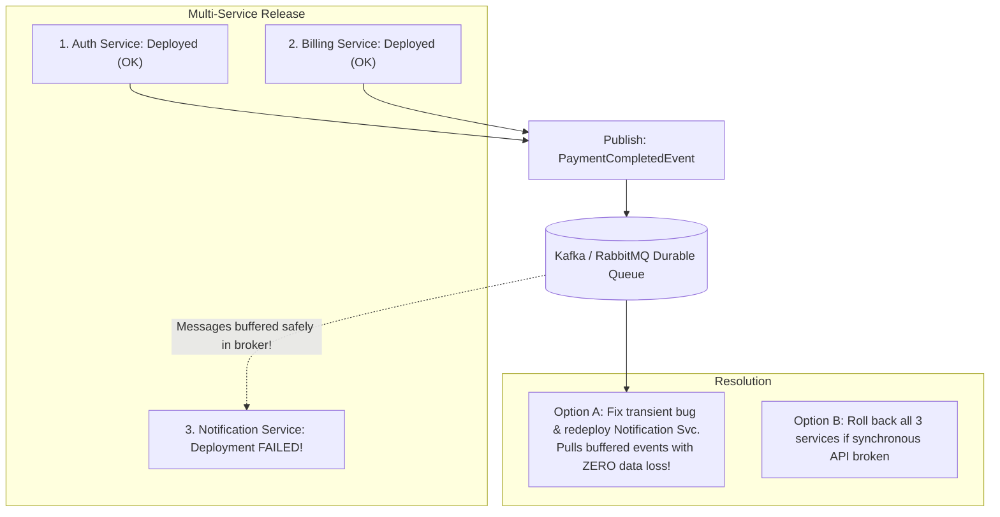

## Fast Revision (10-Second Recall)
- **The Anti-Pattern:** "Lock-Step Deployments" (requiring multiple services to deploy simultaneously at the exact same second). In distributed systems, this is a recipe for catastrophic outages.
- **The Senior Architecture Paradigm:** Independent Service Deployability.
- Every microservice MUST be deployable independently of any other service at any time.
- **How to Achieve This:**
- 1. **Strict API Contract Versioning:** New API fields must be optional; old endpoints must remain active alongside new ones (`/v1` and `/v2` or Protobuf optional fields).
- 2. **Tolerant Reader Pattern:** Services should ignore unknown JSON fields rather than crashing.
- 3. **Asynchronous Event Buffering:** If Notification Service fails, Auth and Billing publish events to Kafka/RabbitMQ. The queue buffers messages safely until Notification Service recovers.
- 4. **Circuit Breakers & Fallbacks:** Calling services handle downstream 503s gracefully without cascading failure.

## The 30-Second Spoken Script
"In a microservices architecture, requiring multiple services to deploy simultaneously in lock-step is an architectural anti-pattern. If you must deploy Service A, B, and C at the exact same minute or the system breaks, you do not have microservices—you have a distributed monolith.

If a deployment updates multiple services and one fails halfway, my operational and architectural protocol:

First, determine if the failure is breaking live customer transactions. If Auth and Billing deployed successfully but Notification failed, can the business continue operating? By designing our systems with asynchronous messaging—such as Kafka or RabbitMQ—Auth and Billing publish 'PaymentCompleted' events to a durable topic. The fact that Notification Service failed deployment does not impact billing or checkout; the messages remain safely queued in Kafka until we fix or roll back Notification Service.

Second, if the failure creates an incompatible API contract between services, we must enforce consumer-driven contract versioning. When Service A depends on new functionality in Service B, Service B must deploy its new API version first, supporting both old and new request schemas. Only after Service B is verified healthy is Service A deployed.

Third, if an incompatible change slipped through and causes user-facing errors, we immediately roll back the dependent services to their previous known-good deployment versions using our automated CD pipeline.

To prevent this permanently:
1. We enforce the Tolerant Reader pattern: services ignore unexpected fields in payloads.
2. We use Protobuf or OpenAPI contract testing in CI (such as Pact) to ensure no deployment breaks existing consumer contracts."

## Scenario / Problem Context
A feature requires simultaneous updates across 3 microservices: Auth Service, Billing Service, and Notification Service. Auth and Billing deployed successfully, but Notification Service failed to deploy. The interviewer evaluates your distributed architecture skills, backward API compatibility, and deployment coordination.

## Architectural Workflow / Sequence


## Deep-Dive Analysis & Root Causes

| Paradigm | FailureImpact | ArchitectureFix |
| --- | --- | --- |
| Synchronous REST Chaining | Catastrophic: If Notification is down, Billing fails, and Checkout crashes | Replace synchronous HTTP calls with asynchronous message queues (Kafka/SQS)
Strict API Versioning | Breaking schema changes crash consumers during partial rollouts | Support both $V1$ and $V2$ simultaneously; use Protobuf backward compatibility
Tolerant Reader Pattern | Services crash on receiving new unexpected JSON fields | Configure serializers to ignore unknown fields (`ignoreUnknownKeys = true`) |


## Practical Debugging Commands & Code
```bash
# 1. Check consumer group lag on Kafka to verify messages are buffering safely:
kafka-consumer-groups.sh --bootstrap-server localhost:9092 --describe --group notification-workers

# 2. Roll back only the failed service if independent:
kubectl rollout undo deployment/notification-service -n production

# 3. Check for contract test compatibility in CI using Pact:
# npx pact-broker can-i-deploy --pacticipant NotificationService --version 2.1.0 --to-environment production
```

## Prevention & Senior Best Practices
- **Decouple Communication with Event-Driven Architecture:** Use asynchronous message queues (Kafka, AWS SQS) for non-blocking secondary operations like notifications and analytics.
- **Enforce Contract Testing in CI:** Use tools like Pact to verify that changes to a producer service do not break any registered consumer service expectations.
- **Deploy in Dependency Order:** Always deploy downstream provider services before upstream consumer services.
