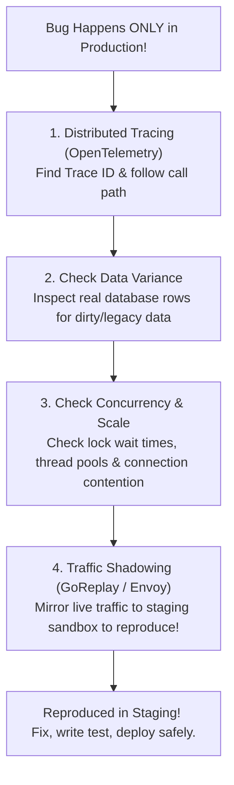

## Fast Revision (10-Second Recall)
- **Why Do Production-Only Bugs Happen?**
- 1. **Scale & Concurrency:** Race conditions, thread contention, and connection pool exhaustion that only manifest under 10,000 RPS.
- 2. **Data Shape & Edge Cases:** Production databases have dirty, un-sanitized legacy data that clean staging fixtures lack.
- 3. **Distributed Infrastructure:** Real network latency, TLS handshakes, load balancer timeouts, and CDN caching layers.
- **The 5-Step Production Investigation Toolkit:**
- 1. **Distributed Tracing (OpenTelemetry):** Trace the exact failed user request across microservices via trace and span IDs.
- 2. **Production Log Correlation:** Search by `correlation_id` across all distributed services.
- 3. **Traffic Shadowing / Replay:** Duplicate live production traffic to a staging sandbox (e.g. using Envoy or GoReplay) to reproduce without impacting users.
- 4. **Production Profiling:** Use continuous profilers (Datadog Continuous Profiler, Pyroscope, eBPF) to detect CPU hot spots or memory leaks in real time.
- 5. **Sanitized Production Data Snapshot:** Import an anonymized copy of production data into staging to test realistic edge cases.

## The 30-Second Spoken Script
"Investigating an issue that occurs exclusively in production requires a disciplined, observability-driven methodology because you cannot attach an interactive debugger to live production servers.

Production-only bugs typically fall into three categories: data variance, concurrency and scale, or infrastructure discrepancies.

Here is my 5-step investigation framework:

Step 1: Isolate the failed transactions using Distributed Tracing and Correlation IDs.
Using OpenTelemetry with Jaeger or Datadog, I find the trace of a failed transaction. A correlation ID allows me to follow a single customer's request across the API gateway, microservices, and database queries, pinpointing the exact microsecond and line of code where the failure occurred.

Step 2: Inspect production data shape differences.
Production databases contain years of legacy data, null values, and edge cases that never exist in clean staging seed scripts. I inspect the specific database rows involved in the failed trace. In many cases, an obscure edge case—such as a user with an empty string country code or a legacy date format—causes an unhandled exception.

Step 3: Analyze concurrency and race conditions under scale.
If the issue only occurs during peak hours, it is almost certainly a race condition, deadlocking, or connection pool starvation. I inspect database lock wait times (pg_stat_activity) and thread contention metrics.

Step 4: Traffic Shadowing (Dark Traffic).
To safely reproduce the issue without risking user data, I use Envoy or GoReplay to shadow a copy of live production traffic to an isolated staging environment. This replays real production payloads, concurrency, and volume against our instrumented test service.

Step 5: Dynamic Log Injection and Continuous Profiling.
If logs lack detail, I use dynamic logging tools or targeted feature flag log levels to increase log verbosity for a single affected tenant without flooding the entire cluster with debug logs."

## Scenario / Problem Context
A bug is actively affecting production users, but every attempt to reproduce it in local development and staging environments fails completely. The engineering team is stumped. The interviewer assesses your advanced production observability techniques and scientific debugging methodology.

## Architectural Workflow / Sequence


## Deep-Dive Analysis & Root Causes

| Dimension | Tool | UseCase |
| --- | --- | --- |
| Distributed Tracing | OpenTelemetry / Jaeger / Datadog APM | Identifies the exact microservice and SQL query that failed in a multi-hop call
Traffic Shadowing (Dark Traffic) | Envoy Mirroring / GoReplay | Replays live production payloads to staging with zero impact on real users
Continuous Profiling | Pyroscope / Parca / eBPF | Identifies lock contention, thread blocking, and CPU spikes in production runtimes
Dynamic Log Level Toggling | Logback JMX / Spring Actuator / Winston | Temporarily switch log level to DEBUG for a single tenant without restarting pods |


## Practical Debugging Commands & Code
```bash
# 1. Search logs across all microservices using a unique Correlation ID:
# In Grafana Loki / ELK:
# {app=~".+"} |= "trace_id=9f8a3b2c1d0e"

# 2. Dynamic log level adjustment at runtime via Spring Boot Actuator (no restart!):
curl -X POST http://localhost:8080/actuator/loggers/com.example.payments   -H "Content-Type: application/json"   -d '{"configuredLevel": "DEBUG"}'

# 3. Mirror live production HTTP traffic to staging using GoReplay:
# gorereplay --input-raw :8080 --output-http "http://staging-api:8080" --output-http-workers 1

# 4. Check for lock contention and blocked queries in PostgreSQL:
SELECT blocked_locks.pid     AS blocked_pid,
       blocking_locks.pid    AS blocking_pid,
       blocked_activity.query AS blocked_statement,
       blocking_activity.query AS current_statement_in_blocking_process
FROM  pg_catalog.pg_locks         blocked_locks
JOIN pg_catalog.pg_stat_activity blocked_activity ON blocked_activity.pid = blocked_locks.pid
JOIN pg_catalog.pg_locks         blocking_locks 
    ON blocking_locks.locktype = blocked_locks.locktype
    AND blocking_locks.database IS NOT DISTINCT FROM blocked_locks.database
    AND blocking_locks.relation IS NOT DISTINCT FROM blocked_locks.relation
    AND blocking_locks.page IS NOT DISTINCT FROM blocked_locks.page
    AND blocking_locks.tuple IS NOT DISTINCT FROM blocked_locks.tuple
    AND blocking_locks.virtualxid IS NOT DISTINCT FROM blocked_locks.virtualxid
    AND blocking_locks.transactionid IS NOT DISTINCT FROM blocked_locks.transactionid
    AND blocking_locks.classid IS NOT DISTINCT FROM blocked_locks.classid
    AND blocking_locks.objid IS NOT DISTINCT FROM blocked_locks.objid
    AND blocking_locks.objsubid IS NOT DISTINCT FROM blocked_locks.objsubid
    AND blocking_locks.pid != blocked_locks.pid
JOIN pg_catalog.pg_stat_activity blocking_activity ON blocking_activity.pid = blocking_locks.pid
WHERE NOT blocked_locks.granted;
```

## Prevention & Senior Best Practices
- **Mandate Distributed Tracing with Correlation IDs:** Every HTTP and gRPC request must carry a `X-Correlation-ID` or `traceparent` header propagated across all services and log lines.
- **Regularly Mirror Sanitized Data to Staging:** Run automated weekly pipelines that sanitize and restore production data schemas to staging so developers test against realistic data shapes.
- **Perform Load Testing with Realistic Concurrency:** Run automated performance tests (k6 or Locust) matching peak production concurrency before major releases.
