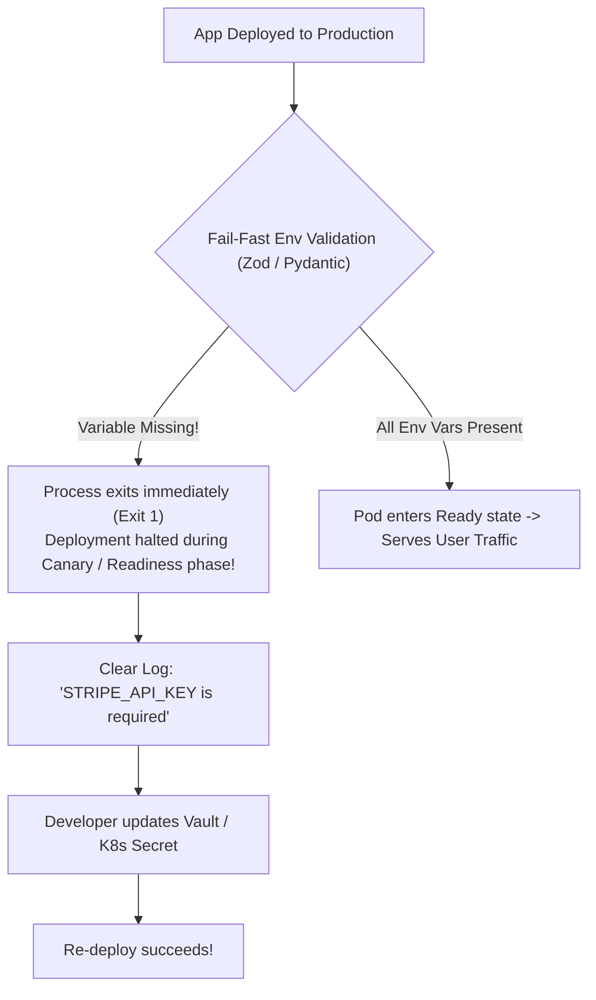

## Fast Revision (10-Second Recall)
- **The Root Cause:** Configuration drift between CI/CD pipeline, Kubernetes ConfigMaps/Secrets, and application code.
- **Why It Happens:** Developer added the key to local `.env`, but omitted it from production Helm values, Terraform manifests, or AWS Secrets Manager.
- **Resolution Protocol:**
- 1. **Identify Missing Keys:** Check logs for `KeyError`, `undefined`, or run schema validation diff.
- 2. **Inject Missing Secret:** Update production ConfigMap/Secret via GitOps (ArgoCD) or CLI.
- 3. **Trigger Rolling Restart:** Kubernetes does NOT automatically reload environment variables when ConfigMaps change—must run `kubectl rollout restart deployment`.
- **Architectural Prevention:** Fail-Fast Environment Validation at bootstrap using Zod, Joi, or Pydantic.

## The 30-Second Spoken Script
"Missing environment variables post-deployment are a classic symptom of configuration drift between application code and deployment manifests.

My resolution and prevention approach:

First, identify the exact missing variables. I check application error logs for unhandled TypeError, KeyError, or null pointer references. If the application uses structured configuration validation, it will output a clear error like: 'Configuration validation failed: STRIPE_WEBHOOK_SECRET is required'.

Second, verify the current environment inside the running pod. In Kubernetes, I check the pod spec using kubectl describe pod or run kubectl exec -- env to see the exact keys injected. I check whether the ConfigMap or Secret exists, whether the key name has a typo, and whether the deployment manifest references the right secret key.

Third, apply the fix and restart pods. Once the ConfigMap or Secret is updated in our GitOps repository or Secrets Manager, Kubernetes does not automatically update environment variables in already running containers. I execute kubectl rollout restart deployment to perform a rolling update that mounts the updated variables.

To prevent this permanently, we implement two automated safeguards:
1. Fail-Fast Schema Validation: On startup, the application validates all environment variables against a strict schema (such as Zod in TypeScript or Pydantic in Python). If any variable is missing or malformed, the process immediately exits with a descriptive log, failing the deployment during canary phase before user traffic hits it.
2. CI/CD Manifest Linting: Our pipeline compares the application's required config manifest against production secret keys before allowing the deployment to proceed."

## Scenario / Problem Context
A feature depends on a newly introduced configuration key (e.g. `FEATURE_FLAG_NEW_CHECKOUT` or `STRIPE_WEBHOOK_SECRET`). In staging it was present, but in production the container boots without it, causing crashes or silent feature failure. The interviewer evaluates your configuration management practices.

## Architectural Workflow / Sequence


## Deep-Dive Analysis & Root Causes

| Tool | Mechanism | Benefit |
| --- | --- | --- |
| Fail-Fast Schema Validation (Zod/Joi) | Validates all `process.env` keys during bootstrap | Prevents silent runtime crashes hours later when feature is first touched
External Secrets Operator (ESO) | Syncs AWS Secrets Manager / Vault to K8s Secrets | Automated synchronization; eliminates manual secret drift
GitOps (ArgoCD / Flux) | Declarative configuration versioned in Git | Audit trail for every config change; automated rollbacks |


## Practical Debugging Commands & Code
```bash
# 1. Inspect environment variables of a running pod:
kubectl exec -it <pod-name> -n production -- env | sort

# 2. Check if the ConfigMap has the required key:
kubectl get configmap app-config -n production -o yaml

# 3. Check if Secret exists and decode a specific key:
kubectl get secret app-secrets -n production -o jsonpath="{.data.DATABASE_PASSWORD}" | base64 --decode

# 4. Trigger rolling restart to apply updated ConfigMap / Secrets:
kubectl rollout restart deployment/api-service -n production
```

## Prevention & Senior Best Practices
- **Fail Fast at Application Startup:** Never access `process.env.KEY` directly in controllers. Centralize all configuration in an `env.ts` file validated with Zod.
- **Maintain a `.env.example` in Git:** Ensure CI checks that all keys defined in `.env.example` exist in production config manifests.
- **Use External Secrets Operator (ESO):** Automatically synchronize secrets from HashiCorp Vault or AWS Secrets Manager into Kubernetes.
