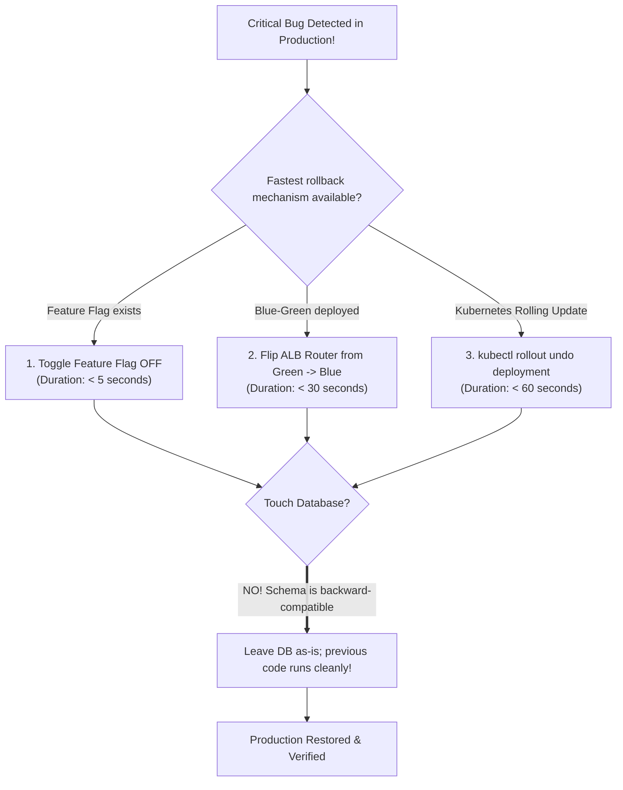

## Fast Revision (10-Second Recall)
- **The Priority Order:** Stop user harm immediately! Rollback $\rightarrow$ Verify $\rightarrow$ Communicate $\rightarrow$ Post-mortem.
- **Rollback Execution Vectors:**
- 1. **Feature Flag Flip (Fastest: &lt; 5 seconds):** If the feature is behind LaunchDarkly/Unleash, disable the flag. Zero pod restarts or redeployments needed!
- 2. **Kubernetes Rollout Undo (&lt; 60 seconds):** `kubectl rollout undo deployment/api`. Reverts pods to previous container image replica set.
- 3. **Blue-Green Router Switch (&lt; 30 seconds):** Flip ALB target group or Route53 weighted record from Green back to Blue.
- **The Big Catch: What about Database Migrations?**
- If migrations followed the Expand/Contract pattern, the schema supports BOTH old and new code. Rollback the code without touching the database! Never roll back schema in panic.

## The 30-Second Spoken Script
"When a critical bug hits production, my priority is stopping customer impact within seconds using the fastest available rollback mechanism.

I evaluate three rollback vectors based on speed:

Vector 1: Feature Flag Kill Switch (under 5 seconds).
If the new logic was released behind a feature flag—such as LaunchDarkly or Unleash—I toggle the flag off immediately. This deactivates the broken code globally across all running pods within seconds without requiring container restarts, re-deployments, or DNS changes.

Vector 2: Traffic / Load Balancer Switching (under 30 seconds).
If using Blue-Green deployments, the previous stable version (Blue) is still running idle. I flip the load balancer target group or Route53 weighted routing from Green back to Blue, restoring 100% stable traffic in under 30 seconds.

Vector 3: Container Rollout Undo (under 60 seconds).
In Kubernetes, I execute kubectl rollout undo deployment/api-service. Kubernetes initiates a rolling update reversing the deployment back to the previous stable ReplicaSet.

What about the database?
A critical rule during emergency rollbacks: DO NOT attempt an emergency down-migration or drop database columns. Because we follow the Expand/Contract pattern, all database changes deployed in step 1 are strictly additive and backward-compatible. The previous version of the application code can run perfectly fine against the new schema.

Once metrics return to normal, we post an incident update, isolate the bug, write regression tests, and fix it properly."

## Scenario / Problem Context
A critical bug in the payment calculation module was deployed to production 10 minutes ago, overcharging users by 15%. The incident commander demands an immediate rollback. The interviewer tests your execution speed, understanding of rollback tooling, and how you handle database migrations that accompanied the release.

## Architectural Workflow / Sequence


## Deep-Dive Analysis & Root Causes

| Mechanism | MttrSpeed | DeploymentRequired | Risk |
| --- | --- | --- | --- |
| Feature Flag Toggle | Under 5 seconds | None | Lowest risk; instant global deactivation
Blue-Green ALB Flip | 15 to 30 seconds | Router configuration change | Near zero; old environment already warm and verified
`kubectl rollout undo` | 30 to 90 seconds | Pod rolling replacement | Low; pulls previously cached Docker image
Git Revert + Full CI/CD Build | 15 to 30 minutes (Too slow for Sev-1!) | Full build, test, and release cycle | High MTTR; leaves customers exposed during build |


## Practical Debugging Commands & Code
```bash
# 1. Instant rollback of Kubernetes deployment to previous revision:
kubectl rollout undo deployment/payment-service -n production

# 2. View history of revisions to select a specific target revision:
kubectl rollout history deployment/payment-service -n production
kubectl rollout undo deployment/payment-service --to-revision=3 -n production

# 3. AWS CLI: Switch ALB target group from Green to Blue:
# aws elbv2 modify-listener --listener-arn <ARN> --default-actions Type=forward,TargetGroupArn=<BLUE_TG_ARN>

# 4. Monitor rollback progress until 100% complete:
kubectl rollout status deployment/payment-service -n production
```

## Prevention & Senior Best Practices
- **Release All Risky Logic Behind Feature Flags:** High-impact business logic (pricing, auth, payments) must always be wrapped in dynamic feature flags.
- **Retain the Previous Blue Environment for 1 Hour:** Do not terminate the older Blue cluster immediately after deploying Green; keep it warm for rapid rollback.
- **Never Deploy Breaking Database Migrations with Code:** Strictly enforce backward compatibility so code can be rolled back without database intervention.
