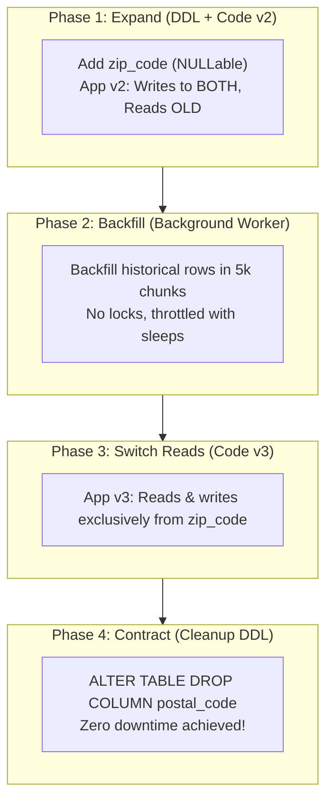

## Fast Revision (10-Second Recall)
- **The Iron Rule:** Database migrations and code deployments must be decoupled. The database must ALWAYS support both the currently running code and the new deploying code.
- **The Expand and Contract Pattern (4 Phases):**
- 1. **Expand (Phase 1):** Add new column/table as nullable. Deploy app that writes to BOTH old and new, reads from old.
- 2. **Backfill (Phase 2):** Run background worker to backfill historical rows in small batches with sleeps.
- 3. **Switch (Phase 3):** Deploy app update that reads and writes exclusively from the new column/table.
- 4. **Contract (Phase 4):** Drop old column/table in a final cleanup migration after all old pods terminate.
- **DDL Guardrail:** Always run `SET lock_timeout = '2s';` before DDL in production so migrations fail fast rather than blocking the table queue.

## The 30-Second Spoken Script
"Deploying a database schema change safely in a zero-downtime production environment requires treating schema evolution as a multi-stage migration using the Expand and Contract pattern, decoupled from application code deployments.

In a rolling deployment, older application pods and newer pods run concurrently for several minutes. If you rename or delete a column in a single migration script, older pods will crash immediately when executing queries.

The Expand and Contract pattern solves this in four distinct phases:

Phase 1 is Expand. We add the new schema element alongside the old one. For example, if we need to rename 'postal_code' to 'zip_code', we create the new column as NULLable. We then deploy application version 2, which writes to both postal_code and zip_code simultaneously, while continuing to read from postal_code.

Phase 2 is Backfill. An asynchronous background migration script copies historical data from the old column to the new column in small, throttled batches of 5,000 rows, preventing table locking and Write-Ahead Log bloat.

Phase 3 is Switch. We deploy application version 3. Now that all historical and newly written records exist in zip_code, version 3 reads and writes exclusively from the new column.

Phase 4 is Contract. Once we verify via telemetry that no active application code references postal_code, we deploy a final DDL migration that drops the old column.

Additionally, every DDL migration must begin with SET lock_timeout = '2s'. If an existing long-running query is accessing the table, the migration aborts immediately rather than sitting in the lock queue and blocking all incoming application reads behind it."

## Scenario / Problem Context
A release requires renaming a column, altering a column type, or adding a NOT NULL constraint on a 50-million-row table. Running a naive SQL migration directly in the pipeline causes exclusive table locks, downtime, and crashes older pods. The interviewer tests your knowledge of zero-downtime migration patterns.

## Architectural Workflow / Sequence


## Deep-Dive Analysis & Root Causes

| Pattern | SafeApproach | Danger |
| --- | --- | --- |
| Adding a Column with Default | Postgres 11+ supports instant `DEFAULT 'val' NOT NULL`. On older PG: add NULLable, backfill, validate constraint | Table rewrite taking `ACCESS EXCLUSIVE` lock on pre-PG11
Renaming a Column | Expand & Contract: add new column, dual write, backfill, swap reads, drop old | `ALTER TABLE RENAME COLUMN` breaks running $N-1$ pods immediately
Adding an Index | `CREATE INDEX CONCURRENTLY` in PostgreSQL | Standard `CREATE INDEX` takes a SHARE lock that blocks all incoming writes
Adding Foreign Key Constraint | `ADD CONSTRAINT ... NOT VALID` followed by `VALIDATE CONSTRAINT` | Validating large foreign keys in one step locks both tables for minutes |


## Practical Debugging Commands & Code
```bash
-- 1. Always set lock timeout before running DDL in production:
SET lock_timeout = '2s';

-- 2. Create index concurrently (does NOT block writes):
CREATE INDEX CONCURRENTLY idx_users_email ON users (email);

-- 3. Add constraint without locking table for validation:
ALTER TABLE orders 
ADD CONSTRAINT chk_orders_status 
CHECK (status IN ('pending', 'shipped', 'delivered')) NOT VALID;

-- 4. Validate constraint in background without blocking concurrent writes:
ALTER TABLE orders VALIDATE CONSTRAINT chk_orders_status;
```

## Prevention & Senior Best Practices
- **Use Migration Linters in CI:** Integrate tools like `strong_migrations` or `squawk` to automatically fail pull requests that contain dangerous DDL commands.
- **Separate Migrations from App Pod Startup:** Never run database migrations inside container entrypoint scripts (`CMD npm start` running migrations causes multi-pod migration race conditions!). Run migrations as a dedicated Kubernetes Job.
- **Always Specify Lock Timeouts:** Mandate `SET lock_timeout = '2s';` in all migration tooling.
