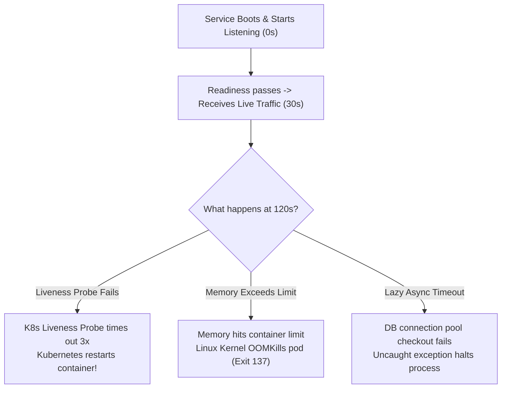

## Fast Revision (10-Second Recall)
- **Why 2 Minutes Specifically?**
- Consistent delayed crashes are almost NEVER random bugs—they are tied to **timers, probes, or resource thresholds**.
- **Top 4 Culprits for a 2-Minute Crash:**
- 1. **Failing Kubernetes Liveness Probe:** Readiness probe passes, but Liveness probe fails after initial delay $\rightarrow$ Kubernetes kills the container at 120s.
- 2. **Memory Leak Under Live Load (OOMKilled):** Heap grows as traffic starts flowing; hits container cgroup memory limit at 2 minutes $\rightarrow$ Linux OOM Killer issues `kill -9` (Exit code 137).
- 3. **Lazy Database / Cache Connection Timeout:** App boots lazily; initial connection pool checkout stalls for 120s $\rightarrow$ uncaught promise rejection crashes node.
- 4. **Thread Pool / Event Loop Starvation:** Heavy synchronous CPU task locks event loop; health check server cannot respond in time.

## The 30-Second Spoken Script
"When a service consistently starts successfully but terminates after precisely two minutes, it indicates a threshold-based failure or an external orchestrator timeout rather than an immediate syntax or bootstrap error.

My debugging workflow:

First, check the container exit code and termination reason. In Kubernetes, I run kubectl describe pod. If the termination reason is OOMKilled with exit code 137, the application hit its container memory limit after receiving traffic. If the reason is 'Liveness probe failed: HTTP probe failed with statuscode: 500', it proves Kubernetes deliberately killed the container because the liveness health check timed out.

Second, inspect liveness vs readiness probe configuration. A classic mistake is pointing the liveness probe to an expensive deep health check endpoint that queries external databases. Once the service experiences traffic load, the database query slows down, the liveness probe exceeds its timeout threshold (e.g., 3 failures at 30-second intervals = 2 minutes), and Kubernetes kills the pod. Liveness probes should only check shallow process responsiveness, not external dependencies.

Third, inspect application logs prior to the crash. I check for uncaught promise rejections, out-of-memory errors, or slow initialization tasks that hit an internal timeout—such as an initial cache warm-up job timing out at 120 seconds.

Fourth, capture heap and CPU telemetry. If it is an OOM kill, I inspect memory metrics in Grafana to see the ramp-up slope, generate a heap dump, and identify the leaking buffer or array."

## Scenario / Problem Context
The service boots up cleanly, passes initial readiness checks, and begins processing requests. However, like clockwork, it terminates and restarts precisely 2 minutes later. The interviewer tests your knowledge of container probe lifecycles, memory leaks, and connection pool timeouts.

## Architectural Workflow / Sequence


## Deep-Dive Analysis & Root Causes

| FailureMechanism | ExitCode | RootCause | Fix |
| --- | --- | --- | --- |
| Failing Liveness Probe | 143 / Terminated by SIGTERM | Liveness probe hits heavy endpoint that times out under load | Make liveness probe shallow (returns 200 without DB checks); increase `timeoutSeconds`
OOMKilled (Out of Memory) | 137 / Killed by SIGKILL | Rapid memory allocation or undersized container memory limits | Increase container memory request/limit; analyze heap dump for memory leaks
Event Loop Blocked | Container unresponsive | Synchronous blocking computation on main thread halts HTTP health listener | Offload CPU-intensive parsing or crypto to worker threads |


## Practical Debugging Commands & Code
```bash
# 1. Check pod termination details, restart counts, and exit codes:
kubectl describe pod <pod-name> -n production | grep -E "State:|Last State:|Exit Code:|Reason:"

# 2. View previous container logs right before it was killed:
kubectl logs <pod-name> -n production --previous --tail=100

# 3. Monitor real-time memory usage of the pod:
kubectl top pod <pod-name> -n production --containers

# 4. Check kernel dmesg for OOM killer invocations on the worker node:
# dmesg -T | grep -i "oom-killer"
```

## Prevention & Senior Best Practices
- **Keep Liveness Probes Shallow:** Liveness probes should only verify that the HTTP process is alive (`return 200 OK`). Never check downstream databases in a liveness probe (use Readiness probes for that).
- **Right-Size Container Memory Limits:** Set JVM `-Xmx` or Node.js `--max-old-space-size` to 75% of the container's cgroup limit to prevent kernel SIGKILL.
- **Use Profiling in Staging:** Subject services to 5-minute sustained load tests in staging before production deployment to detect delayed memory growth.
