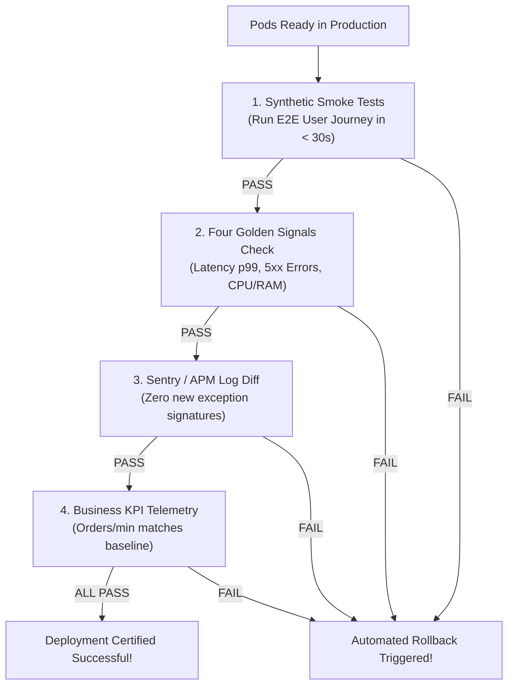

## Fast Revision (10-Second Recall)
- **The 4 Pillars of Post-Deployment Verification (PDV):**
- 1. **Automated Synthetic Smoke Tests:** Execute automated end-to-end API flows (e.g. Health $\rightarrow$ Login $\rightarrow$ Create Order $\rightarrow$ Delete Order) against canary pods.
- 2. **The "Four Golden Signals" Monitoring:** Latency, Traffic (RPS), Errors (5xx), and Saturation (CPU/Memory). Verify none breach SLA thresholds.
- 3. **Log Ingestion & Exception Rates:** Compare error log volume between previous version and new version (look for zero new error signatures).
- 4. **Business KPIs / Real-Time Telemetry:** Confirm business metrics (checkout conversion, signups per minute) match historical baselines.
- **Automated Canary Analysis (ACA):** Use tools like Kayenta or Argo Rollouts to automatically calculate a health score (0-100) before completing promotion.

## The 30-Second Spoken Script
"Verifying a deployment requires moving beyond basic 'pods running' status to verifying functional correctness, system telemetry, and business KPIs.

I use a four-phase Post-Deployment Verification (PDV) framework:

Phase 1: Automated Synthetic Smoke Testing. The moment new pods enter the Ready state, our CD pipeline executes a suite of automated synthetic tests against internal endpoints. These tests exercise critical user paths—such as authenticating a test user, creating an item, reading it back, and deleting it. If any smoke test fails, the deployment aborts automatically.

Phase 2: Monitoring the Four Golden Signals. For 10 to 15 minutes post-deployment, we monitor:
1. Latency: p95 and p99 response times must remain within 5% of the baseline.
2. Error Rate: HTTP 5xx errors must remain below 0.1%.
3. Traffic: Request throughput must match expected time-of-day volume.
4. Saturation: CPU, memory, and database connection pool utilization must remain stable.

Phase 3: Log Exception Differential. We use Datadog or Sentry to compare new error occurrences. If the new release introduces any brand-new exception signatures that never existed in the previous build, an automated alert fires.

Phase 4: Business Telemetry. In consumer systems, technical metrics can look green even while business logic is broken (for example, a button click returning 200 OK with empty cart data). We monitor business conversion metrics—such as payment transactions per minute—against historical thresholds.

Only when all four gates pass for 15 minutes is the deployment marked officially successful."

## Scenario / Problem Context
The pipeline reports that the pods are running. But how do you definitively verify that the release is functioning for real users without waiting for customer support complaints? The interviewer tests your automated verification strategy and observability metrics.

## Architectural Workflow / Sequence


## Deep-Dive Analysis & Root Causes

| Gate | Tool | PassCriteria |
| --- | --- | --- |
| 1. Synthetic Smoke Tests | Postman / Newman / Playwright | 100% of core synthetic transactions return expected payloads in &lt; 200ms
2. Golden Signals | Prometheus / Datadog / Grafana | 5xx error rate &lt; 0.1%, p95 latency delta &lt; +5%
3. Error Signature Diff | Sentry / Rollbar | Zero new unhandled exception types introduced in release window
4. Business Metrics | Segment / Mixpanel / Metabase | Checkout / Signup event rate within 2 standard deviations of normal |


## Practical Debugging Commands & Code
```bash
# 1. Automated curl health check with HTTP status code assertion:
status=$(curl -s -o /dev/null -w "%{http_code}" https://api.example.com/health)
if [ "$status" -ne 200 ]; then echo "Health check failed with $status"; exit 1; fi

# 2. Run post-deploy Newman (Postman) smoke tests in CI/CD:
newman run ./tests/smoke-collection.json --env-var "baseUrl=https://api.example.com"

# 3. Check Datadog canary error budget via API query:
curl -X GET "https://api.datadoghq.com/api/v1/query?from=$(date -d '15 minutes ago' +%s)&to=$(date +%s)&query=sum:trace.http.request.errors{env:production,version:v2.4.0}"
```

## Prevention & Senior Best Practices
- **Embed Smoke Tests in the Deployment Pipeline:** Never make smoke tests manual; automate them as a mandatory blocking stage in GitHub Actions / ArgoCD.
- **Maintain Dedicated Test Accounts:** Create automated synthetic test accounts with sandbox payment cards to execute realistic end-to-end flows safely in production.
- **Automate Canary Analysis (ACA):** Use Argo Rollouts to automate metric scoring and promote or rollback without human observation.
