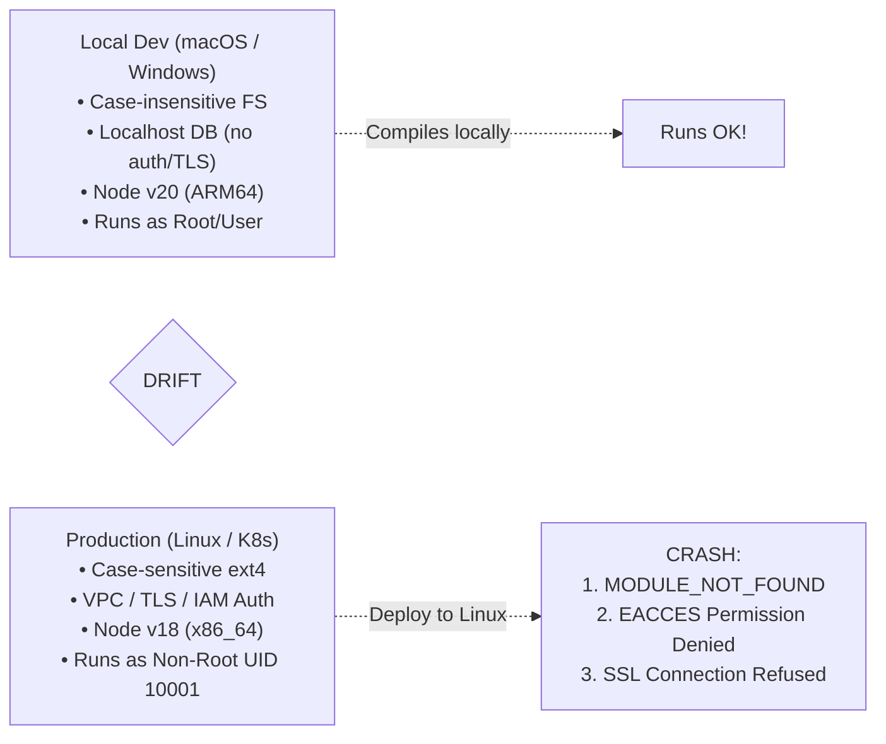

## Fast Revision (10-Second Recall)
- **The Golden Rule (12-Factor App):** Dev/Prod Parity. Keep development, staging, and production as similar as possible.
- **Top 5 Discrepancies Between Local and Production:**
- 1. **Case-Sensitive Filesystem:** macOS and Windows filesystems are case-insensitive by default (`import User from "./user"` works locally, fails on Linux with `MODULE_NOT_FOUND`).
- 2. **Runtime & OS Version Differences:** Local machine runs Node 20.x on Darwin; production runs Node 18.x on Alpine Linux (native C++ bindings like `bcrypt` fail).
- 3. **Network & Firewall Restrictions:** Local connects to local Postgres; production requires VPC peering, security groups, or TLS certificates.
- 4. **File Permissions & Non-Root Containers:** Local runs as root or user; production Docker runs as unprivileged user `appuser` (cannot write to `/tmp` or create folders).
- 5. **Missing Environment Variables:** Config values defaulted in `.env` are omitted in production Kubernetes Secrets.

## The 30-Second Spoken Script
"The 'works on my machine but fails in production' problem stems from environment drift and violation of the 12-Factor App principle of Dev-Prod parity.

When troubleshooting this discrepancy, I check five primary divergence vectors:

First, filesystem case sensitivity. Developers often build on macOS or Windows, where the filesystem is case-insensitive. A developer imports a file with mismatched casing—such as importing capital User from lowercase user.js. It compiles locally, but crashes immediately on production Linux with MODULE_NOT_FOUND because Linux filesystems like ext4 are strictly case-sensitive.

Second, native runtime binaries and container architecture. If an application relies on native compiled C++ modules—like bcrypt or sharp—compiling them on an Apple Silicon ARM64 laptop creates binaries that cannot run on a production x86_64 Linux container unless multi-arch Docker builds are used.

Third, file permissions and non-root users. Locally, developers run with broad permissions. Production containers run under an unprivileged user (UID 10001) for security. If the application attempts to write temporary files or logs to a directory lacking write permissions, it crashes.

Fourth, network topology and security groups. Local services talk over localhost with no latency and no firewalls. In production, requests traverse VPCs, NAT gateways, and Kubernetes Service meshes requiring mutual TLS and strict security group ingress rules.

Fifth, configuration and environment variables. Production environments require explicit external secrets that may differ from local default fallbacks.

The permanent solution is containerization: running the exact same Docker container in local development via Docker Compose or Dev Containers as in production."

## Scenario / Problem Context
The classic developer complaint: "It works on my machine!" The application passes all tests locally on macOS/Windows, but crashes or throws 500s when deployed to production Linux servers. The interviewer tests your understanding of environment parity and system-level differences.

## Architectural Workflow / Sequence


## Deep-Dive Analysis & Root Causes

| DriftVector | LocalBehavior | ProductionBehavior | Mitigation |
| --- | --- | --- | --- |
| Filesystem Case Sensitivity | `require("./User")` resolves `user.js` on macOS | Throws `Cannot find module` on Linux ext4 | Enable ESLint `import/no-unresolved` with case sensitivity checks
User Permissions | Writes to `/var/log` or current working directory | Crashes with `EACCES: permission denied` under non-root user | Explicitly configure `USER node` and set ownership on `/app` in Dockerfile
Native Architecture | Builds ARM64 binaries on Apple Silicon M-series | Exec format error on AMD64 Linux servers | Use `docker buildx --platform linux/amd64` in CI pipeline
Network & TLS | Unencrypted plain HTTP / direct Postgres socket | Requires SSL mode `verify-full` and CA cert verification | Test with local TLS certificates via mkcert |


## Practical Debugging Commands & Code
```bash
# 1. Check exact OS, kernel, and architecture in production:
uname -a

# 2. Check current user UID/GID and write permissions:
id && ls -ld /app/storage /tmp

# 3. Test DNS resolution and network connectivity from inside the container:
nc -zv postgres-service.internal 5432
curl -Iv https://auth.internal.corp/health

# 4. Multi-platform Docker build command:
docker buildx build --platform linux/amd64,linux/arm64 -t my-app:v1.0 . --push
```

## Prevention & Senior Best Practices
- **Use Docker Dev Containers:** Mandate Docker Compose or VS Code Dev Containers for local development so all engineers develop on Linux identical to production.
- **Add ESLint Import Case Sensitivity Rules:** Enforce `eslint-plugin-import` with `caseSensitive: true` in pre-commit git hooks.
- **CI Multi-Arch Verification:** Run all unit and integration tests inside the exact production Docker image in GitHub Actions.
