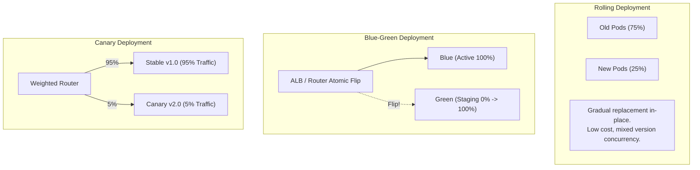

## Fast Revision (10-Second Recall)
- **The 3 Major Zero-Downtime Strategies:**
- 1. **Rolling Deployment:** Progressively replaces old pods with new pods (e.g. 25% at a time). Default in Kubernetes. Cost-effective (no double hardware), but old and new versions run concurrently for several minutes.
- 2. **Blue-Green Deployment:** Provisions a complete duplicate environment (Green). Tests Green thoroughly, then flips load balancer router instantly. Instant rollback, zero version concurrency; requires 2x hardware capacity during deploy.
- 3. **Canary Deployment:** Routes a tiny slice of real traffic (e.g. 2%, 10%) to the new version. Monitors telemetry; automatically promotes to 100% or rolls back on errors. Safest, but requires intelligent routing proxies (Istio, Envoy).
- **Essential Kubernetes Prerequisite:** Properly configured `readinessProbe` and `terminationGracefulShutdown`.

## The 30-Second Spoken Script
"Deploying without downtime requires an orchestration strategy that ensures new application instances are fully initialized and healthy before the load balancer routes production traffic to them, while older instances gracefully drain in-flight requests.

There are three primary zero-downtime deployment strategies, each with distinct tradeoffs:

Strategy 1: Rolling Updates.
This is the standard pattern in Kubernetes. The orchestrator boots up a fraction of new pods—such as 25%—waits for their readiness probes to return HTTP 200, adds them to the load balancer, and then terminates a matching number of old pods with a graceful SIGTERM drain.
Advantage: It requires minimal extra infrastructure cost.
Disadvantage: Both old and new versions run simultaneously during the 5-minute rollout, requiring strict backward compatibility.

Strategy 2: Blue-Green Deployments.
We maintain two identical production environments: Blue (active production) and Green (idle standby). We deploy the new release entirely to Green, run comprehensive automated smoke tests against it, and then execute an atomic switch at the load balancer or DNS layer, routing 100% of traffic to Green.
Advantage: Rollback is instantaneous—if a bug emerges, we flip the router back to Blue in 5 seconds.
Disadvantage: It requires 2x compute capacity during deployment.

Strategy 3: Canary Deployments.
We deploy the new release alongside the existing version, but route only a small percentage of real user traffic—such as 2% or 5%—using an intelligent service mesh like Envoy or Istio. We monitor the error rates and p99 latency of the canary pods for 15 minutes. If metrics remain healthy, we progressively ramp traffic to 25%, 50%, and 100%.

For high-scale enterprise systems, Canary Deployment with automated metric analysis is the gold standard because it limits the blast radius of any unexpected defect to a tiny fraction of users."

## Scenario / Problem Context
The business requires 99.99% availability, meaning no scheduled maintenance windows. Deployments must occur continuously in the middle of the workday without dropping active user connections. The interviewer evaluates your knowledge of rolling updates, blue-green, and canary deployments.

## Architectural Workflow / Sequence


## Deep-Dive Analysis & Root Causes

| Strategy | Cost | RollbackSpeed | ConcurrencyRisk | BestFor |
| --- | --- | --- | --- | --- |
| Rolling Update | Low (+25% surge) | Moderate (1-3 minutes) | High (v1 and v2 run simultaneously) | Standard microservices with backward-compatible APIs
Blue-Green | High (2x duplicate cluster) | Instant (&lt; 30 seconds) | None (Atomic switch) | Monoliths, complex stateful apps, major version upgrades
Canary | Low to Moderate | Fast (Drop canary traffic) | High (Small subset exposed) | High-traffic consumer apps, risk-sensitive financial APIs |


## Practical Debugging Commands & Code
```bash
# 1. Kubernetes Rolling Update deployment configuration:
# spec:
#   strategy:
#     type: RollingUpdate
#     rollingUpdate:
#       maxSurge: 25%
#       maxUnavailable: 0   # Guarantees capacity never dips below 100%!

# 2. Check rollout progress:
kubectl rollout status deployment/web-api -n production

# 3. Argo Rollouts Canary step configuration (Argo CD):
# spec:
#   strategy:
#     canary:
#       steps:
#       - setWeight: 5
#       - pause: {duration: 10m}
#       - setWeight: 20
#       - pause: {duration: 30m}
```

## Prevention & Senior Best Practices
- **Configure `terminationGracePeriodSeconds` & `preStop` Hook:** Give containers time to finish processing in-flight HTTP requests before SIGKILL (e.g. 30-second graceful drain).
- **Set `maxUnavailable: 0`:** In Kubernetes rolling updates, set `maxUnavailable: 0` so new pods must be healthy before any old pod is removed, maintaining 100% capacity.
- **Enforce Strict Backward Compatibility:** Always design APIs and database schemas to support $N-1$ and $N$ versions simultaneously.
