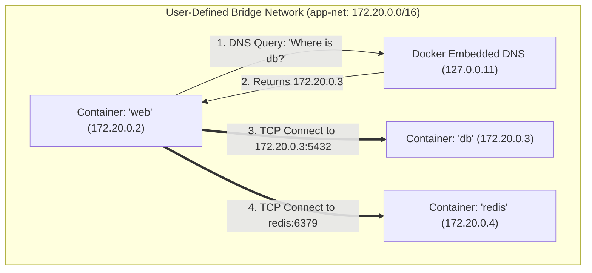

## Fast Revision (10-Second Recall)
- **Why `localhost` Fails:** Each Docker container gets its own isolated network namespace and loopback interface (`127.0.0.1`). Container A cannot see Container B on localhost.
- **The Modern Standard: User-Defined Bridge Networks.**
- When containers are attached to a custom bridge network, Docker provides **automatic embedded DNS service discovery**!
- Container `web` connects to `postgres` using the hostname `http://postgres:5432` without hardcoding IP addresses!
- **The Default Bridge vs Custom Bridge:**
- The default bridge (`docker0`) does NOT support DNS resolution by container name (legacy `--link` is deprecated). Always create a custom bridge: `docker network create my-net`!

## The 30-Second Spoken Script
"Containers communicate with each other using Docker Network Drivers, with User-Defined Bridge Networks being the standard for multi-container applications on a single host.

Here is how container communication works:

First, why localhost fails:
Every container possesses its own isolated network namespace, routing table, and loopback adapter. If Container A attempts to reach Container B on 'localhost:5432', it is searching for PostgreSQL inside its own container filesystem, resulting in Connection Refused.

Second, the User-Defined Bridge Network and Embedded DNS:
When we create a custom bridge network using 'docker network create app-net' and attach our containers to it, Docker runs an internal DNS resolver at 127.0.0.11.
Docker automatically maps the container name or service name to its internal IP address.
For example, our web application connects to the database using the connection string 'postgres://postgres:5432/mydb'. Docker's embedded DNS automatically resolves 'postgres' to the dynamic container IP (like 172.18.0.3).

Third, in Docker Compose:
Docker Compose automatically creates a dedicated user-defined bridge network for your project. All services declared in docker-compose.yml (such as web, api, db, redis) can communicate with each other instantly using their service names as hostnames.

For multi-host communication across different physical servers, Docker uses the Overlay Network driver (in Docker Swarm) or relies on Kubernetes CNI plugins (like Calico, Cilium, or AWS VPC CNI)."

## Scenario / Problem Context
A web app container needs to query a Redis cache and a PostgreSQL database container on the same host. Connecting via `localhost` fails with connection refused. The interviewer tests your understanding of Docker network drivers, internal DNS, and service discovery.

## Architectural Workflow / Sequence


## Deep-Dive Analysis & Root Causes

| Driver | Scope | Characteristics |
| --- | --- | --- |
| Bridge (Default / Custom) | Single Docker host | Isolated private subnet; custom bridge provides automated DNS resolution by container name
Host Network (`--net=host`) | Single Docker host | Removes network isolation; container shares host network stack directly (fastest, but port collisions possible)
Overlay Network | Multiple Docker hosts (Swarm) | Encapsulates packets via VXLAN; enables containers on different VMs to talk directly
None (`--net=none`) | Single Docker host | Disables all networking; container is completely air-gapped |


## Practical Debugging Commands & Code
```bash
# 1. Create a custom user-defined bridge network:
docker network create my-app-network

# 2. Run database container on the network:
docker run -d --name database --network my-app-network postgres:16-alpine

# 3. Run application container on the same network (communicates via hostname 'database'):
docker run -d --name web --network my-app-network -e DB_HOST=database my-web-app

# 4. Test DNS resolution and connectivity between containers:
docker exec -it web ping -c 2 database
docker exec -it web nc -zv database 5432
```

## Prevention & Senior Best Practices
- **Never Use the Default Bridge for Multi-Container Apps:** The default `bridge` lacks automatic DNS resolution. Always use a custom bridge network.
- **Use Docker Compose for Multi-Container Stacks:** Docker Compose creates an isolated network automatically and handles DNS resolution.
- **Never Expose Internal Database Ports to the Host:** Only map ports (`-p 80:80`) for public edge services; keep databases and caches internal to the bridge network.
