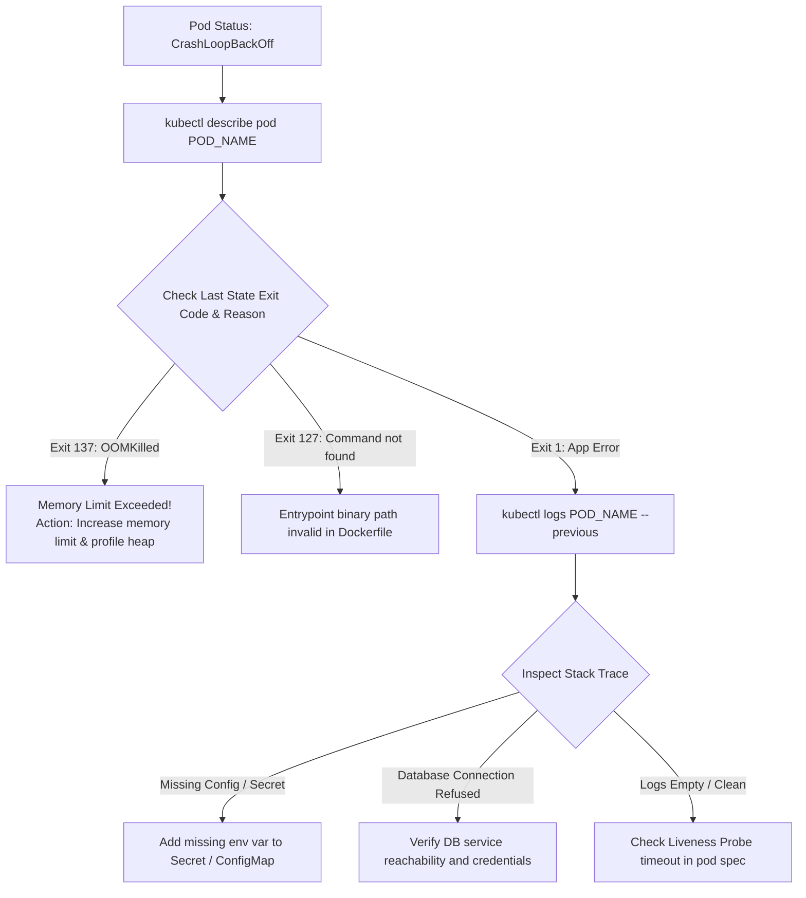

## Fast Revision (10-Second Recall)
- **What is CrashLoopBackOff?** It is NOT an error itself—it is Kubernetes saying: "Your container started, crashed, I restarted it, and it crashed again. I am now waiting in an exponential backoff loop before restarting again."
- **The 3 Golden Commands:**
- 1. **`kubectl describe pod <name>`:** Look at **Last State** (Exit Code & Reason) and **Events** at the bottom.
- 2. **`kubectl logs <name> --previous`:** Read stdout/stderr right before the container died.
- 3. **`kubectl get events`:** Check for failed mounts, missing ConfigMaps, or secret volume errors.
- **Top 4 Causes of CrashLoopBackOff:**
- - Exit 137: **OOMKilled** (Memory limit exceeded).
- - Exit 1: **Unhandled Exception** / Application bootstrap crash (missing DB env).
- - Exit 127: **Command Not Found** (bad entrypoint script path).
- - Failing **Liveness Probe** killing the container repeatedly.

## The 30-Second Spoken Script
"CrashLoopBackOff means a container starts, encounters a fatal error, terminates, and Kubernetes is progressively backing off restart attempts—from 10 seconds up to 5 minutes—to prevent thrashing the node.

My 4-step triage methodology:

Step 1: Check the exit code and events with kubectl describe.
I run 'kubectl describe pod POD_NAME'.
First, I inspect the 'Last State' block to check the Exit Code:
If Exit Code is 137 and Reason is OOMKilled, the application hit its container memory limit and was killed by the Linux kernel.
If Exit Code is 1, the application crashed with an unhandled runtime error.
If Exit Code is 127, the container could not find the binary specified in CMD or ENTRYPOINT.
Second, I inspect the Events section at the bottom. This immediately flags external blockers—such as failing to mount a missing Secret or ConfigMap.

Step 2: Inspect previous container logs.
Because the container has crashed and restarted, running normal 'kubectl logs' often shows an empty startup log of the newly booted container. I run:
'kubectl logs POD_NAME --previous'
This displays the stdout and stderr of the exact container instance that just crashed, revealing the fatal stack trace, missing environment variable, or failed database connection.

Step 3: Check Liveness Probe misconfigurations.
If logs look normal and the app booted fine, I check the liveness probe in the pod spec. If the probe is timing out or pointing to an invalid endpoint, Kubernetes is deliberately killing the healthy application.

Step 4: Interactive debugging if needed.
If logs are inconclusive, I use 'kubectl debug' to launch an ephemeral debug container with a shared process namespace, or override the command to a sleep loop to inspect the filesystem interactively."

## Scenario / Problem Context
After a deployment, `kubectl get pods` shows `STATUS: CrashLoopBackOff` with a rapidly climbing restart count. The service is down. The interviewer evaluates your systematic troubleshooting steps from kubectl describe down to interactive container debugging.

## Architectural Workflow / Sequence


## Deep-Dive Analysis & Root Causes

| ExitCode | Meaning | Remedy |
| --- | --- | --- |
| `Exit 137 (OOMKilled)` | Container exceeded memory limit | Increase `resources.limits.memory` in deployment YAML
`Exit 1 (App Crash)` | Application threw unhandled exception during bootstrap | Check `kubectl logs --previous` for stack trace
`Exit 143 (SIGTERM)` | Terminated by Kubernetes liveness probe failure | Increase `initialDelaySeconds` and `timeoutSeconds` on liveness probe
`Exit 126 / 127` | Binary not found or lacks execute permissions (`chmod +x`) | Verify entrypoint path and permissions in Dockerfile |


## Practical Debugging Commands & Code
```bash
# 1. Get detailed pod status, exit codes, and recent events:
kubectl describe pod <pod-name> -n production

# 2. View logs of the crashed container instance before restart:
kubectl logs <pod-name> -n production --previous --tail=100

# 3. Stream logs of multi-container pod:
kubectl logs <pod-name> -c <container-name> -n production --previous

# 4. Spin up an interactive debug container sharing process namespace:
kubectl debug -it <pod-name> -n production --image=busybox --target=<container-name>
```

## Prevention & Senior Best Practices
- **Enforce Memory Limit Headroom:** Set memory limits at least 25% to 30% higher than average runtime memory to absorb traffic spikes.
- **Use Generous `initialDelaySeconds` on Probes:** Slow-starting frameworks (Java Spring Boot) need 30 to 60 seconds before liveness probes begin probing.
- **Validate ConfigMaps and Secrets in CI:** Test that all referenced Kubernetes Secrets and ConfigMaps exist before applying deployment manifests.
