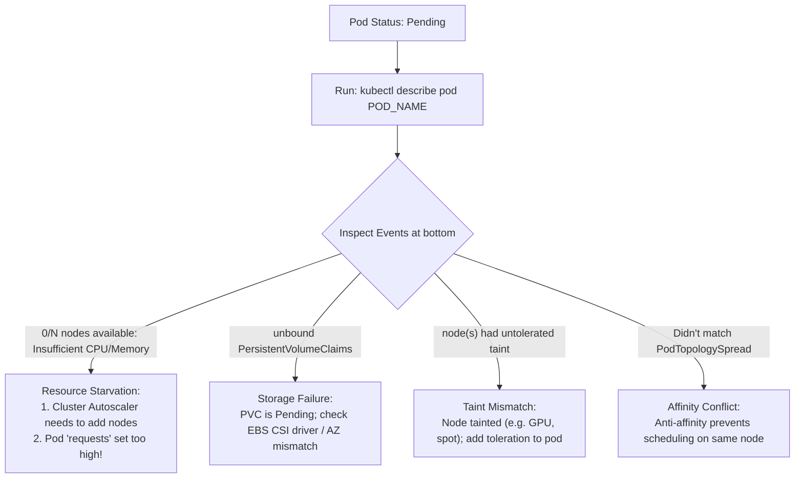

## Fast Revision (10-Second Recall)
- **What Does "Pending" Mean?** The pod has been created in etcd, but the **Kube-Scheduler has not assigned it to a worker node**, or container images are waiting on prerequisite volumes.
- **The Single Most Powerful Command:** `kubectl describe pod <pod-name>`. Read the **Events** section at the very bottom!
- **Top 4 Reasons Pods Get Stuck in Pending:**
- 1. **Insufficient CPU / Memory on Nodes:** Requested `resources.requests` exceed available allocatable capacity on all cluster worker nodes (`0/10 nodes available: 10 Insufficient cpu`).
- 2. **Unbound PersistentVolumeClaim (PVC):** Pod requests a PVC that has not been provisioned or is in another availability zone.
- 3. **Taints and Tolerations / NodeSelectors:** Nodes have taints (e.g. `node.kubernetes.io/unreachable` or dedicated GPU taint) that the pod does not tolerate.
- 4. **Node Affinity / Anti-Affinity Collisions:** Pod specifies `podAntiAffinity` requiring 1 pod per node, but all nodes already have a replica.

## The 30-Second Spoken Script
"A Kubernetes pod stuck in the Pending state means that the Kube-Scheduler cannot find a worker node that satisfies all the pod's scheduling constraints, or the pod is waiting for dependent resources like PersistentVolumeClaims to be bound.

My investigation procedure:

Step 1: Check the Pod Events.
The first and most decisive step is running 'kubectl describe pod POD_NAME' and scrolling directly to the Events table at the bottom. In 95% of cases, the Kube-Scheduler prints the exact scheduling failure reason.

For example, you will see messages like:
- '0/8 nodes available: 8 Insufficient memory.'
- '0/8 nodes available: 8 node(s) had untolerated taint.'
- 'pod has unbound immediate PersistentVolumeClaims.'

Step 2: Troubleshoot Resource Starvation (Insufficient CPU/Memory).
If the event is 'Insufficient cpu' or 'Insufficient memory', the cluster nodes are full. I check total cluster capacity using 'kubectl top nodes' and 'kubectl describe nodes'. Often, an engineer configured an unrealistically large resource request—such as requesting 8 vCPUs for a microservice on a cluster of 4-vCPU nodes. A single pod can never be scheduled on a node smaller than its request.
The fix: right-size resource requests, or let the Cluster Autoscaler provision additional cloud worker nodes.

Step 3: Troubleshoot Storage Binding (PVCs).
If the pod is waiting for a PersistentVolumeClaim, I run 'kubectl get pvc'. If the PVC is in 'Pending' status, the cloud storage provisioner (like AWS EBS CSI driver) failed to create the volume, or the volume exists in Availability Zone us-east-1a while the available nodes are in us-east-1b.

Step 4: Check Taints, Tolerations, and Node Affinity.
I verify if the pod specifies nodeSelector or affinity rules that match no running nodes, or if cluster nodes have taints that the pod lacks tolerations for."

## Scenario / Problem Context
A deployment is triggered, but new pods never start. `kubectl get pods` shows `STATUS: Pending` for 30 minutes. The interviewer tests your knowledge of the Kubernetes Scheduler, resource requests vs limits, taints and tolerations, and PersistentVolumeClaim binding.

## Architectural Workflow / Sequence


## Deep-Dive Analysis & Root Causes

| SchedulerEvent | RootCause | Resolution |
| --- | --- | --- |
| `Insufficient cpu / memory` | Sum of pod requests exceeds node allocatable capacity | Right-size `resources.requests` or trigger Cluster Autoscaler to add EC2 nodes
`unbound immediate PersistentVolumeClaims` | PVC storage class failed to provision volume or AZ mismatch | Inspect `kubectl describe pvc`; ensure volume and node share same AZ
`node(s) had untolerated taint` | Node has taint (`dedicated=gpu:NoSchedule`) without pod toleration | Add corresponding `tolerations` block to pod spec
`MatchNodeSelector` | No nodes possess the label specified in `nodeSelector` | Correct label typo or apply label to worker node (`kubectl label node`) |


## Practical Debugging Commands & Code
```bash
# 1. Inspect scheduling failure reasons in Events:
kubectl describe pod <pod-name> -n production | tail -n 20

# 2. Check cluster node resource allocation and capacity:
kubectl describe nodes | grep -A 8 "Allocated resources:"

# 3. Check if PersistentVolumeClaims are stuck:
kubectl get pvc -n production
kubectl describe pvc <pvc-name> -n production

# 4. View Cluster Autoscaler logs to check if node scale-up failed:
kubectl logs -l app=cluster-autoscaler -n kube-system --tail=50
```

## Prevention & Senior Best Practices
- **Set Realistic Resource Requests:** Base `resources.requests` on actual p95 historical usage; never set requests equal to maximum peak limits.
- **Enable Cluster Autoscaler / Karpenter:** Automatically provision new worker nodes when pods cannot be scheduled due to capacity limits.
- **Use `WaitForFirstConsumer` on StorageClasses:** Ensures PVCs are provisioned in the exact Availability Zone where the pod is scheduled.
