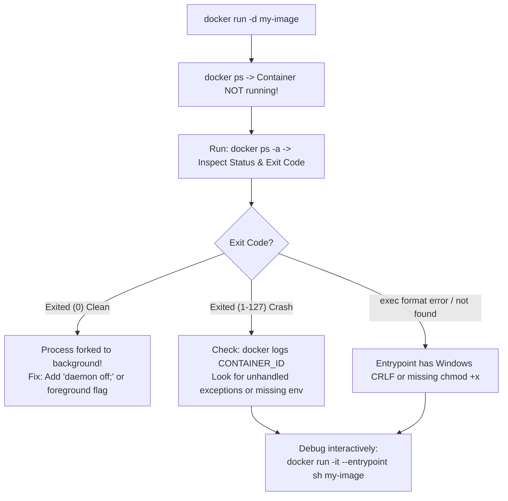

## Fast Revision (10-Second Recall)
- **The Fundamental Container Law:** A Docker container only lives as long as its **PID 1 (primary foreground process)** is running. If PID 1 finishes, backgrounds itself, or crashes, the container halts immediately.
- **Top 4 Reasons Containers Exit Immediately:**
- 1. **Background Daemonizing Process:** Running `nginx` or `apache2ctl start` without `daemon off;` $\rightarrow$ process forks to background, PID 1 exits $\rightarrow$ container dies with Exit 0.
- 2. **Missing Environment Variables / Secrets:** App crashes on bootstrap due to missing `DATABASE_URL` (Exit 1).
- 3. **Entrypoint Script Permission / Shebang Error:** Entrypoint script lacks `chmod +x` or has Windows `\r\n` CRLF line endings.
- 4. **Command Override Failure:** Missing default `CMD` or incorrect JSON syntax (`CMD ["node", "server.js"]` vs `CMD node server.js`).

## The 30-Second Spoken Script
"A Docker container exits immediately because of how Linux containers work: a container lives only as long as its primary foreground process—PID 1—is actively running. If that process forks to the background or encounters a fatal startup error, the container terminates.

My systematic debugging workflow:

Step 1: Inspect the exit code and logs.
I run 'docker ps -a' to check the container's exit code:
If it exited with (0), the process completed its task successfully and exited normally—often because a background daemon like Nginx was started without the 'daemon off;' flag.
If it exited with (1) or (137), an unhandled exception or OOM kill occurred.
I run 'docker logs CONTAINER_ID' to read stdout and stderr from the container right before termination. In 90% of cases, the log reveals an immediate fatal error—such as an unhandled exception or missing environment variable.

Step 2: Inspect container details.
If logs are empty, I run `docker inspect CONTAINER_ID --format '{{.State.ExitCode}} {{.State.Error}}'`. This catches system-level failures, like a missing binary or incorrect path in the ENTRYPOINT.

Step 3: Override ENTRYPOINT to enter interactive debug shell.
If the container crashes before writing logs, I override the entrypoint with an interactive shell:
'docker run -it --entrypoint sh my-image'
Once inside, I manually execute the startup script line by line to observe where it fails. Common pitfalls include Windows CRLF carriage returns breaking bash shebangs (exec /entrypoint.sh: no such file or directory) or missing execute permissions."

## Scenario / Problem Context
You run `docker run -d my-image`, but running `docker ps` shows no active containers. `docker ps -a` shows `Exited (0)` or `Exited (1)` two seconds ago. The interviewer tests your understanding of container lifecycles, PID 1 execution, and command overrides.

## Architectural Workflow / Sequence


## Deep-Dive Analysis & Root Causes

| ExitCode | Meaning | Cause | Solution |
| --- | --- | --- | --- |
| `Exited (0)` | Clean process termination | Application completed its run or forked into background (e.g. `service nginx start`) | Run in foreground: `nginx -g "daemon off;"`
`Exited (1)` | Application error | Uncaught exception, missing configuration, syntax error | Check `docker logs` for stack trace
`Exited (127)` | Command not found | Binary or entrypoint script path does not exist in container | Verify file path in Dockerfile `ENTRYPOINT`
`Exited (137)` | Killed by SIGKILL (128 + 9) | Out of Memory (OOM) killed by host kernel | Increase Docker memory limits |


## Practical Debugging Commands & Code
```bash
# 1. View all stopped containers and their exact exit codes:
docker ps -a --format "table {{.ID}}	{{.Image}}	{{.Status}}	{{.Names}}"

# 2. View logs of the crashed container:
docker logs --tail 50 <container_id>

# 3. Inspect container termination state and errors:
docker inspect <container_id> --format='{{json .State}}'

# 4. Override entrypoint to debug interactively:
docker run -it --entrypoint /bin/sh my-image:latest
```

## Prevention & Senior Best Practices
- **Always Run Services in the Foreground:** In Docker, services must not daemonize (`CMD ["nginx", "-g", "daemon off;"]`).
- **Use Proper JSON Exec Form for CMD:** Always use `CMD ["node", "app.js"]` rather than shell form `CMD node app.js` to ensure signals like SIGTERM reach the process directly.
- **Convert CRLF to LF in Shell Scripts:** Use `dos2unix` or `.gitattributes` to prevent Windows line-endings from corrupting bash entrypoints.
