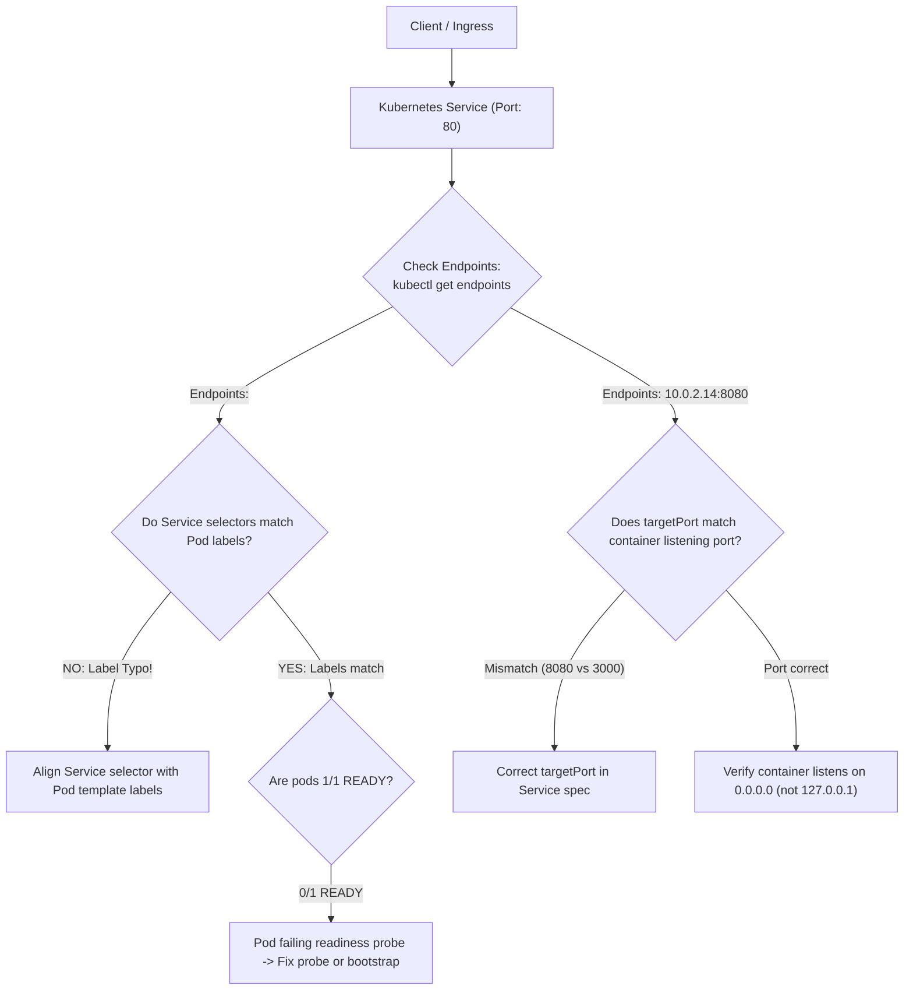

## Fast Revision (10-Second Recall)
- **How a Kubernetes Service Works:**
- A Service does NOT route traffic directly to pods. It routes traffic to an **EndpointSlice** populated by the **Endpoints Controller** based on matching **labels**.
- **The #1 Cause of Routing Failures:** **Label Selector Mismatch!**
- - Service spec: `selector: { app: web }`.
- - Pod spec: `labels: { app: web-api }` $\rightarrow$ Result: `Endpoints: <none>`!
- **Top 4 Checkpoints:**
- 1. **`kubectl get endpoints <service-name>`:** If `none`, selector labels are mismatched.
- 2. **`port` vs `targetPort`:** `port` is the port the Service exposes; `targetPort` is the port the container is listening on.
- 3. **Readiness Probe Failure:** Unready pods are automatically excluded from endpoints!
- 4. **Process Bound to Localhost:** Container listens on `127.0.0.1` instead of `0.0.0.0`.

## The 30-Second Spoken Script
"When a Kubernetes Service is not routing traffic to pods, the failure almost always lies in the Service selector labels, targetPort mismatches, or failing readiness probes.

My 4-step diagnostic procedure:

Step 1: Check the Service Endpoints.
The single most informative command is:
'kubectl get endpoints SERVICE_NAME'
If the output shows 'Endpoints: none', it proves that the Service has zero active backend pods associated with it.

Step 2: Check Label Selector Alignment.
If endpoints are none, I compare the Service selector against the Pod labels:
I run `kubectl get svc SERVICE_NAME -o jsonpath='{.spec.selector}'` and `kubectl get pods --show-labels`.
A common mistake during refactoring is a label typo—for example, the Service specifies 'app: api', but the new deployment template labels were changed to 'app: api-service'. If the labels do not match 100% identically, the Endpoints controller cannot link them.

Step 3: Check Pod Readiness Status.
Even if labels match perfectly, the Endpoints controller will NOT route traffic to a pod if its Readiness Probe is failing. If 'kubectl get pods' shows '0/1 READY', the pod is excluded from the Service endpoints to protect clients from receiving errors during startup.

Step 4: Check 'port' vs 'targetPort'.
If endpoints are populated with pod IPs, but requests still fail, I check port mappings:
'port' is the port exposed by the Service inside the cluster (e.g. 80).
'targetPort' is the port the application container is listening on (e.g. 8080). If targetPort points to 3000 but the container listens on 8080, traffic routes into a void."

## Scenario / Problem Context
Pods are running and healthy, but when other pods or the Ingress controller call the Service, requests time out or return `503 Service Unavailable`. The interviewer evaluates your knowledge of Kubernetes Service abstractions, label selectors, endpoint slices, and kube-proxy.

## Architectural Workflow / Sequence


## Deep-Dive Analysis & Root Causes

| Issue | DiagnosticCommand | Fix |
| --- | --- | --- |
| Label Selector Mismatch | `kubectl get endpoints <svc>` returns `<none>` | Update `spec.selector` in Service YAML to match `spec.template.metadata.labels`
Failing Readiness Probe | `kubectl get pods` shows `0/1 READY` | Troubleshoot application startup; pods only receive traffic when `1/1 READY`
`port` vs `targetPort` Inversion | `curl <svc-ip>:<port>` returns connection refused | Ensure `targetPort` matches the container's actual `containerPort`
App Bound to `127.0.0.1` | Endpoint exists, but pod rejects traffic from other pods | Reconfigure containerized server to bind to `0.0.0.0` |


## Practical Debugging Commands & Code
```bash
# 1. Check if Service has registered active Pod IPs:
kubectl get endpoints <service-name> -n production

# 2. Check Service selector and compare with running pod labels:
kubectl get svc <service-name> -n production -o jsonpath='{.spec.selector}'
kubectl get pods -n production --show-labels

# 3. Test reaching the pod IP directly from another pod (bypassing Service):
kubectl run test-curl --rm -it --image=curlimages/curl -- curl -Iv http://<pod-ip>:<targetPort>/health

# 4. View EndpointSlice object (modern replacement for Endpoints):
kubectl get endpointslice -l kubernetes.io/service-name=<service-name> -n production
```

## Prevention & Senior Best Practices
- **Use Standardized Helm Charts:** Prevent label typos by generating service selectors and pod labels from a single shared variable (`{{ include "chart.labels" . }}`).
- **Automate Endpoint Verification in CD:** Assert that `kubectl get endpoints` returns at least one active IP before closing deployment tasks.
- **Name Your Ports:** Use named ports (`name: http`) in container specs and reference `targetPort: http` in the Service to eliminate numeric port typos.
