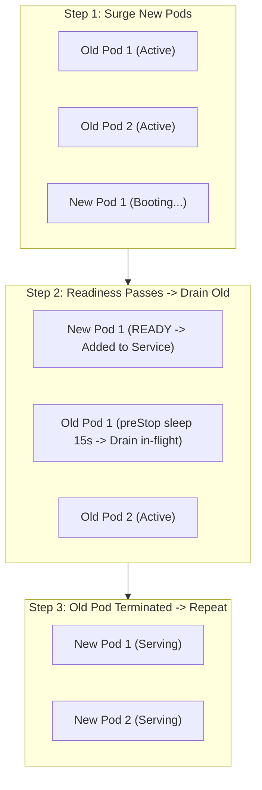

## Fast Revision (10-Second Recall)
- **The Rolling Update Strategy (Default in K8s):**
- Gradually replaces pods of the old ReplicaSet with pods of the new ReplicaSet.
- **The Two Critical Parameters:**
- 1. **`maxSurge`:** How many pods can be created **above** desired count (e.g. `25%`).
- 2. **`maxUnavailable`:** How many pods can be unavailable **below** desired count.
- **Zero-Downtime Golden Setting:** `maxUnavailable: 0` and `maxSurge: 25%` (Guarantees capacity NEVER drops below 100%!).
- **Graceful Termination Hook:** Add `preStop: sleep 15` so the load balancer has time to deregister the pod IP before the container process receives SIGTERM.

## The 30-Second Spoken Script
"Performing a zero-downtime rolling update in Kubernetes requires configuring three key elements: the RollingUpdate strategy parameters, robust readiness probes, and graceful termination lifecycle hooks.

Here is the operational configuration:

First, Rolling Update Strategy Parameters.
In the Deployment spec, we set:
strategy:
  type: RollingUpdate
  rollingUpdate:
    maxSurge: 25%
    maxUnavailable: 0
Setting maxUnavailable to 0 is the golden rule for zero downtime: it guarantees that Kubernetes will NEVER terminate an existing old pod until a new pod is fully created, healthy, and ready to serve traffic. maxSurge at 25% means Kubernetes can temporarily run up to 125% total capacity during the rollout.

Second, Readiness Probe Synchronization.
A rolling update only works if Kubernetes knows when a new pod is actually ready. With a readiness probe configured, Kubernetes starts a new pod, waits for the probe to return HTTP 200, adds the pod to the Service Endpoints, and only THEN issues a termination signal to an old pod.

Third, Graceful Connection Draining (preStop Hook).
When an old pod is marked for termination, there is a slight 2 to 5 second network propagation delay while kube-proxy and the Ingress controller remove the pod IP from load balancer routing tables. If the application terminates immediately on SIGTERM, in-flight requests receive Connection Refused.
To eliminate this, we configure a preStop lifecycle hook:
preStop:
  exec:
    command: ["/bin/sh", "-c", "sleep 15"]
This pauses termination for 15 seconds, giving the load balancer time to deregister the pod before the application process shuts down."

## Scenario / Problem Context
You need to deploy a new container image across a 20-pod deployment serving high-volume live traffic. The deployment must maintain 100% processing capacity without dropping a single active customer connection. The interviewer evaluates your knowledge of rolling update parameters and container draining.

## Architectural Workflow / Sequence


## Deep-Dive Analysis & Root Causes

| Parameter | Purpose | Impact |
| --- | --- | --- |
| `maxSurge: 25%` | Allows K8s to spin up 25% extra pods during deployment | Maintains full traffic capacity during transition
`maxUnavailable: 0` | Ensures zero old pods are killed before new pods are ready | Guarantees 100% capacity at all times
`preStop: sleep 15` | Pauses SIGTERM to allow Ingress/ALB to remove pod from routing table | Eliminates dropped in-flight HTTP connections
`terminationGracePeriodSeconds: 45` | Total time allowed for preStop sleep + graceful in-flight request completion | Prevents kernel SIGKILL before long API calls finish |


## Practical Debugging Commands & Code
```bash
# 1. Production Deployment strategy snippet:
# spec:
#   strategy:
#     type: RollingUpdate
#     rollingUpdate:
#       maxSurge: 25%
#       maxUnavailable: 0
#   template:
#     spec:
#       terminationGracePeriodSeconds: 45
#       containers:
#       - name: app
#         lifecycle:
#           preStop:
#             exec:
#               command: ["/bin/sh", "-c", "sleep 15"]

# 2. Trigger rolling update by updating container image:
kubectl set image deployment/web-app web=my-repo/web:v2.1.0 -n production

# 3. Track rolling update progress in real time:
kubectl rollout status deployment/web-app -n production
```

## Prevention & Senior Best Practices
- **Always Set `maxUnavailable: 0`:** Never allow `maxUnavailable` to be greater than 0 if you cannot afford capacity dips during peak hours.
- **Always Implement a `preStop` Sleep Hook:** Eliminates 502/504 errors caused by Ingress routing delay during pod terminations.
- **Always Configure Readiness Probes:** Without readiness probes, Kubernetes considers pods ready immediately, breaking rolling update guarantees.
