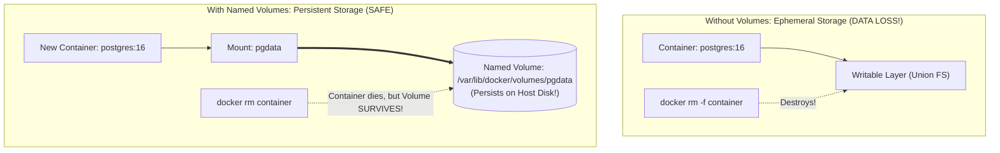

## Fast Revision (10-Second Recall)
- **The Iron Law of Containers:** Containers are **ephemeral and stateless** by default. Any data written inside a container's writable layer is destroyed when the container is deleted (`docker rm`)!
- **The Solution: Docker Volumes.**
- Docker bypasses the Union File System and writes directly to host storage.
- **Named Volumes vs Bind Mounts:**
- 1. **Named Volumes (`docker volume create pgdata`):** Managed completely by Docker in `/var/lib/docker/volumes/`. High performance, OS-independent, safe from host file permission collisions. **Best for databases!**
- 2. **Bind Mounts (`-v /my/host/folder:/var/lib/postgresql/data`):** Maps a specific host directory into container. Good for mounting source code in local dev, but fragile for databases due to Linux UID/GID permission conflicts.

## The 30-Second Spoken Script
"To persist database data inside Docker and prevent data loss during container restarts or upgrades, we must use Docker Volumes rather than relying on the container's ephemeral writable layer.

By default, any data written inside a container is stored in its copy-on-write storage driver. When that container is deleted, recreated, or upgraded, that storage layer is permanently destroyed.

There are two primary ways to persist storage in Docker:

Method 1: Docker Named Volumes (Recommended for Production and Databases).
A Named Volume is managed directly by the Docker daemon in /var/lib/docker/volumes. It is isolated from the host filesystem structure, delivers optimal I/O performance, and survives container deletion.
In docker-compose.yml, we define:
services:
  db:
    image: postgres:16
    volumes:
      - pgdata:/var/lib/postgresql/data
volumes:
  pgdata:

When the container stops, upgrades, or is removed via 'docker rm', the pgdata volume remains completely untouched. When a new container boots and mounts pgdata, all tables, indexes, and transactions are preserved.

Method 2: Bind Mounts.
A Bind Mount maps a specific directory from the host machine directly into the container (for example, -v /data/postgres:/var/lib/postgresql/data). While useful for mounting local code in development, bind mounts can introduce serious permission issues in production because PostgreSQL runs as UID 999 inside the container and will fail with 'permission denied' if the host folder is owned by root.

For production databases, Named Volumes or managed cloud storage plugins (like Amazon EBS CSI in Kubernetes) are mandatory."

## Scenario / Problem Context
A developer restarts or upgrades a PostgreSQL Docker container, and all tables and customer records vanish. The interviewer tests your understanding of Docker storage drivers, copy-on-write filesystems, and the differences between named volumes and bind mounts.

## Architectural Workflow / Sequence


## Deep-Dive Analysis & Root Causes

| StorageType | Location | Performance | UseCase |
| --- | --- | --- | --- |
| Named Volumes | Managed by Docker (`/var/lib/docker/volumes/`) | Optimal native disk speed | Production databases, stateful apps, Prometheus data
Bind Mounts | Explicit host path (`/home/user/app/data`) | Good, but subject to host filesystem permissions | Mounting source code or configs into dev containers
tmpfs Mounts | Host RAM memory only | Ultra-fast in-memory | Transient secrets, sensitive caches that must never touch disk |


## Practical Debugging Commands & Code
```bash
# 1. Create a dedicated named volume:
docker volume create postgres_data

# 2. Run PostgreSQL mounting the named volume:
docker run -d   --name production-db   -e POSTGRES_PASSWORD=secret   -v postgres_data:/var/lib/postgresql/data   postgres:16-alpine

# 3. Inspect volume details and host mountpoint:
docker volume inspect postgres_data

# 4. Backup database volume to tarball:
docker run --rm   -v postgres_data:/volume   -v $(pwd):/backup   busybox tar -czvf /backup/pg_backup.tar.gz -C /volume .
```

## Prevention & Senior Best Practices
- **Never Run Production Databases in Ephemeral Containers:** Always verify volume mounts are declared before launching database containers.
- **Automate Volume Backups:** Regularly back up Docker volumes to Amazon S3 using automated snapshot scripts or volume backup sidecars.
- **In Kubernetes, Use PersistentVolumeClaims (PVCs):** Decouple storage provisioning from pods using StatefulSets backed by EBS or Ceph storage classes.
