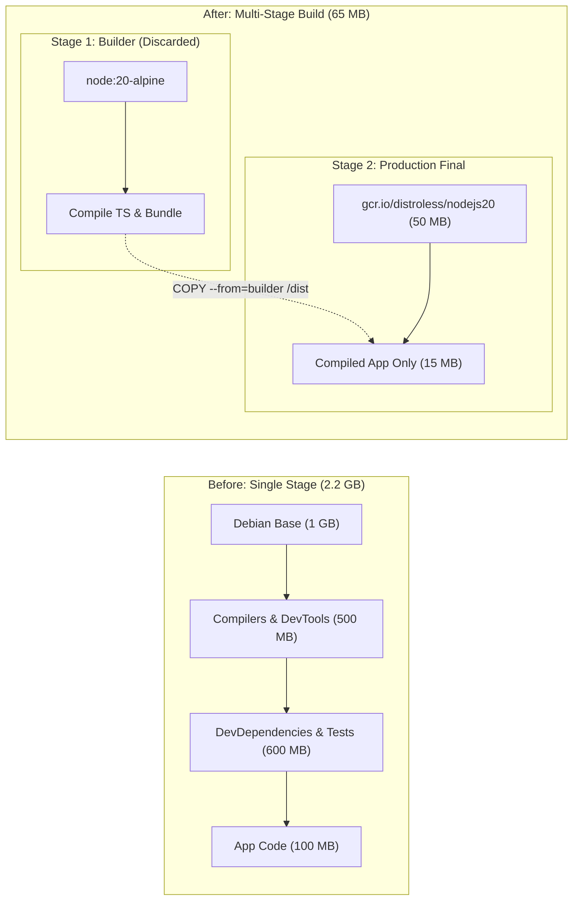

## Fast Revision (10-Second Recall)
- **Why Do Docker Images Balloon to 2GB?**
- - Using full base OS images (`FROM ubuntu:latest` or `FROM node:20` includes full compilers, man pages, python, curl).
- - Shipping development dependencies (`devDependencies`, TypeScript compiler, testing frameworks) into production.
- - Unnecessary files included in build context (missing `.dockerignore`).
- **The 4 Levers to Shrink Images:**
- 1. **Multi-Stage Builds:** Compile code in a "builder" stage, copy ONLY compiled output into a lean production stage.
- 2. **Minimal Base Image:** Switch from `node:20` (1.1GB) to `node:20-alpine` (130MB) or `gcr.io/distroless/nodejs20` (50MB).
- 3. **Prune devDependencies:** Run `npm prune --production` before final layer.
- 4. **Use `.dockerignore`:** Exclude `.git`, `node_modules`, `tests`, `docs` from build context.

## The 30-Second Spoken Script
"Reducing a bloated 2GB Docker image down to 50 to 100MB relies on three architectural techniques: Multi-Stage Builds, selecting minimal base images, and excluding build tools from the final production runtime.

Here is my 4-step optimization playbook:

Step 1: Implement Multi-Stage Builds.
In a single-stage build, compilers, build tools (like gcc, make, typescript), and intermediate object files remain embedded in the final image forever. With Multi-Stage builds, we define a 'builder' stage where we compile the code and build assets. In the final stage, we start from a clean minimal image and copy ONLY the compiled binaries or built dist folder, discarding all build tools and source code.

Step 2: Choose Minimal Base Images (Alpine or Distroless).
Full base images like 'node:20' or 'python:3.11' contain an entire Debian OS with hundreds of unnecessary system utilities, starting at 1GB before code is even added. For Node.js, switching to 'node:20-alpine' drops base size to 130MB. For Go or Rust, we compile a static binary and use 'scratch' or Google Distroless, resulting in an image smaller than 30MB containing zero OS baggage.

Step 3: Exclude Development Dependencies.
For JavaScript/Node.js, devDependencies (Jest, Webpack, TypeScript) often make up 80% of node_modules. We run 'npm ci --omit=dev' or copy only production dependencies to the final stage.

Step 4: Use a strict .dockerignore.
We ensure .git, local node_modules, logs, and test artifacts are excluded from the Docker build context.

Applying these steps typically shrinks a 2.2GB Node.js image down to 85MB, reducing container pull times in Kubernetes from minutes to 3 seconds."

## Scenario / Problem Context
A Node.js or Go Docker image has ballooned to 2.2GB. Deployments take 10 minutes because Kubernetes nodes spend minutes pulling massive layers from ECR. Leadership asks you to optimize the image down to under 100MB. The interviewer evaluates your containerization best practices.

## Architectural Workflow / Sequence


## Deep-Dive Analysis & Root Causes

| Technique | Impact | HowItWorks |
| --- | --- | --- |
| Multi-Stage Build | Saves 500MB to 1.5GB | Separates build environment from execution environment; compilers never reach production
Minimal Base Images (Alpine / Distroless) | Saves 800MB+ | Strips out package managers (apt), shells (bash), and unused utilities
`.dockerignore` file | Saves 200MB to 1GB | Prevents local `.git/` history and local `node_modules/` from entering Docker context
Chain `RUN` Commands with Cleanup | Saves 100MB to 300MB | `apt-get install && rm -rf /var/lib/apt/lists/*` in a single layer to avoid layer retention |


## Practical Debugging Commands & Code
```bash
# 1. Analyze Docker image layers and size breakdown with dive:
# dive my-bloated-image:latest

# 2. Production Multi-Stage Dockerfile example (Node.js):
# # Build Stage:
# FROM node:20-alpine AS builder
# WORKDIR /app
# COPY package*.json ./
# RUN npm ci
# COPY . .
# RUN npm run build && npm prune --production
#
# # Production Stage:
# FROM node:20-alpine AS runner
# WORKDIR /app
# ENV NODE_ENV=production
# COPY --from=builder /app/node_modules ./node_modules
# COPY --from=builder /app/dist ./dist
# USER node
# CMD ["node", "dist/main.js"]

# 3. Check image size from CLI:
docker images my-image --format "{{.Repository}}:{{.Tag}} -> {{.Size}}"
```

## Prevention & Senior Best Practices
- **Always Implement `.dockerignore` First:** Add `.git`, `node_modules`, `coverage`, and `.env` to `.dockerignore` before building.
- **Run Container Size Linters in CI:** Fail pull requests in CI if built Docker images exceed an agreed budget (e.g. 150MB).
- **Use Distroless for Maximum Security:** Google Distroless images contain only your application and its runtime dependencies—no shell or package manager, reducing CVE attack surface by 90%.
