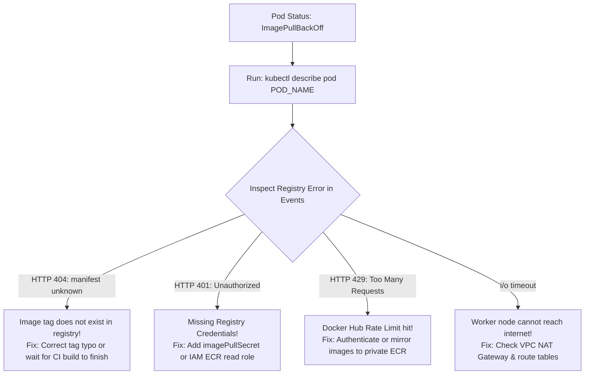

## Fast Revision (10-Second Recall)
- **What is ImagePullBackOff?** The Kubelet failed to pull the container image from the container registry, and is now waiting in an exponential backoff loop before retrying.
- **Top 4 Root Causes:**
- 1. **Typo in Image Name or Tag:** Image tag does not exist in registry (e.g. `v1.2.3` instead of `v1.2.4`, or commit SHA typo).
- 2. **Missing Registry Authentication (`imagePullSecrets`):** Pulling from private ECR, Docker Hub, or GHCR without an authorized Kubernetes Secret.
- 3. **Docker Hub Rate Limiting:** Exceeded unauthenticated rate limit (100 pulls per 6 hours) $\rightarrow$ HTTP 429 Too Many Requests.
- 4. **Network / VPC NAT Gateway Block:** Private worker nodes cannot reach public registry due to missing NAT Gateway or proxy.
- **First Move:** `kubectl describe pod <pod-name>` $\rightarrow$ read exact HTTP error from registry (404 Not Found vs 401 Unauthorized vs 429 Rate Limit).

## The 30-Second Spoken Script
"ImagePullBackOff indicates that the Kubelet on the worker node attempted to pull the container image from the registry, failed, and is now pausing in an exponential backoff loop before retrying.

My diagnostic and resolution protocol:

Step 1: Inspect the exact registry error using kubectl describe.
I run 'kubectl describe pod POD_NAME' and inspect the Events section at the bottom. The Kubelet outputs the exact error returned by the registry:
1. If the error is 'manifest unknown' or 'not found' (HTTP 404): The image name or tag has a typo, or the CI/CD pipeline failed to push the image to ECR before Kubernetes was instructed to deploy it.
2. If the error is 'unauthorized' or 'authentication required' (HTTP 401/403): The Kubelet lacks credentials to authenticate with the private registry.
3. If the error is 'toomanyrequests' (HTTP 429): The node hit Docker Hub's pull rate limits.
4. If the error is 'i/o timeout' or 'no route to host': The worker node is in a private VPC subnet with no NAT Gateway or route to the internet.

Step 2: Resolve Authentication issues (imagePullSecrets).
For private registries (like GitHub Packages or Docker Hub), I verify that the pod spec references a valid imagePullSecret:
`imagePullSecrets: [{name: regcred}]`
In AWS EKS, worker nodes should use IAM Roles for Service Accounts (IRSA) with the AmazonEC2ContainerRegistryReadOnly policy, eliminating the need to rotate static Docker credentials manually.

Step 3: Verify image existence manually.
I run 'docker pull' or 'aws ecr describe-images' using the AWS CLI to confirm that the specific image tag exists in the remote repository."

## Scenario / Problem Context
During deployment, pods are stuck with `STATUS: ImagePullBackOff` or `ErrImagePull`. Traffic is blocked. The interviewer evaluates your knowledge of container registries, authentication secrets, IAM roles, and network security.

## Architectural Workflow / Sequence


## Deep-Dive Analysis & Root Causes

| RegistryError | Meaning | Fix |
| --- | --- | --- |
| `manifest for my-app:v1.2 not found` | Image tag does not exist in registry | Verify tag in ECR/DockerHub; fix typo in deployment manifest
`pull access denied / unauthorized` | Missing or expired registry authentication credentials | Create `docker-registry` secret and attach to service account or deployment
`toomanyrequests: You have reached your pull rate limit` | Docker Hub anonymous rate limit (100 pulls per 6h) | Authenticate Docker Hub account or mirror base images to AWS ECR
`dial tcp: lookup registry: i/o timeout` | DNS resolution failure or no internet route from private subnet | Ensure VPC private subnet route table has NAT Gateway entry |


## Practical Debugging Commands & Code
```bash
# 1. Inspect exact registry error:
kubectl describe pod <pod-name> -n production | grep -A 5 -E "Failed to pull|ErrImagePull"

# 2. Create Docker registry secret in Kubernetes:
kubectl create secret docker-registry ecr-secret   --docker-server=123456789.dkr.ecr.us-east-1.amazonaws.com   --docker-username=AWS   --docker-password=$(aws ecr get-login-password --region us-east-1)   -n production

# 3. Check if image tag exists in AWS ECR using CLI:
aws ecr describe-images --repository-name my-app --image-ids imageTag=v2.4.1
```

## Prevention & Senior Best Practices
- **Mirror Public Images to Private Registries:** Never pull directly from Docker Hub in production; mirror images to AWS ECR or Google Artifact Registry.
- **Use Node IAM Roles Instead of Static Secrets:** On AWS EKS, attach `AmazonEC2ContainerRegistryReadOnly` to node instance roles to avoid secret rotation.
- **Sequential Deployment in CI:** Ensure the CD pipeline explicitly waits for `docker push` to exit with 0 before updating Kubernetes manifests.
